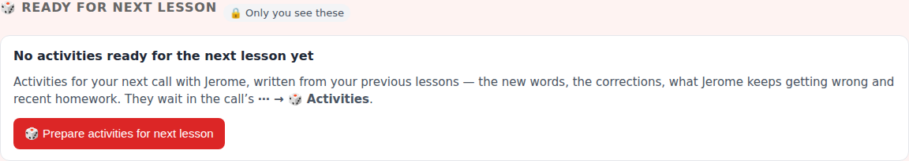
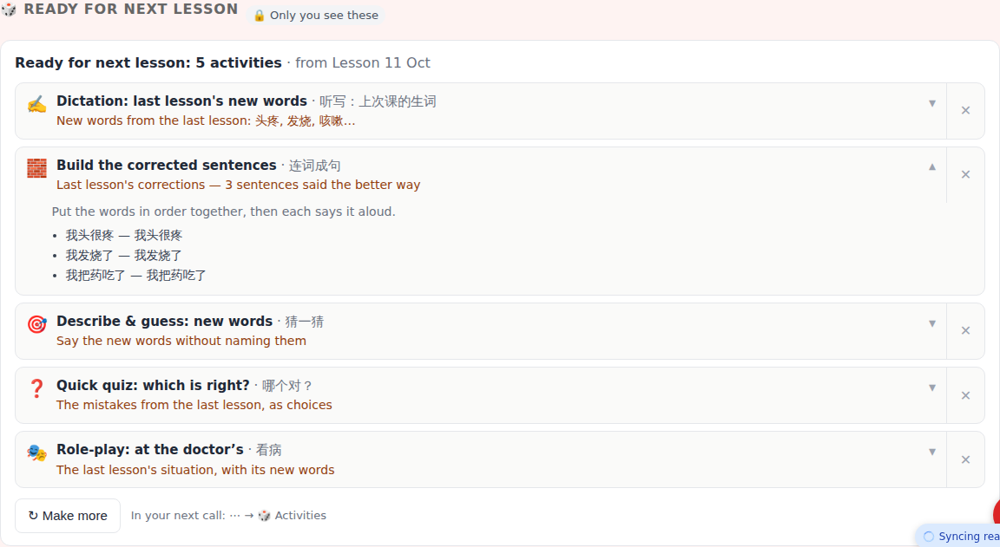
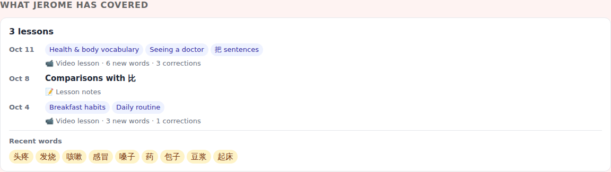
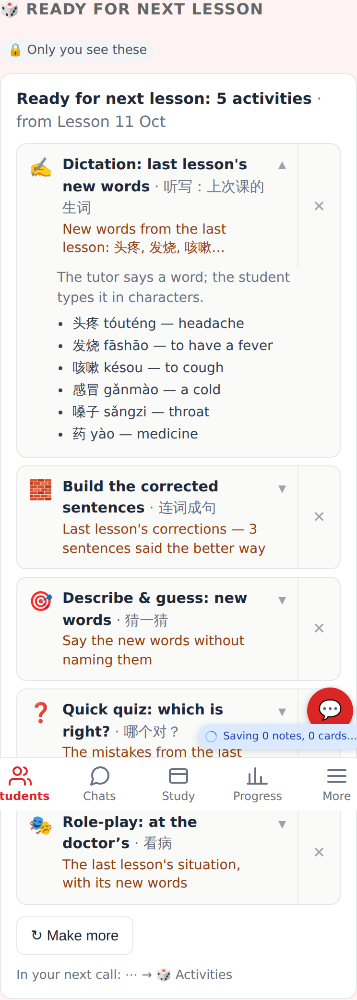
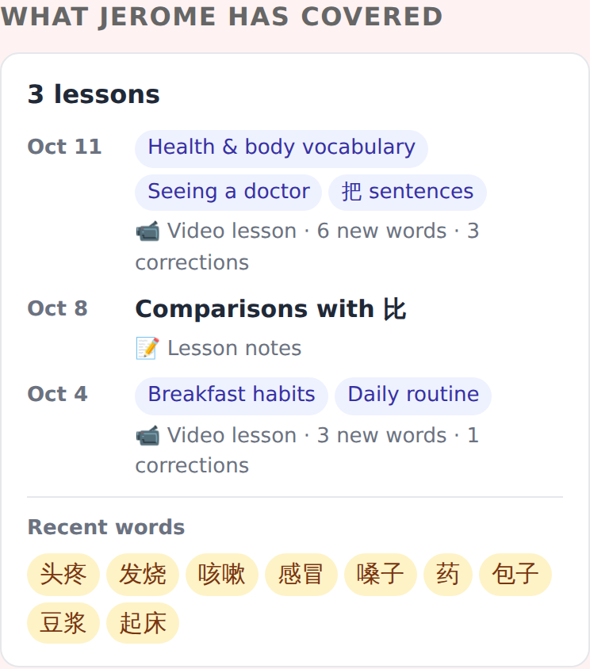
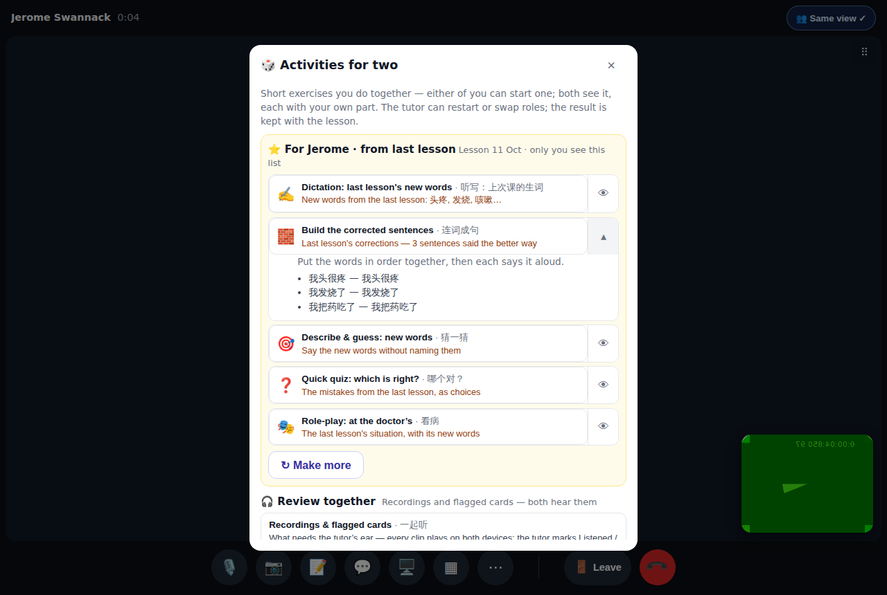
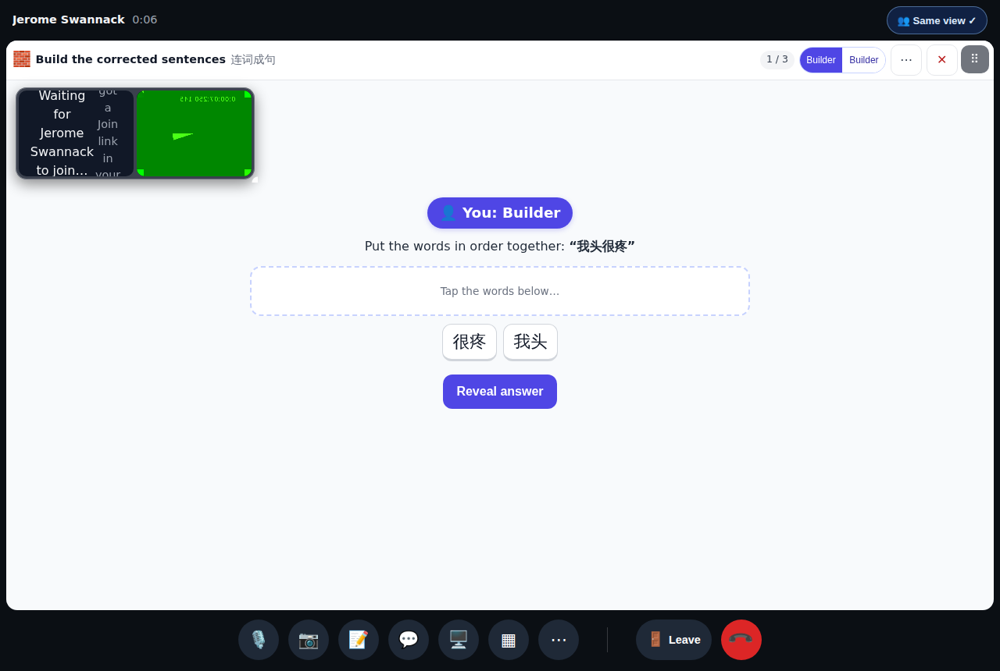
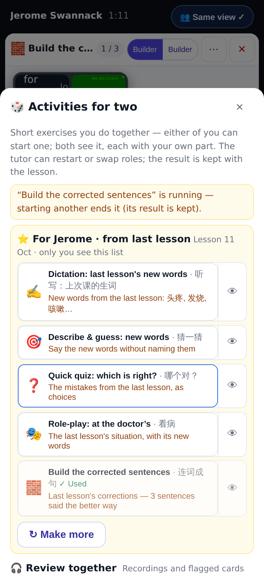

# Prepared in-call activities + "What <student> has covered"

Seeded with a recorded lesson report (health vocabulary, 3 corrections), an earlier one and a logged lesson;
E2E_TEST_MODE's fake model writes the activities (the real one writes them from the same briefing).

## Web — tutor's student page

"🎲 Ready for next lesson" before anything is prepared (desktop).

5 activities from Lesson 11 Oct, each with its why; one opened to show what's in it; ✕ dismisses (Undo), ↻ Make more.

Lessons merged by day (recorded lessons' topics, a logged lesson's title), new words / corrections, recent words.

The same section at 412×915 (2×), the dictation's preview open.

Coverage at phone width.

## Web — in the call (tutor)

⋯ → 🎲 Activities: "For Jerome · from last lesson" first, 👁 shows what's in one, then the catalogue.

"Build the corrected sentences" started from the list — the same engine and tile as a catalogue activity.

At phone width, after starting one: it moves down marked ✓ Used.

## Lab app

See `lab-*.png` (Roborazzi): the student page section + coverage, the call menu's prepared section (phone and unfolded), a prepared activity running.
