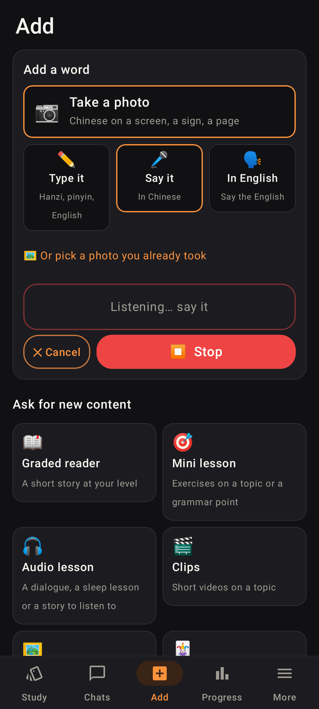
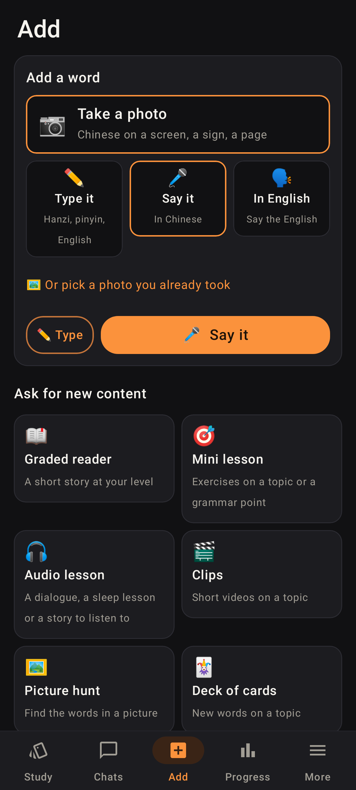
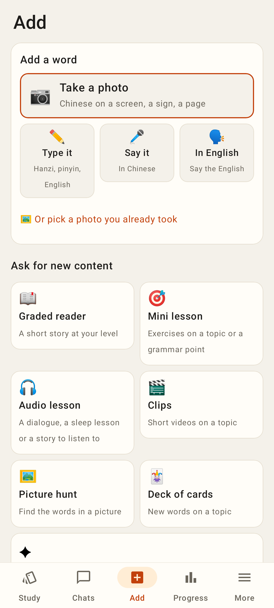
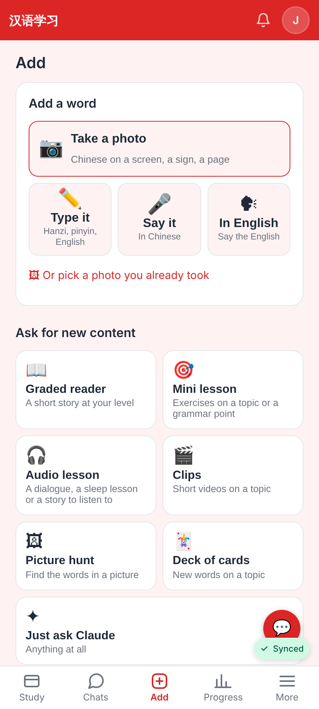
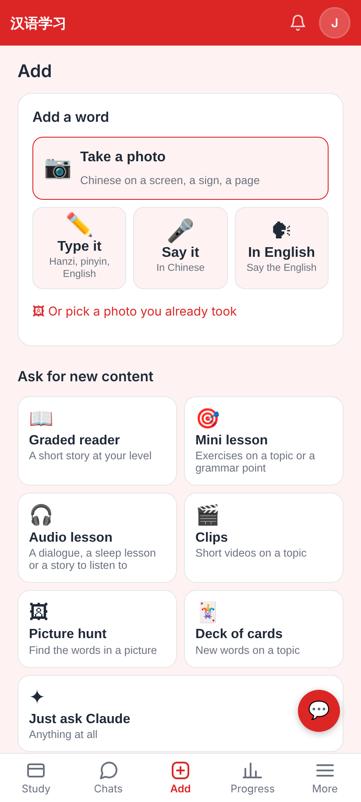

# ＋ Add tab: nothing records until 🎤 is tapped

Lab app (Roborazzi, 412×915 dp, dark), coming back to the ＋ Add tab with 🎤 Say it still picked:

Before: the box started listening by itself on every return (and the running take turned every tab-bar tap into "stop the take").

After: the box is idle; nothing records until he taps 🎤 Say it.

The tab on a fresh open (unchanged): no box, no take.

Web (Playwright, 412×915 at 2×; the web page never started a take on open — the fix there makes the one-shot explicit):

The tab on open: no voice box, nothing recording.

After ✏️ Type it → Progress tab → back to ＋ Add: the tab bar navigated at once; nothing records.
