# Suspend & snooze — screenshots (412×915)

The web app is light-only; the Lab app is shown light and dark.

## Web

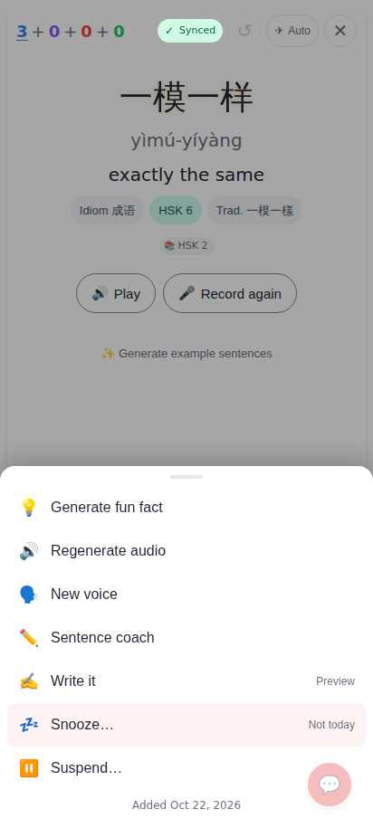
⋯ on the answer side: **💤 Snooze… · Not today** and **⏸️ Suspend…**.

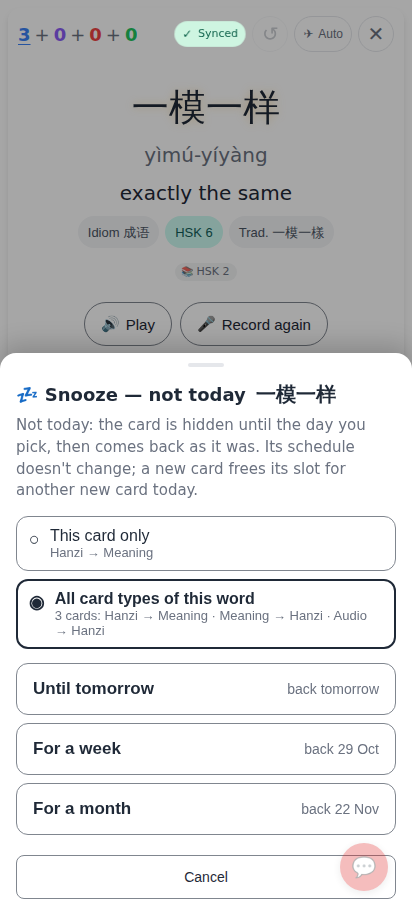
Snooze sheet — "All card types of this word" chosen; each length says when the card is back.

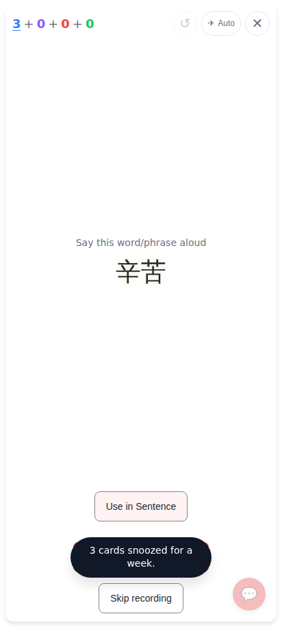
After "For a week": the card leaves the session, "3 cards snoozed for a week."

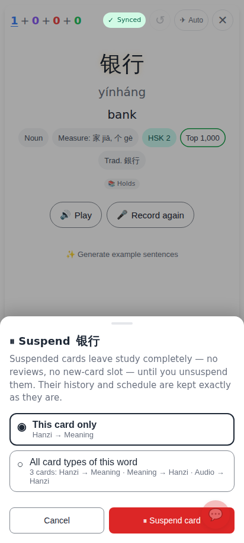
Suspend sheet — what suspending means, This card only / All card types, ⏸️ Suspend card.

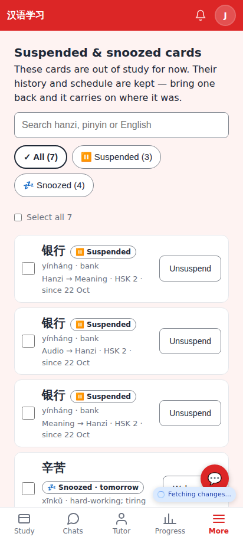
Settings / More → **Suspended & snoozed cards**: search, All / Suspended / Snoozed, per-row Unsuspend / Wake now.

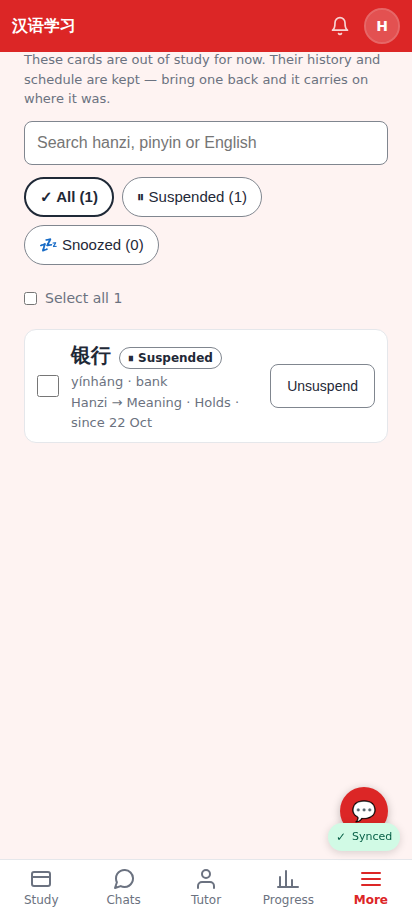
The list with one suspended card (e2e run).

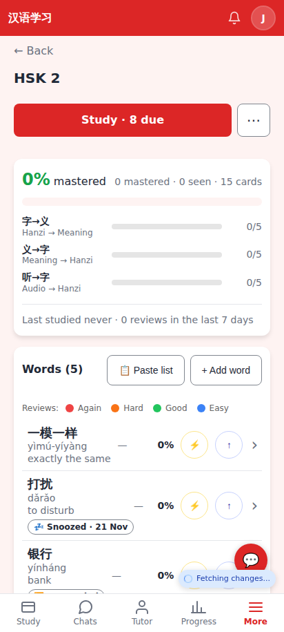
Deck page rows: "⏸️ Suspended" / "💤 Snoozed · 21 Nov" tags (icon + words).

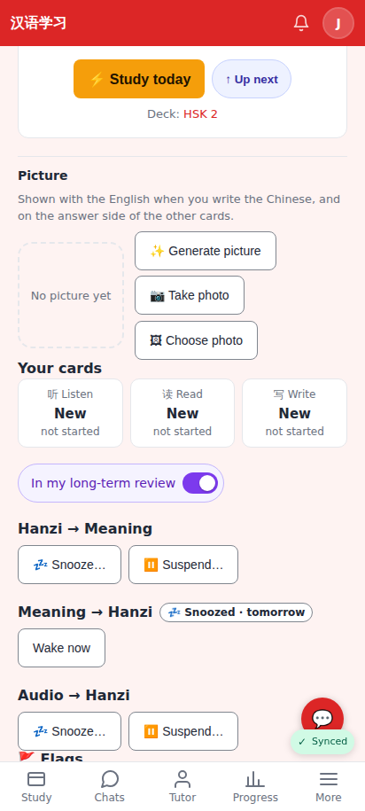
Card hub: each card type with its hold and Wake now / Unsuspend, or Snooze… / Suspend….

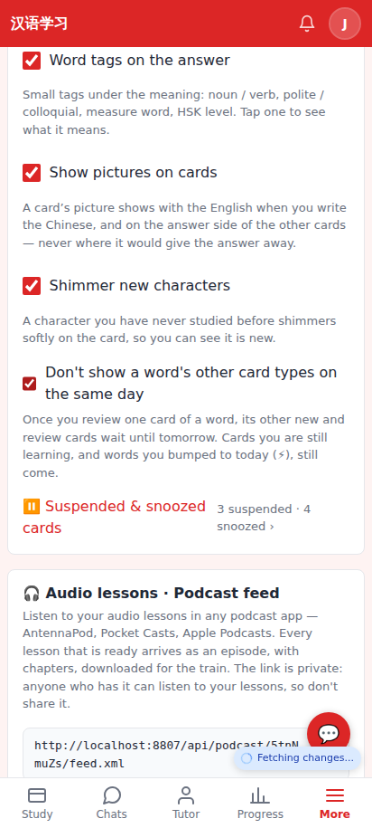
Settings → Study: "Don't show a word's other card types on the same day" (off by default) and the list.

## Lab app

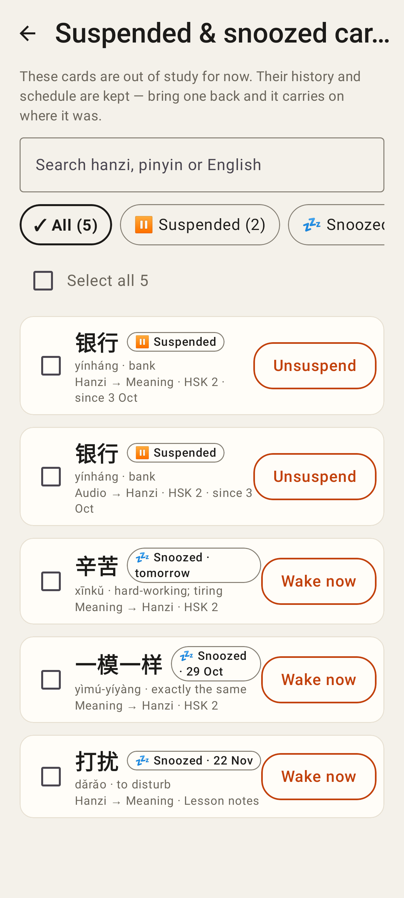
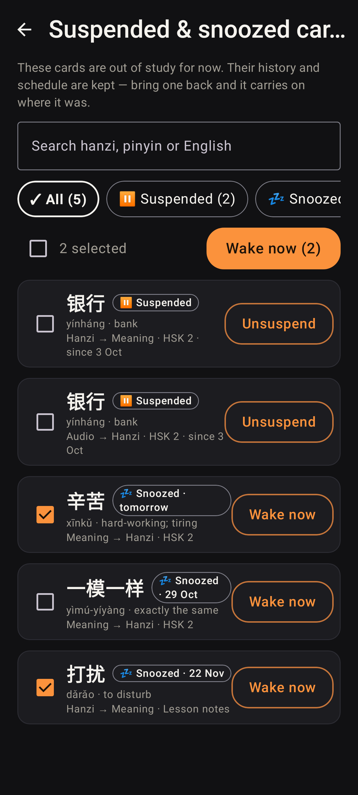
Suspended & snoozed cards — light, and dark with two ticked (Wake now (2)).

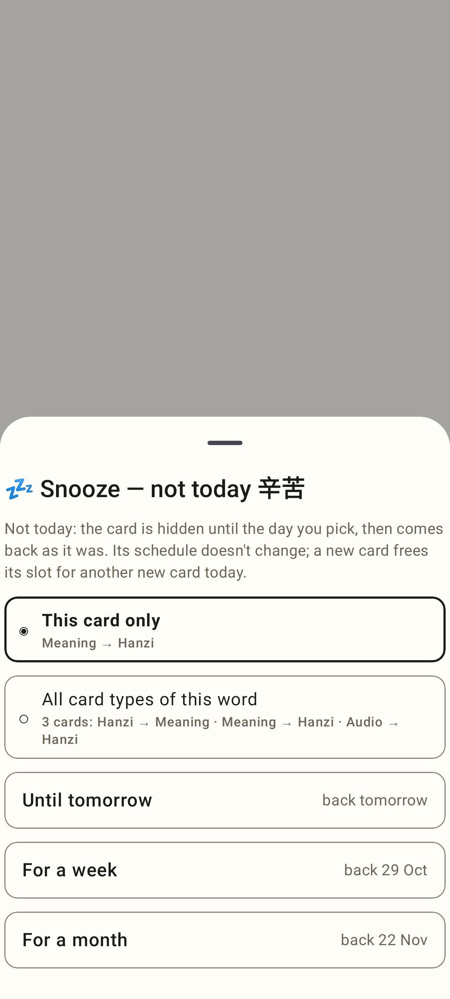
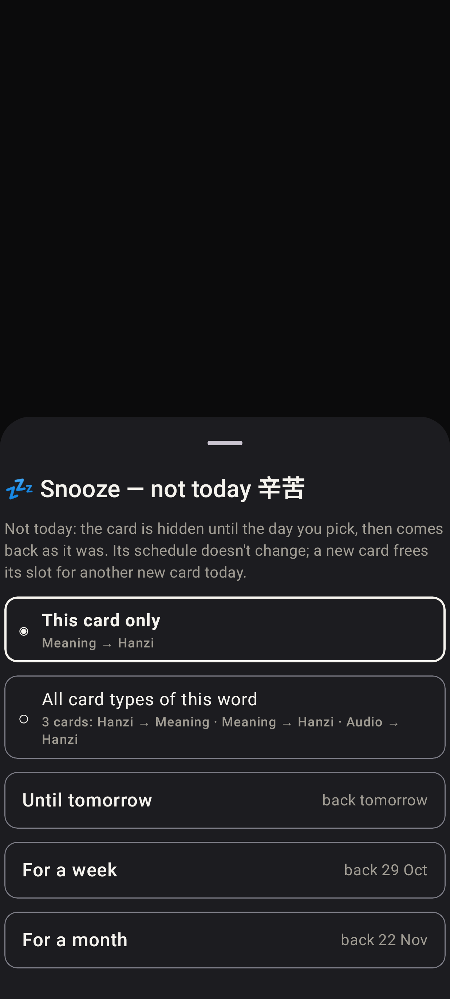
Snooze sheet, light and dark.

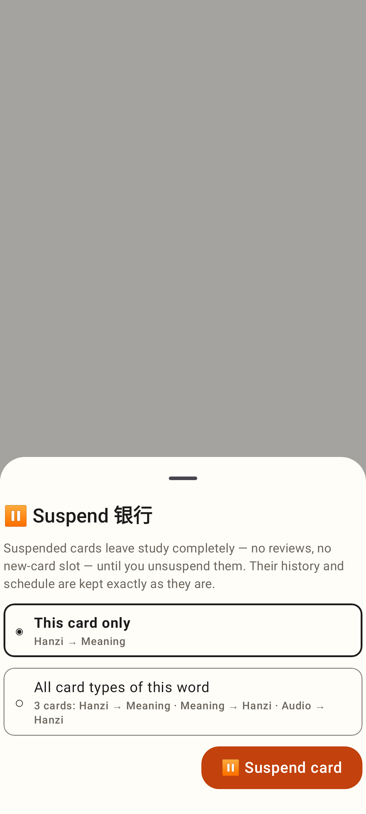
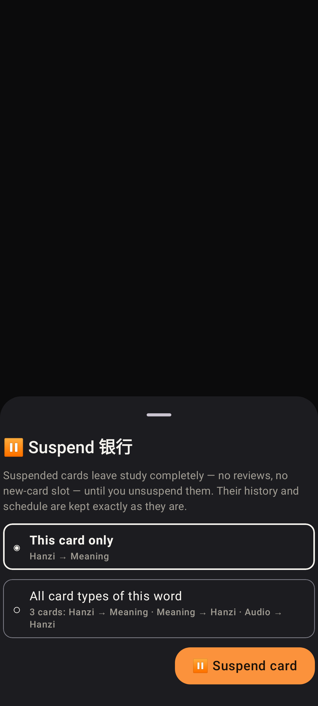
Suspend sheet, light and dark.

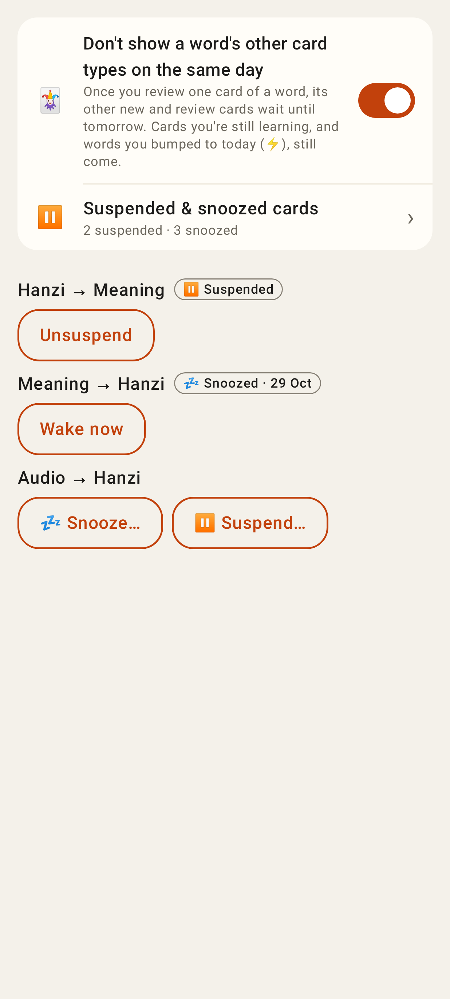
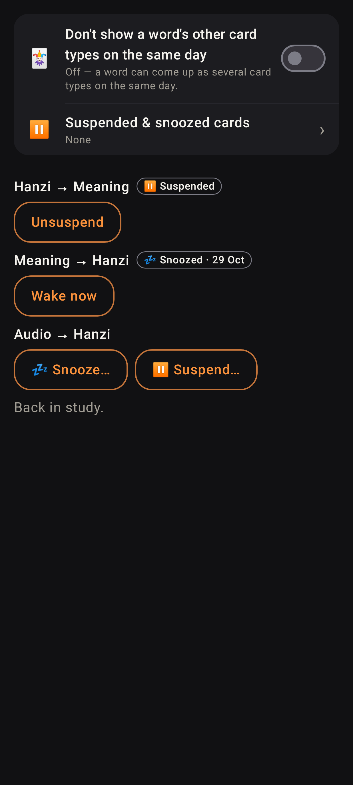
Settings card (switch on / off) and the card hub's per-card controls.
