# Leeches + Forget this card: screenshots (412×915)

The web app is light-only. The Lab app is shown in light and dark.

## Web

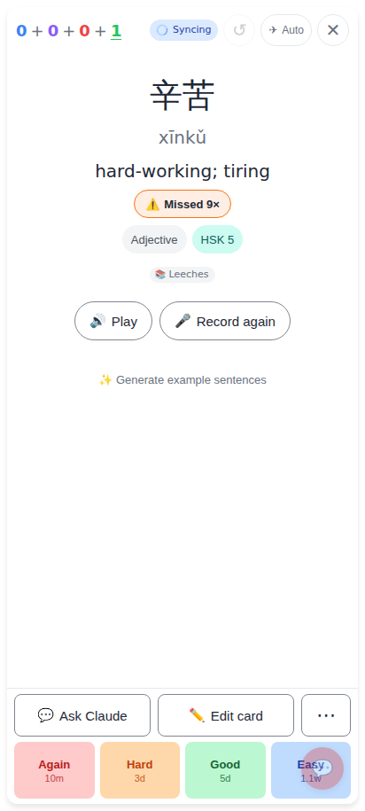
A card missed 9 times after it was learned: **⚠️ Missed 9×** under the meaning, next to the word tags.

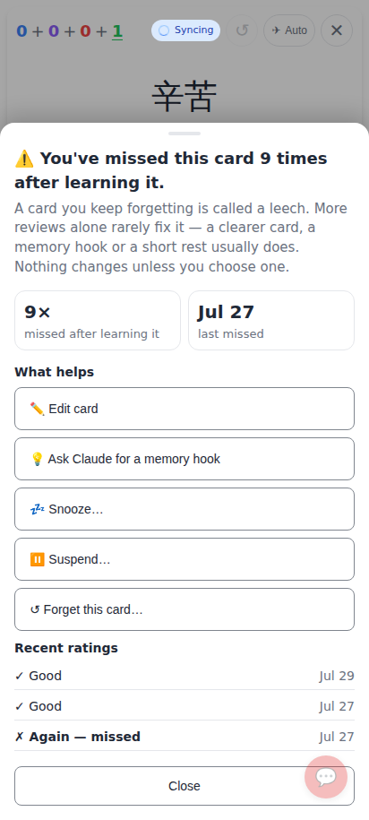
The leech sheet shows the misses and when the last one was. **What helps** comes first (Edit card ·
Ask Claude for a memory hook · Snooze · Suspend · Forget), then the recent ratings (✗ Again — missed).

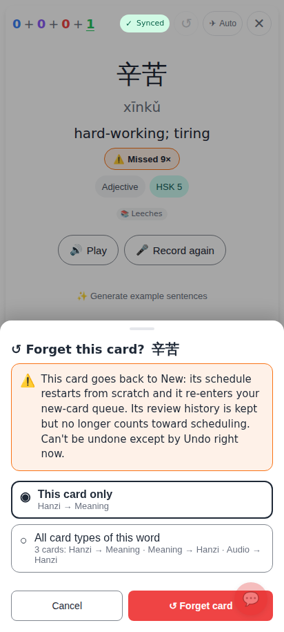
Forget this card…: the warning comes first, then This card only / All card types of this word, then
↺ Forget card.

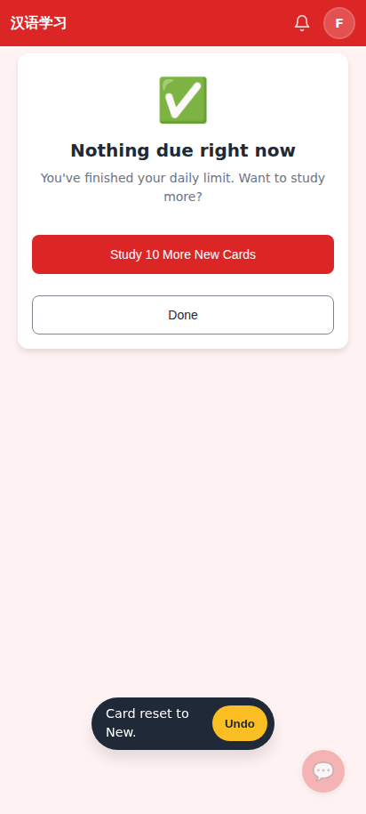
"Card reset to New." with **Undo**. This was the last card due, so the session is done.

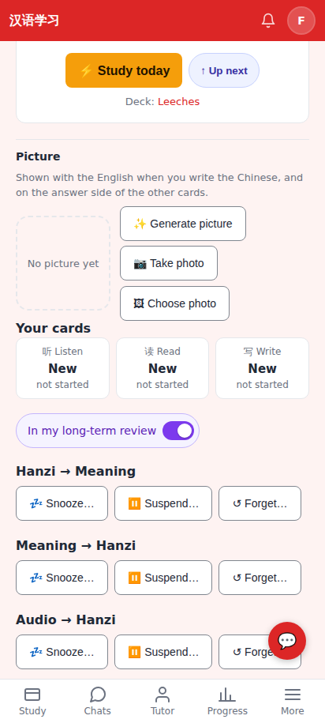
Card hub: the forgotten card is New ("not started"), and each card type has ↺ Forget… next to
Snooze / Suspend.

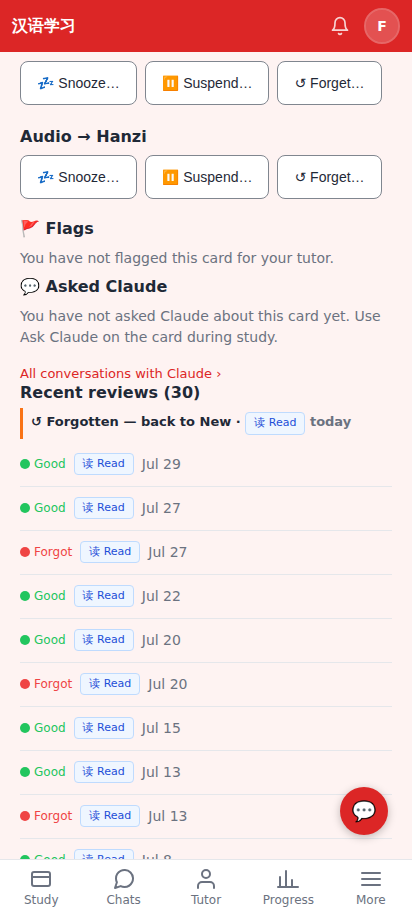
The card hub's Recent reviews: **↺ Forgotten — back to New** is a marker line above the reviews it
reset. It is not a review.

## Lab app

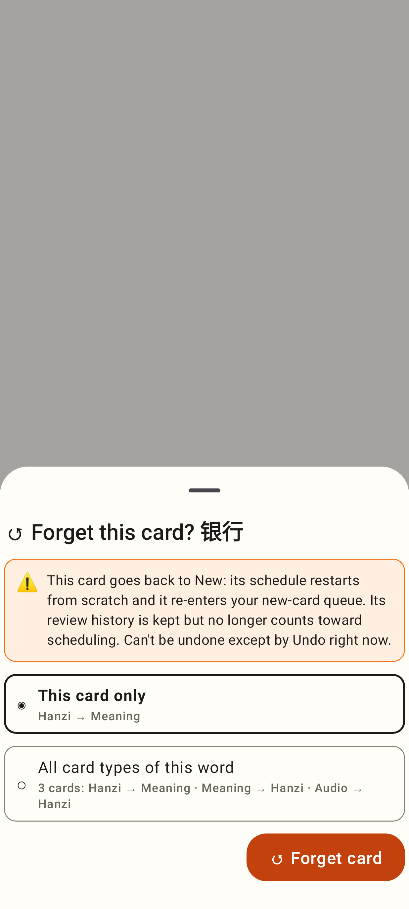
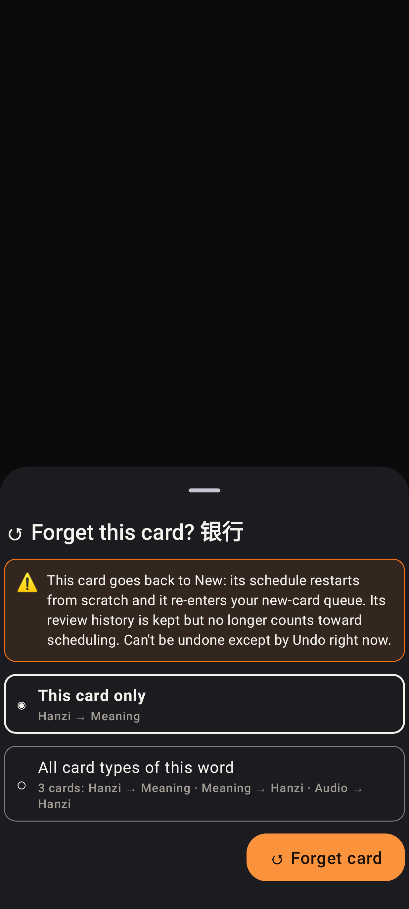
The Forget sheet in light and dark.

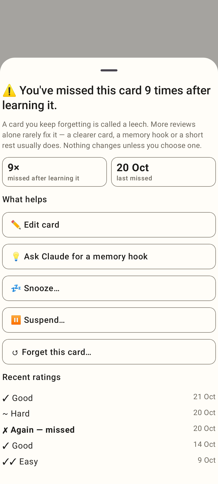
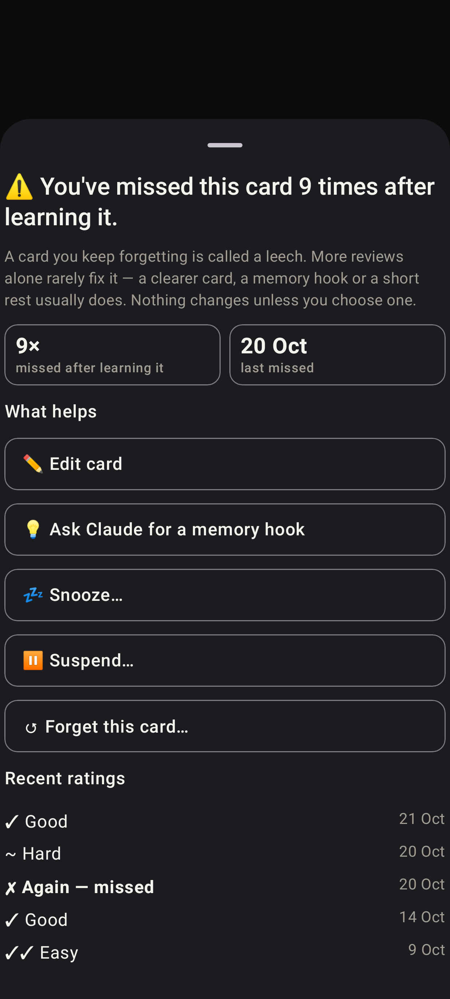
The leech sheet in light and dark.

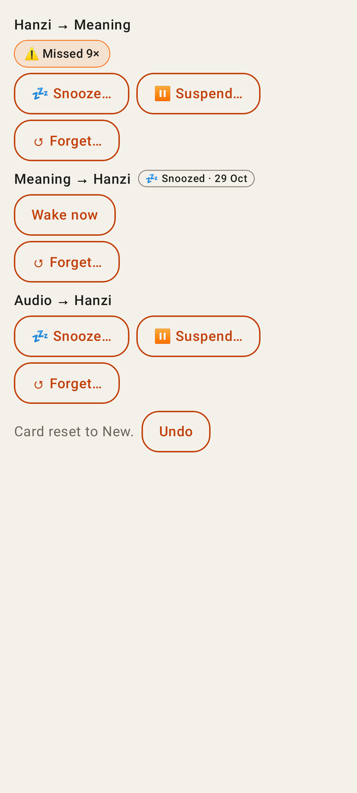
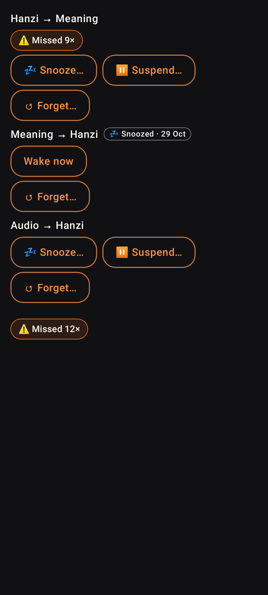
Card hub: the leech pill, ↺ Forget… per card type, "Card reset to New." with Undo.
