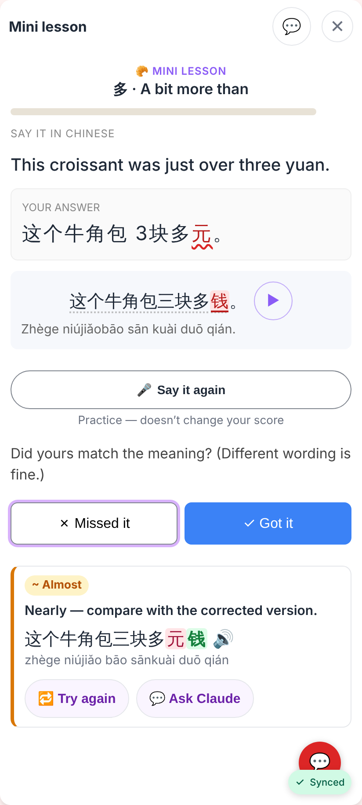

# Answer check: coherent "Almost", digits = numerals

Phone viewport (412×915, 2×). The mini-lesson player with the E2E stand-in model returning Jerome's real
self-contradictory check (`e2e/tests/lesson-answer-check-coherence.spec.ts`).

"This croissant was just over three yuan." He said 这个牛角包 3块多元. "You said" marks only 元 (3 is 三). The model answer
marks only 钱. "~ Almost" keeps a neutral headline: the model's "Use 钱 or 块 alone, not both together" contradicted its own
fix. The tip offering his own 块多元 as a fix is dropped. The red-pen fix shows 三 (only 元 → 钱 changes) with word-by-word
pinyin that reads the number (sānkuài). "Say the corrected version" is gone: once 3 = 三, the fix is the model answer.

Before this change, the same answer showed the headline "Use 钱 or 块 alone, not both together" and the tip "…or just 元 alone
(块多元)". The fix's pinyin was "zhège niú jiǎo bāo kuài duō qián", without the 3, and the 3 was painted red against 三.
