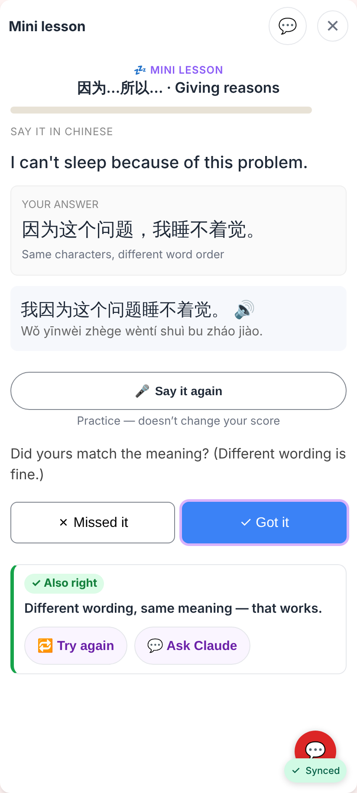
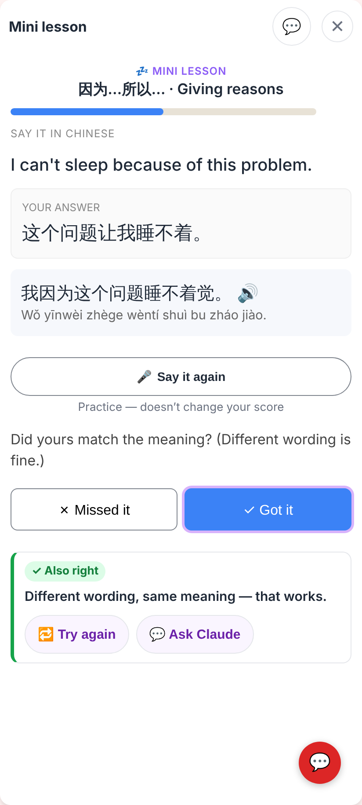

# Answer check sanity — screenshots (412×915 @2x)

"Say it in Chinese": *I can't sleep because of this problem.* — model answer 我因为这个问题睡不着觉。

1. Jerome's answer 因为这个问题，我睡不着觉。 — the same characters in another order: nothing painted red, a neutral
   "Same characters, different word order" under it, the model answer unmarked. The E2E fake returns the exact
   contradictory check he got ("…but 因为 clause should come before the subject" + a tip comparing a text with itself);
   the sanity rules drop the tip and give the plain "Different wording, same meaning — that works.".

2. Different wording (这个问题让我睡不着。): once Claude says it's right, the device's character marks go — a right
   answer is never painted as errors (before the verdict, or on Almost / Not quite, they still show).
