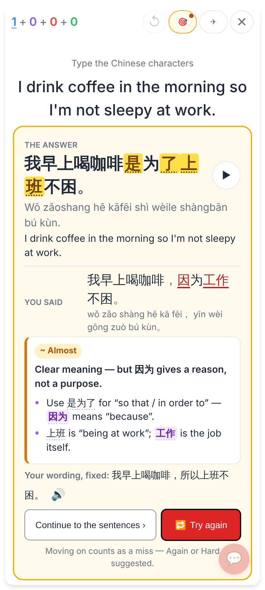
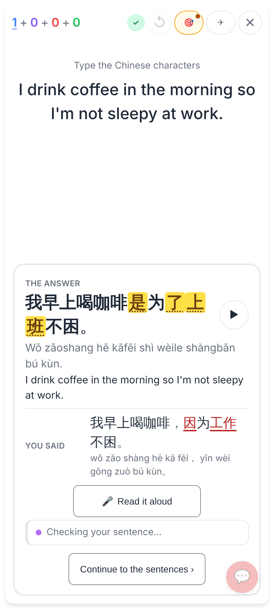
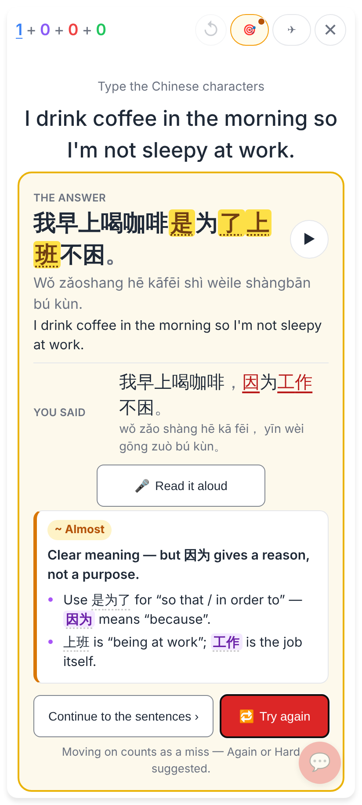
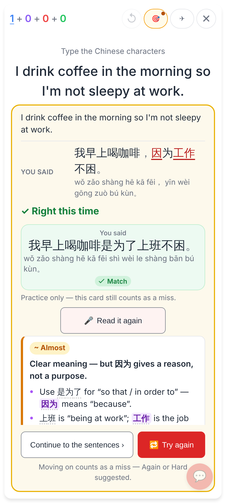
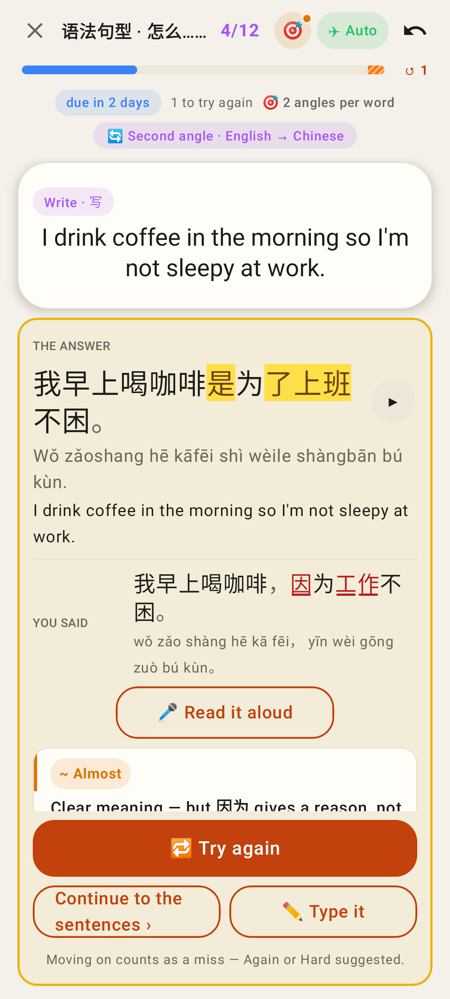
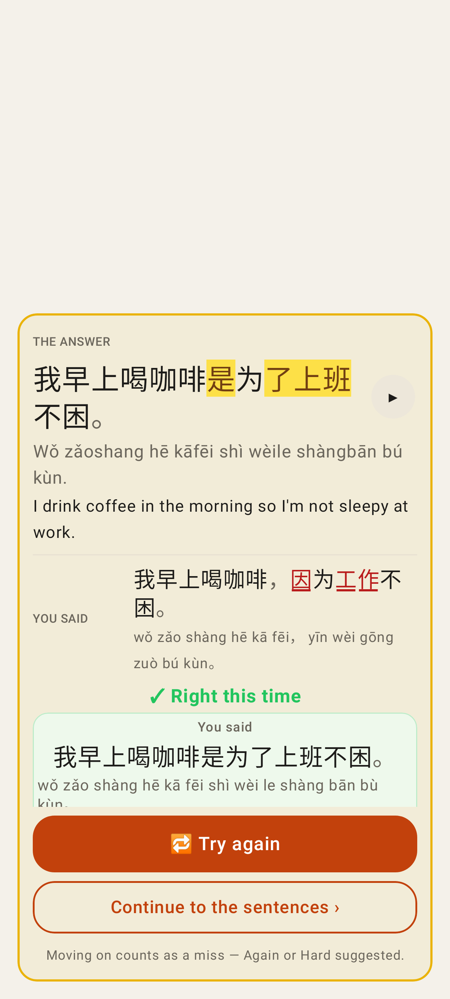
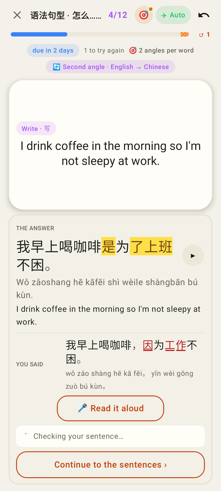

# 🎤 Read it again on the answer-first sentence check

Hard mode, English → Chinese, a sentence card: 我早上喝咖啡是为了上班不困。, answered 我早上喝咖啡，因为工作不困。.
Phone viewport 412 × 915 at 2×. Web shots come from the real app against the local worker, with Claude's check
stubbed and the transcriber faked. Lab shots are Roborazzi screenshots of the homework pass card.

Before (#723): a missed sentence showed the answer and the diff but had no 🎤. "Continue to the sentences" skipped
the "👁 The answer" panel, which is where #722 put "Read it again".

Web, while Claude checks: 🎤 Read it aloud sits right under "You said", so the verdict arriving below never moves it.

Web: "~ Almost" lands below the 🎤.

Web: read aloud right shows "✓ Right this time" with the You said row and "Practice only — this card still counts
as a miss." The card stays ≈ Nearly.

Lab, homework pass: the same layout, with 🎤 Read it aloud between "You said" and Claude's card.

Lab: a take read right, practice only.

Lab, while Claude checks: the 🎤 is already there.
