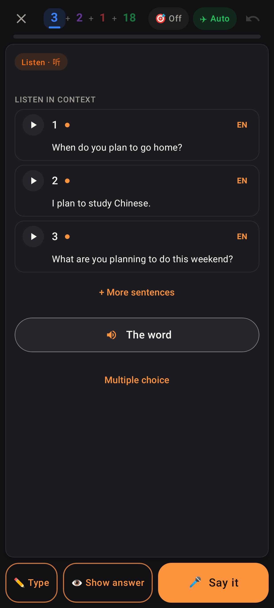
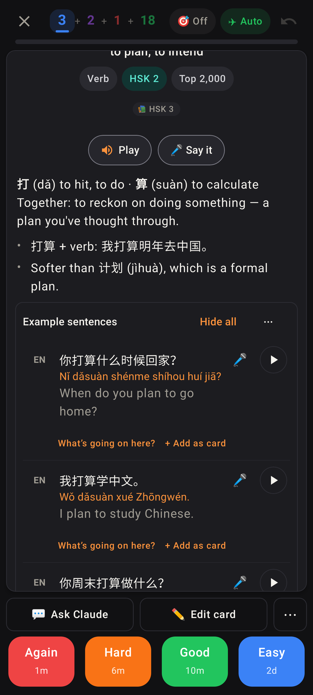
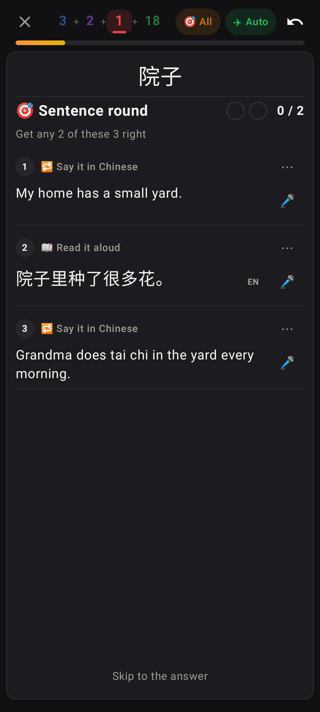
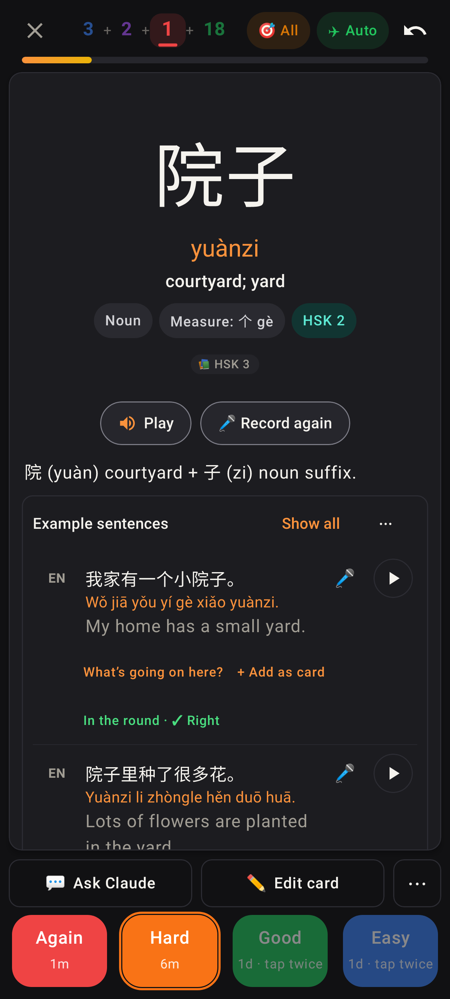
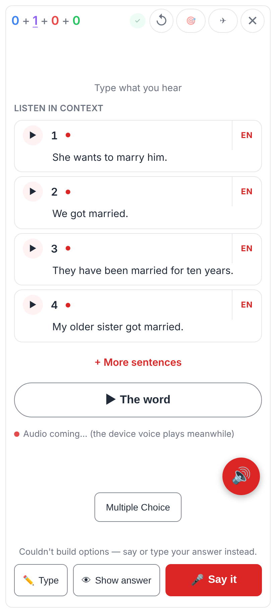
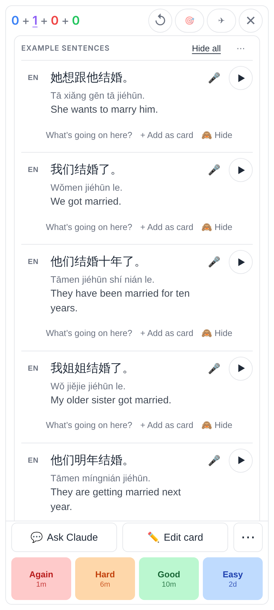
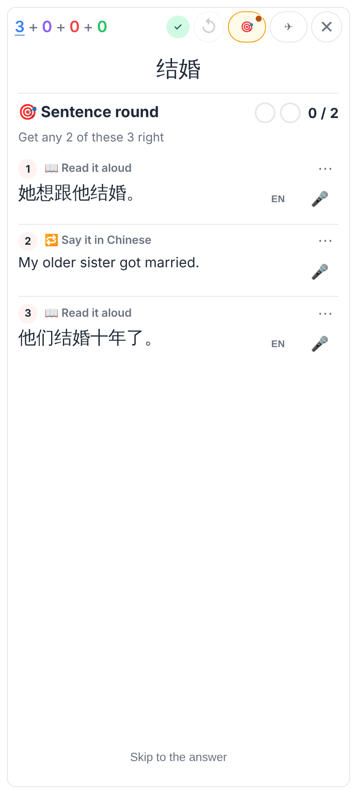
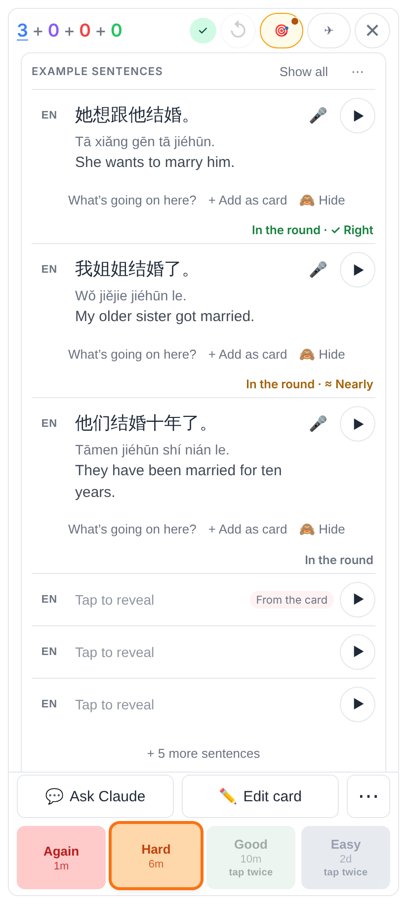

# The answer side keeps the question's sentence order

Phone viewport (412×915 @2×). Lab app in the dark theme, web app in the light theme. Each pair shows the question side, then the answer side. The answer side's "Example sentences" start with the same sentences in the same order.

## Lab app (dark)

Lab, listening card: "Listen in context" in this showing's shuffled order. EN is opened on every row so you can see which sentence is which.

Lab, the answer side after Show all: the same sentences in the same order. "From the card" moved with its row.

Lab, Hard mode's Sentence round on a reading card. The card's own sentence is not in the round.

Lab, the answer side: the round's sentences come first in the round's order, each labelled with how it went. The card's own sentence follows them.

## Web app (light)

Web, listening card: "Listen in context" with EN opened on every row.

Web, the answer side after Show all: 她想跟他结婚 · 我们结婚了 · 他们结婚十年了 · 我姐姐结婚了, then the card's own sentence.

Web, the Sentence round: 她想跟他结婚 · 我姐姐结婚了 · 他们结婚十年了.

Web, the answer side: the three round sentences, opened and labelled ✓ Right / ≈ Nearly / untried, then "From the card", then the rest.
