# 📝 "N words to recap" in the Ask Claude chat

The chat's ⋯ menu entry now opens the readers' word recap pass with the chat as its source.

## Web (412×915 @2×)

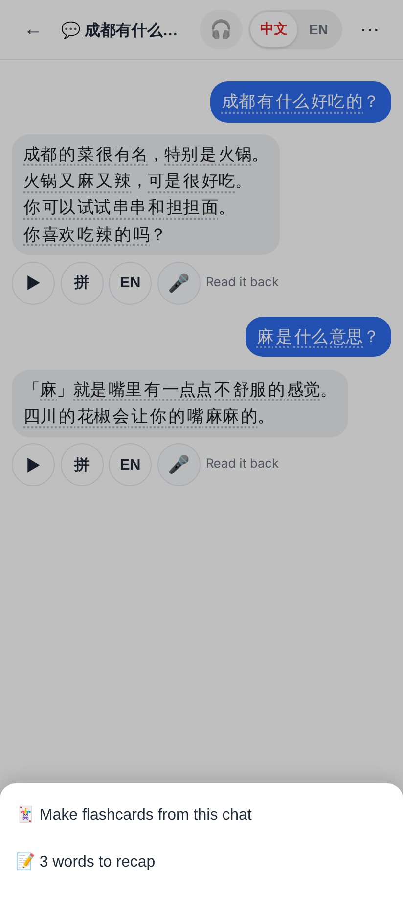
⋯ in the Ask Claude chat: "📝 3 words to recap" (shown only when there are words not yet recapped).

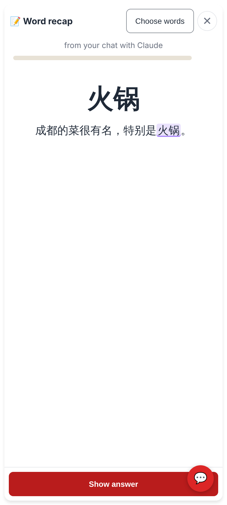
A chat-sourced card: the word with the sentence of Claude's message it came from, "from your chat with Claude".

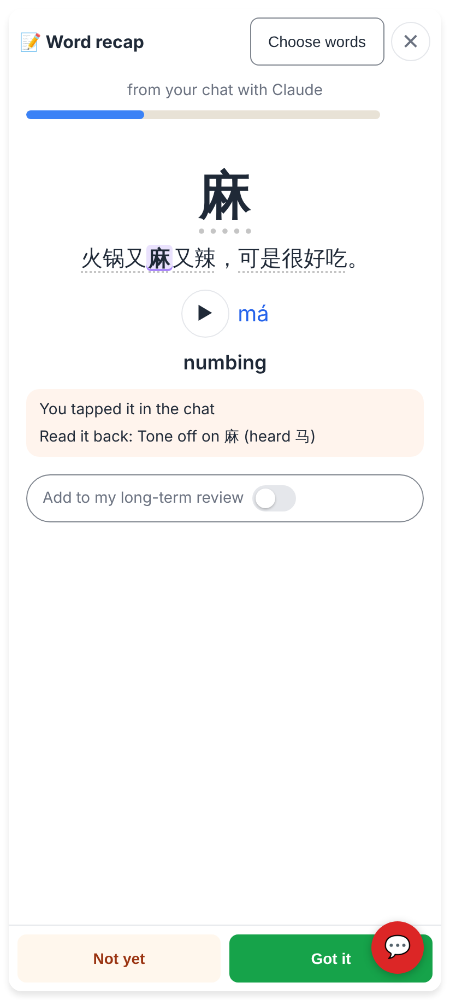
The back: ▶, pinyin, meaning, why it's here ("You tapped it in the chat", "Read it back: …"), the switch OFF by default.

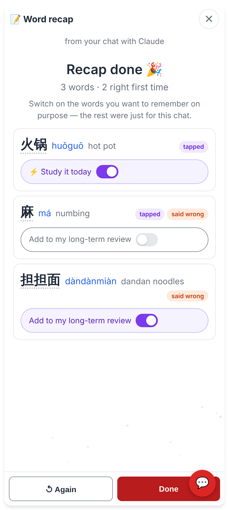
The summary: every word with its switch — ⚡ Study it today for a word already in the decks, "Add to my long-term review" (→ "From my chats" + Up next) for a new one.

## Lab app (Roborazzi)

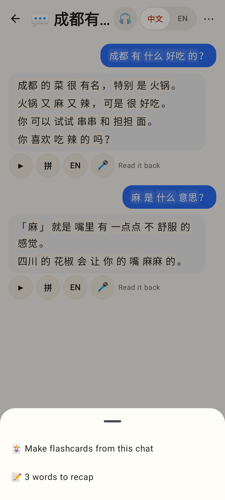
⋯ menu, light.

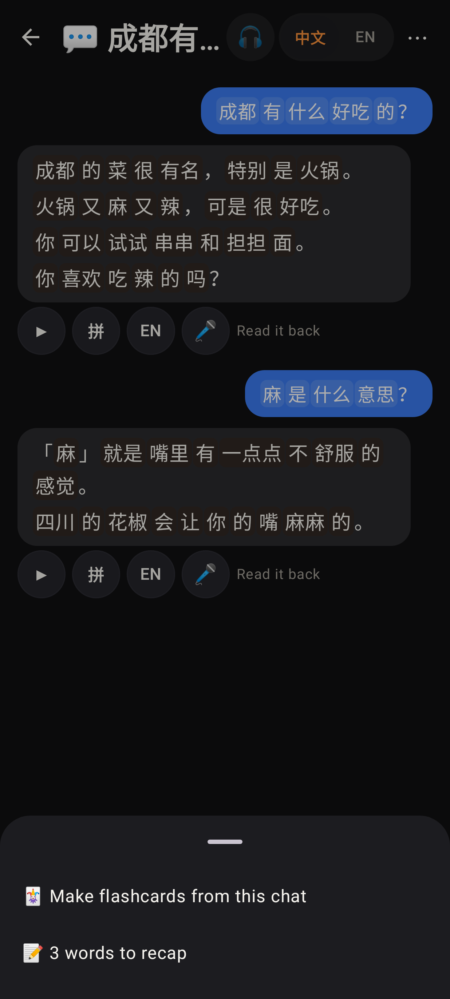
⋯ menu, dark.

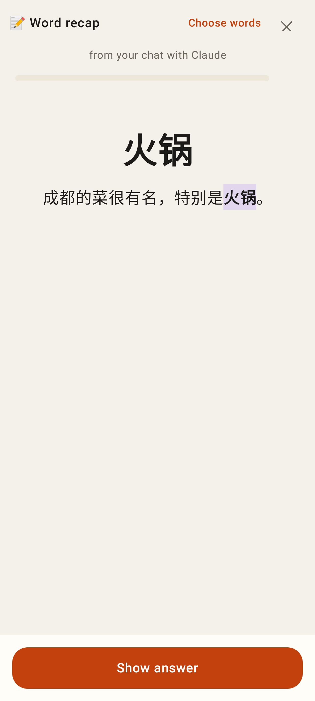
A chat-sourced card, front.

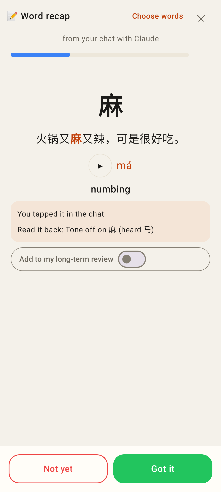
Back, light.

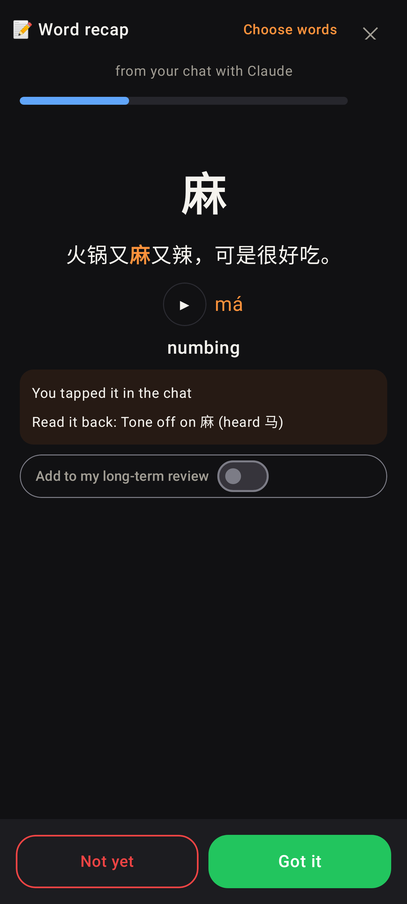
Back, dark.

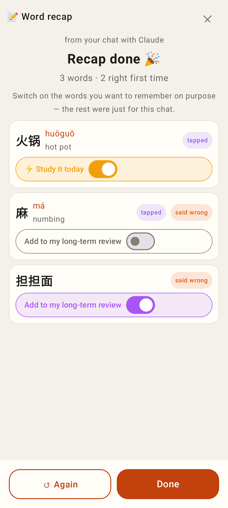
Summary, light.

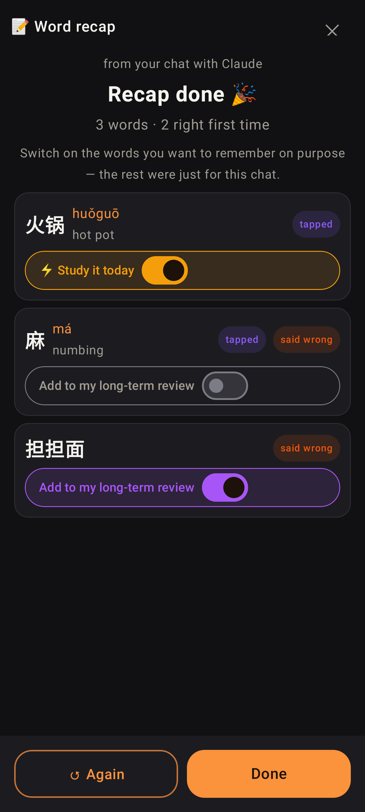
Summary, dark.
