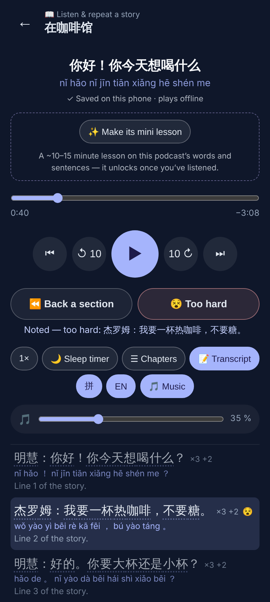
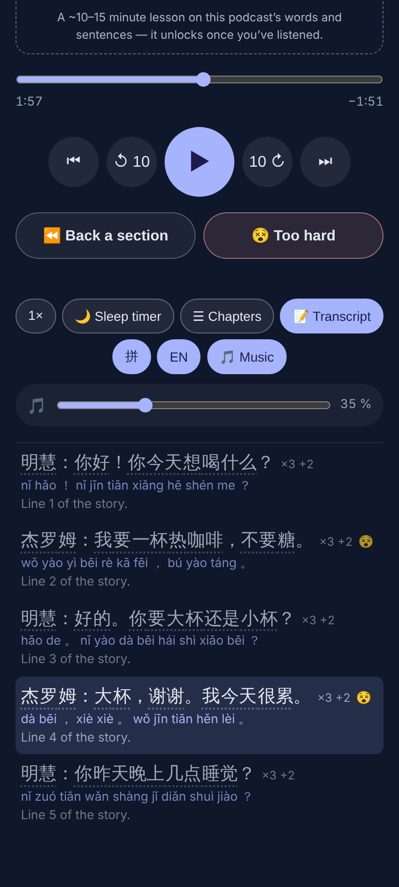
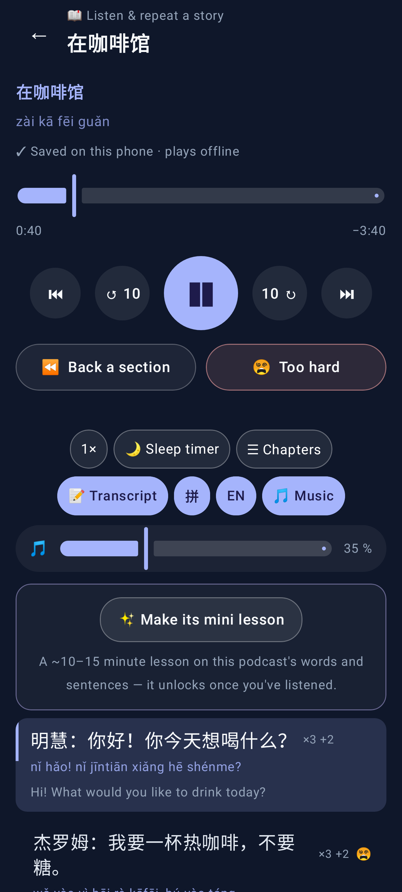
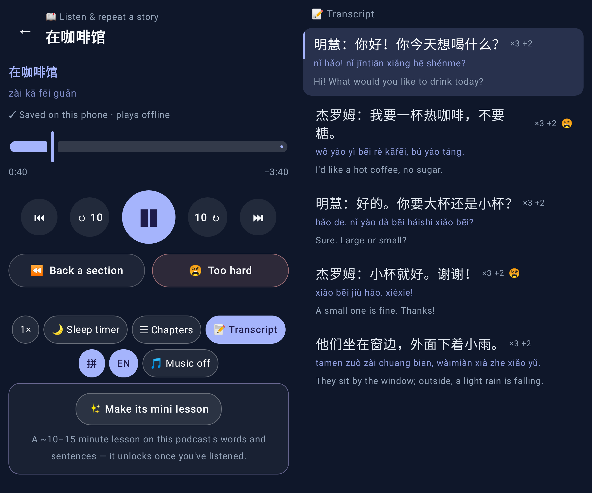

# Feedback while listening — screenshots

Web player (412×915 @2×, a real story lesson made by the local worker in E2E mode):

⏪ Back a section · 😵 Too hard under the controls; "Noted — too hard: …" confirms which line it was about.

The lines marked too hard on this device carry a 😵 in the transcript.

Lab app player (Roborazzi):

The same two buttons on the Lab player; 😵 on the flagged transcript row.

Unfolded (Pixel Fold open).

**The Lab lock screen / media notification** is drawn by Android and can't be rendered in a screenshot
test. It shows: ⏮ (back a section) · ⏯ · ⏭ (next section) · 🚩 **Too hard** (Media3 flag icon; it fills in
— "Noted — too hard" — for 2.5 s after a tap, with a haptic). A headset's previous / next do the same as ⏮ / ⏭.
