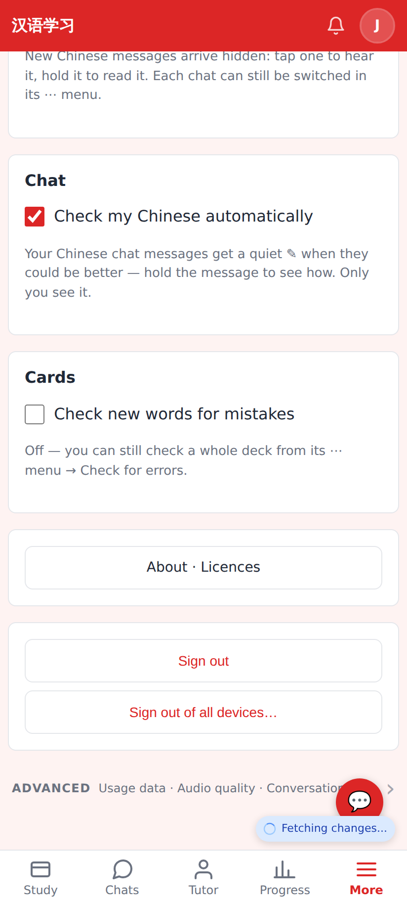
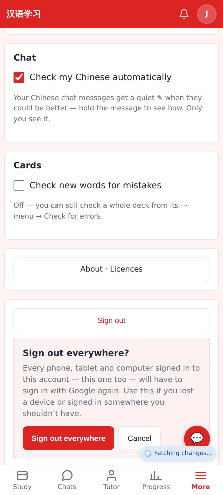
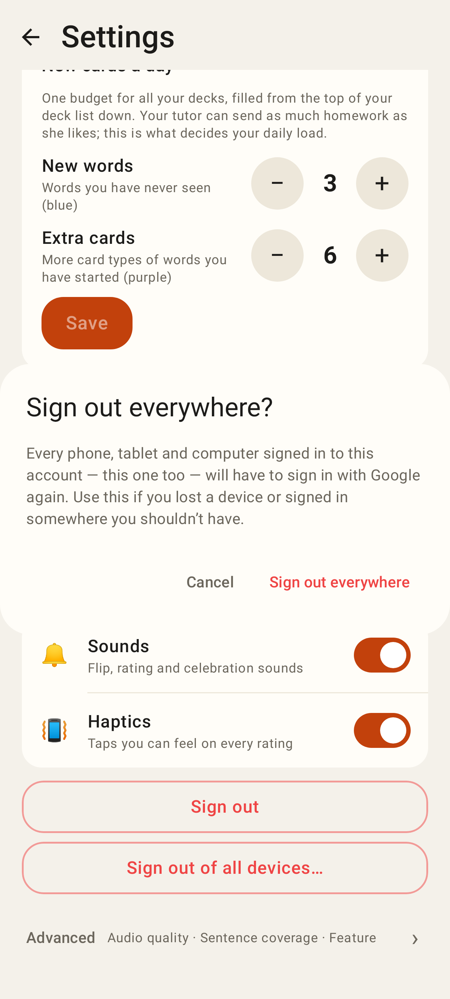

# Sign-in hardening — screenshots

Web Settings: **Sign out** (now revokes this session on the server) and the new **Sign out of all devices…**.

Web: the in-page confirm before every session of the account is revoked.

Web: a `?code=` link minted for someone else's sign-in signs nobody in (login CSRF) and says why.

Lab app Settings: Sign out of all devices… → confirm dialog (Roborazzi `settings-12-sign-out-everywhere`).
