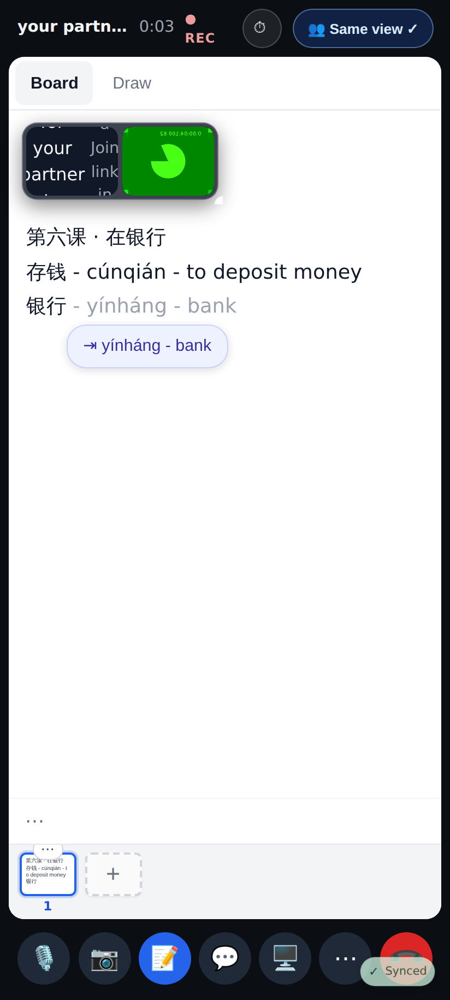
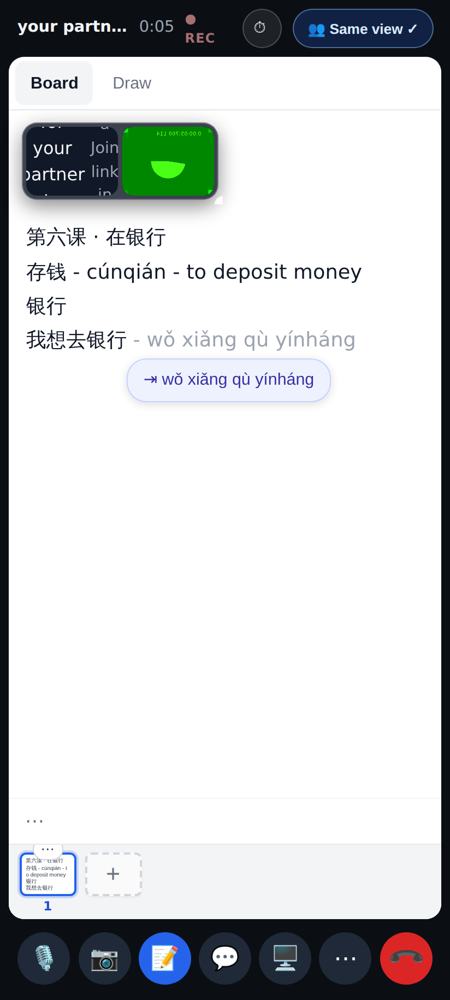
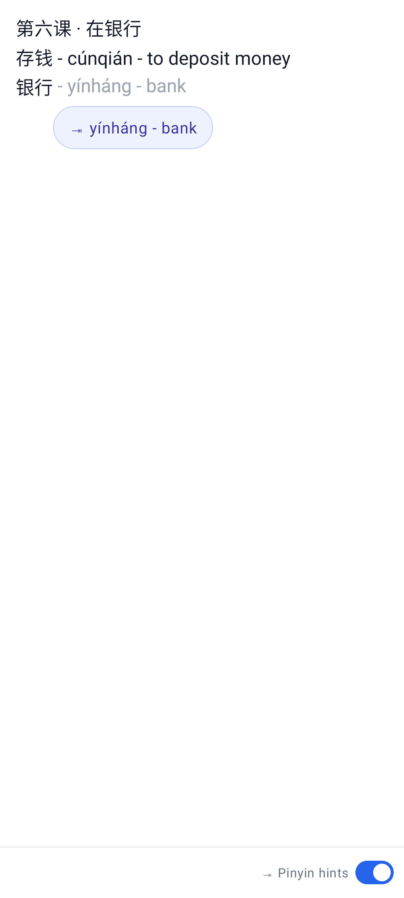
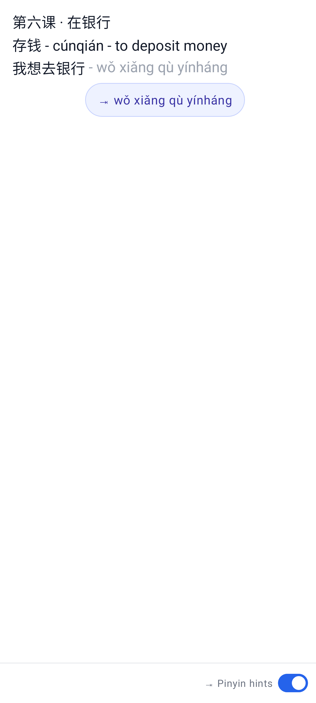

# Board tab-complete you can rely on — screenshots

Web, phone viewport (412×915, 2×), a solo call's text board. Before this PR both states showed **nothing**
(a slow model answer was dropped by the next edit; a 503 silenced the board for a minute).

The server's answer is still on its way: the device's own gloss — the dictionary's pinyin and first meaning
of 银行 — shows at once (ghost + touch chip). The server's contextual gloss replaces it when it comes.

The server can't help (503): a phrase the dictionary has no single entry for still gets the device's
pinyin (` - wǒ xiǎng qù yínháng`, words joined like the server's).

Lab app (Roborazzi, same states):

