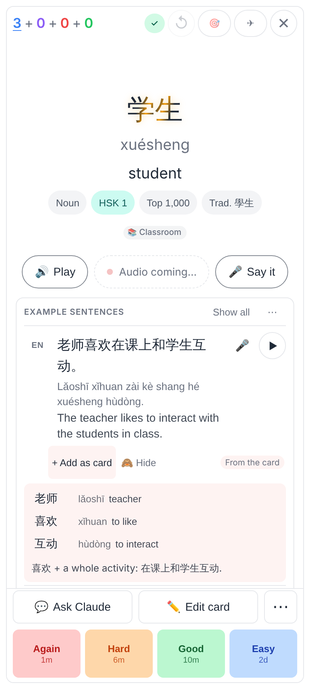
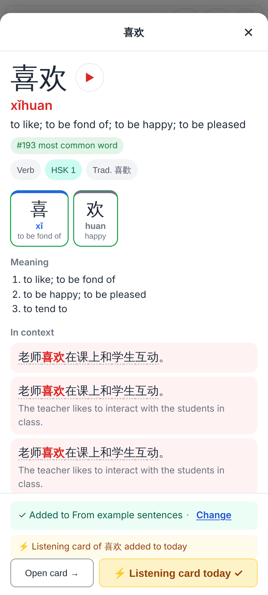
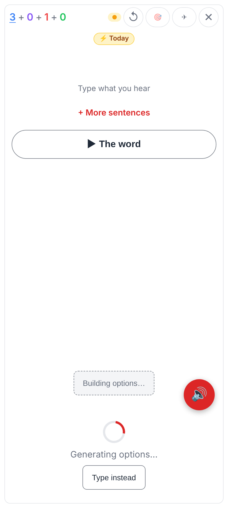
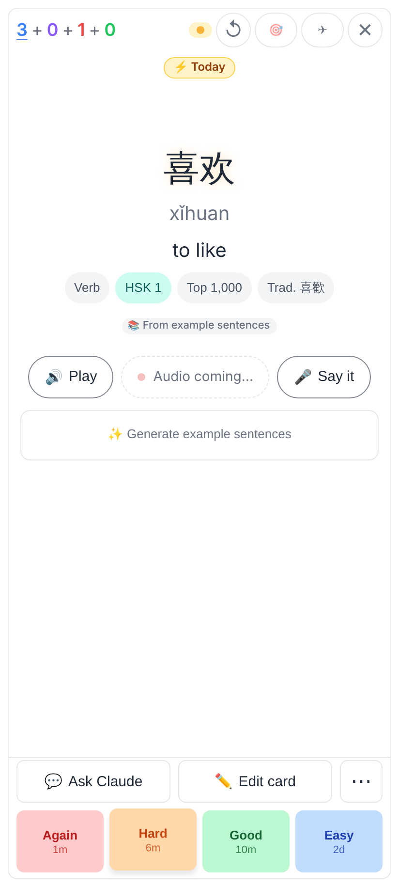

# ⚡ by ear for a word just added from a sentence breakdown — and it comes next

Phone viewport (412×915 @2×), from `e2e/tests/study-breakdown-bump-next.spec.ts` (`SHOT_DIR=…`).

01 — In a session: the card's example sentence → "What's going on here?" (one word per row).

02 — 喜欢 → the explorer → "+ Add as card" (one tap, "From example sentences") → ⚡ Study it today: "⚡ Listening card of 喜欢 added to today" — its clip is still being made, and it is the listening card all the same (it used to be the reading card).

03 — The card on screen stayed; once it was rated, the very next card is 喜欢's listening card (⚡ Today).

04 — Its answer side: 喜欢.
