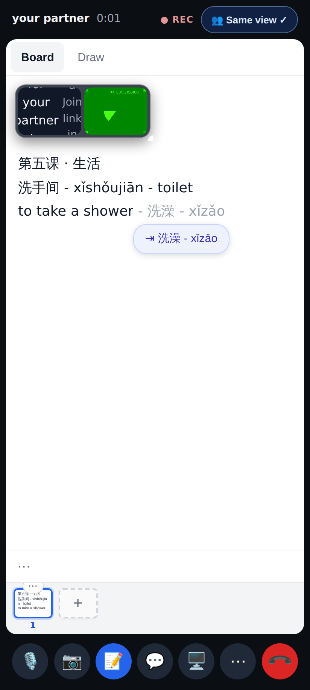
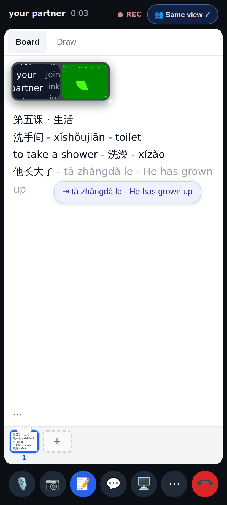
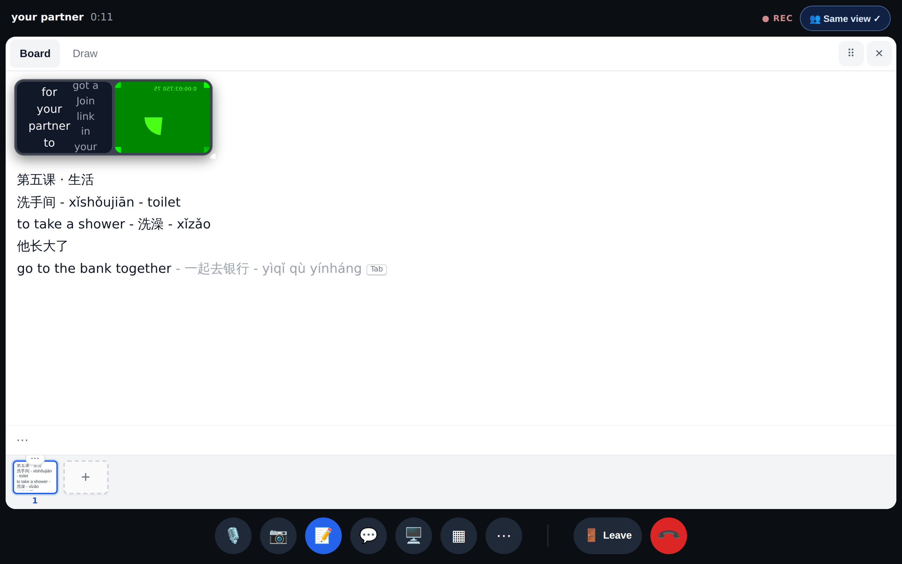
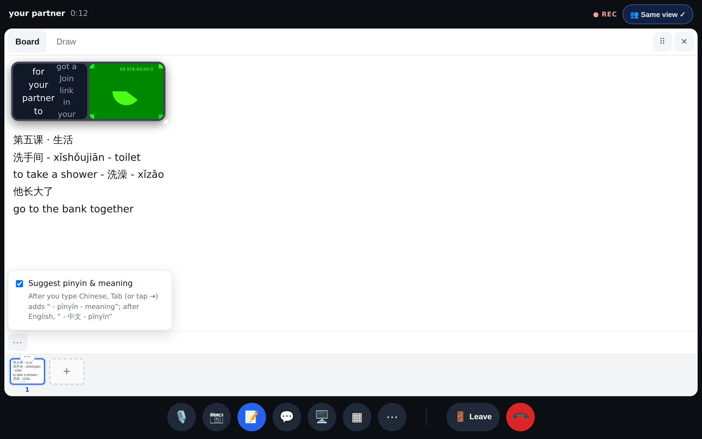
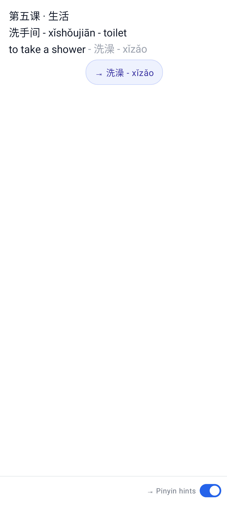

# Board tab-complete: better pinyin + English → Chinese

Phone (412×915): after typing "to take a shower" and pausing, the grey ghost is ` - 洗澡 - xǐzǎo` and the chip "⇥ 洗澡 - xǐzǎo".

The English line after a tap on the chip, then Chinese on the next line: ` - tā zhǎngdà le - He has grown up` (长 read zhǎng here).

Desktop: a phrase gets its whole translation, with the 一 tone change written (yìqǐ) and 行 read háng in 银行.

The board ⋯ menu: the hint now mentions both directions.

Lab app (Roborazzi `lab-calls-gloss-en-01`): the same offer, ghost and chip.
