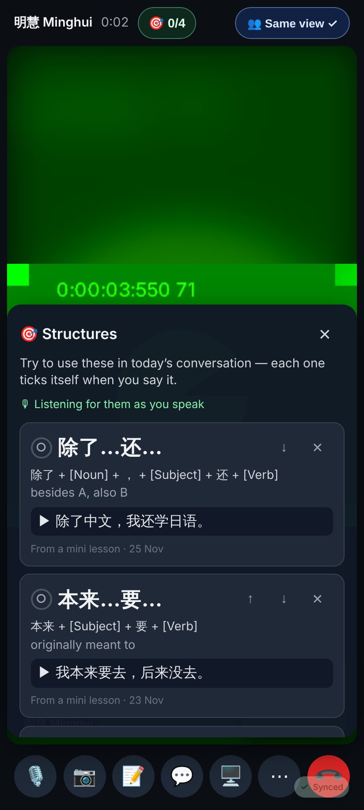
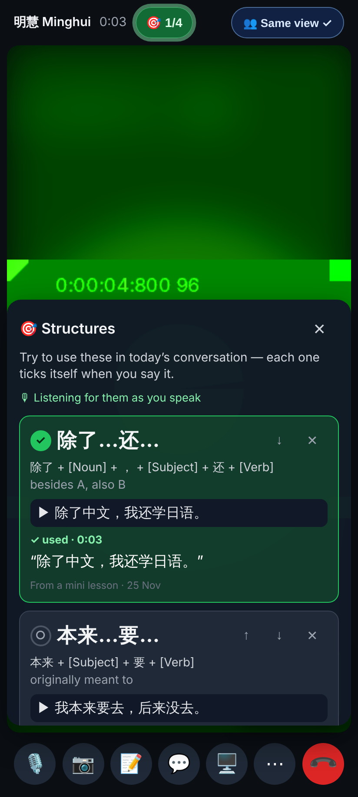
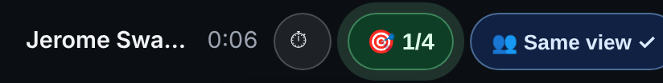
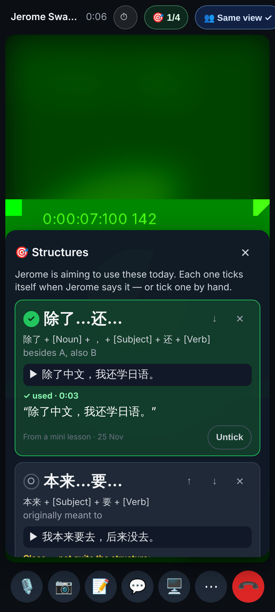
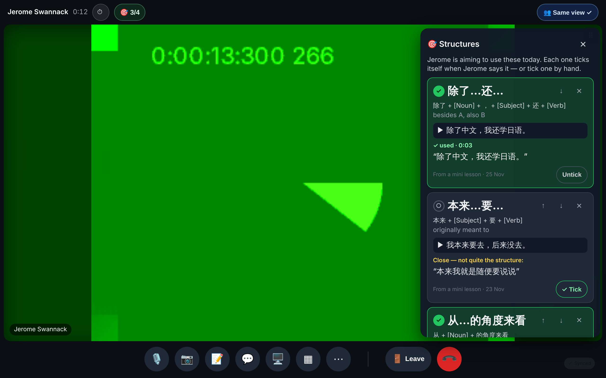
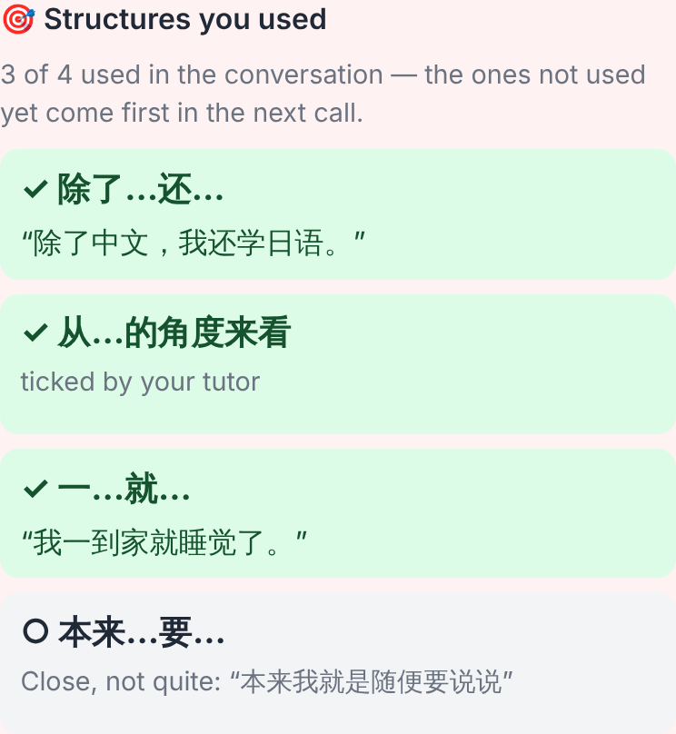
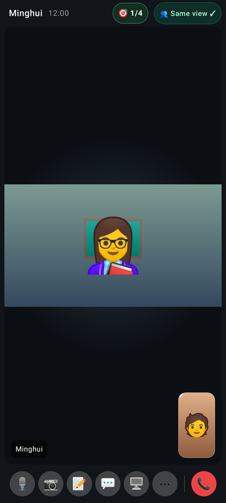
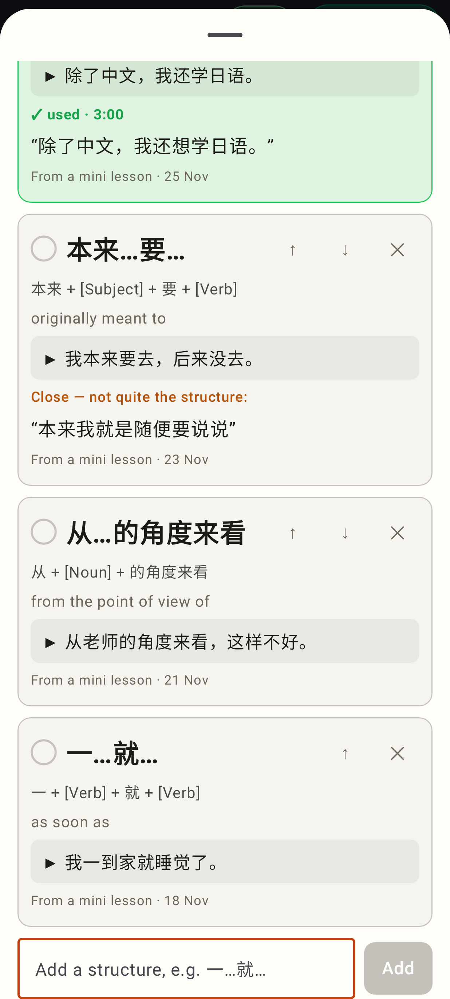
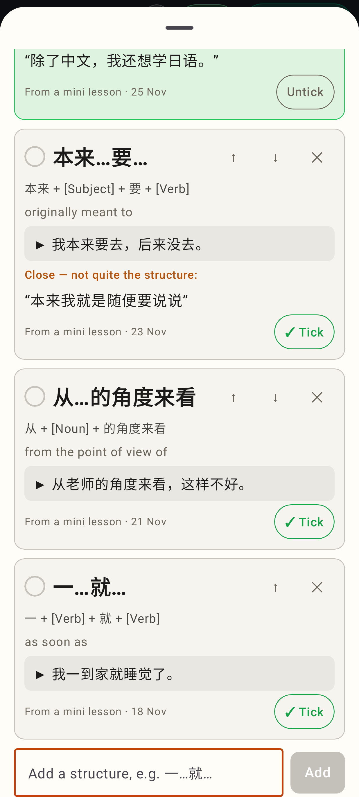

# 🎯 Structures to use in a video call

Web at 412×915 @2x (Pixel Fold folded) unless noted; the Lab app from Roborazzi. Structures from the student's real
mini lessons (除了…还…, 本来…要…, 从…的角度来看, 一…就…); his speech fed through the E2E stand-in transcript.

The student's page: the panel opens once near the start, "Listening for them as you speak", each structure big with its line, meaning and a ▶ example.

He said 除了中文，我还学日语。 — ✓ used · 0:03 with the sentence; the chip reads 🎯 1/4.

The tutor's top bar: 🎯 1/4 next to the timer and Same view.

The tutor's panel: ✓ Tick / Untick by hand, the near miss "本来我就是随便要说说" kept with its sentence.

1280×800: the panel docks on the right of the stage.

After the call: "🎯 Structures you used" — used with the sentence, ticked by the tutor, close, not tried.

Lab app: the chip in the call's top bar.

Lab app: the student's sheet (used, near miss, open; Add a structure).

Lab app: the tutor's sheet with ✓ Tick / Untick.
