# Calls round 7: timer, call sounds, the sharer sees her share

Desktop shots are 1280 px wide, phone shots are 412×915. All are at 2×, from the local app with a fake camera.

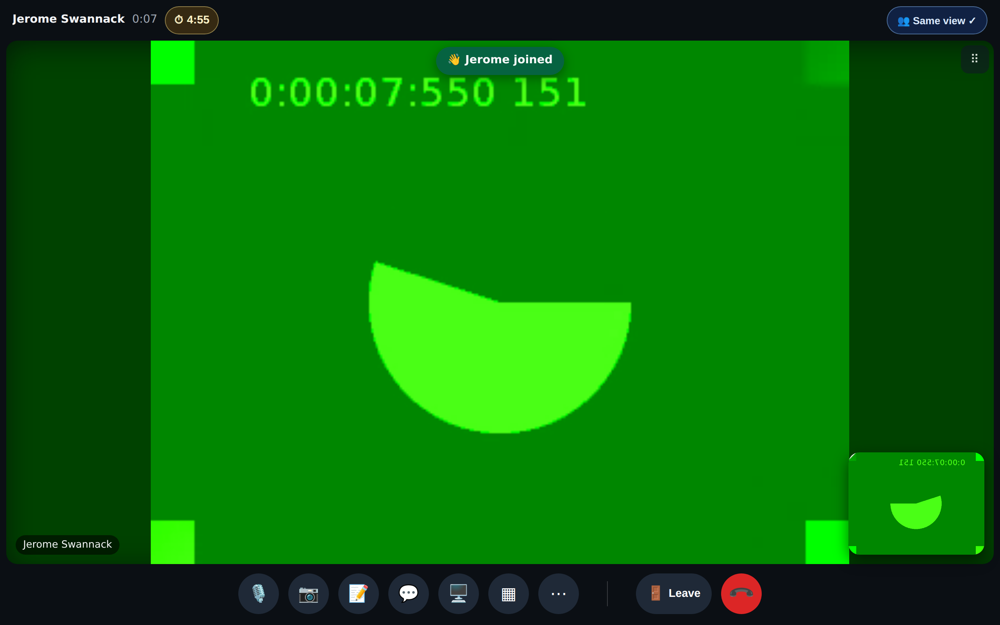
Tutor, desktop: the ⏱ 4:55 pill in the top bar and the "👋 Jerome joined" toast. A soft chime plays with the toast.

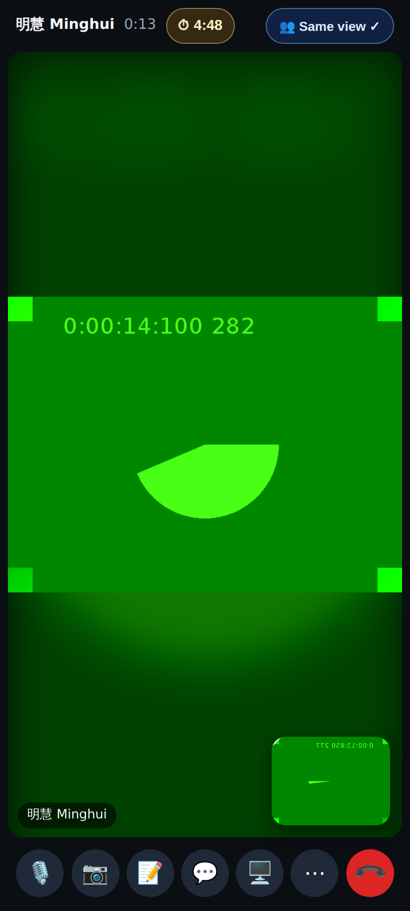
Student, phone: the same countdown, kept in step through room time.

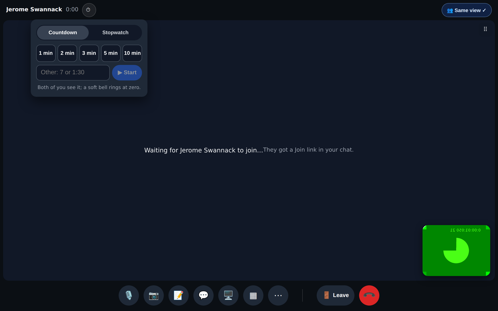
Tutor: Countdown or Stopwatch, presets for 1 / 2 / 3 / 5 / 10 min, or a typed length ("7", "1:30").

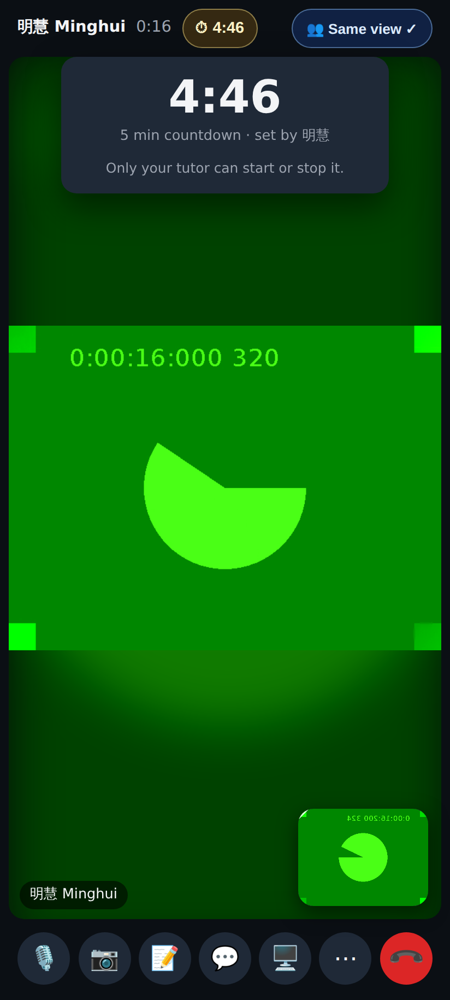
Student: the panel is read-only and says "set by 明慧" and "Only your tutor can start or stop it".

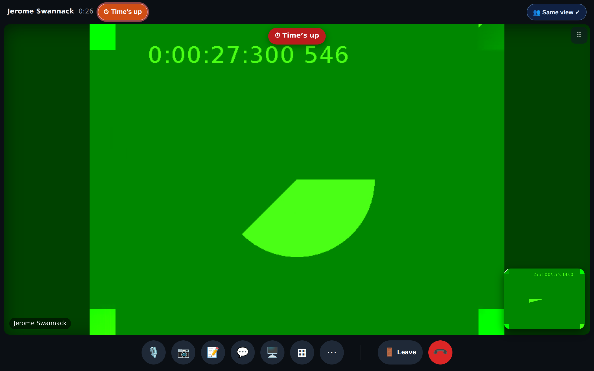
At zero: the pill reads "Time's up" and flashes, a "⏱ Time's up" toast shows and a soft bell plays, once per run.

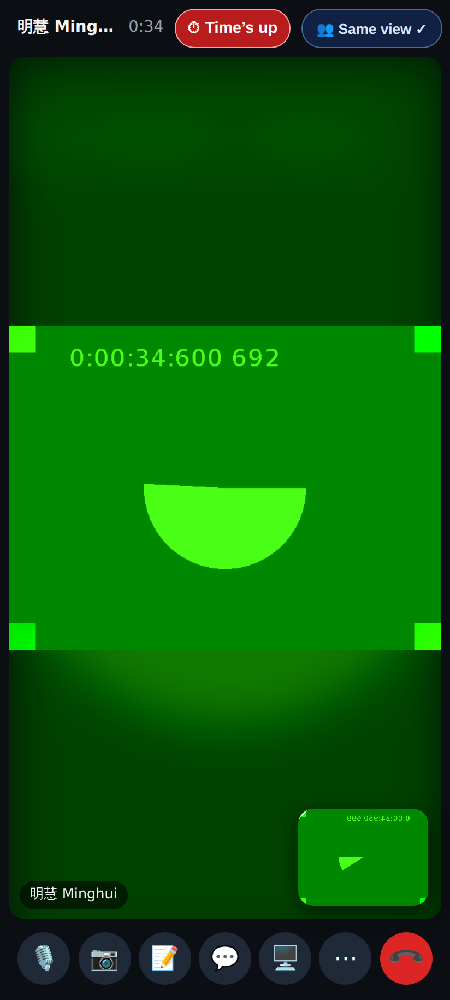
Student, phone: "Time's up" appears at the same moment.

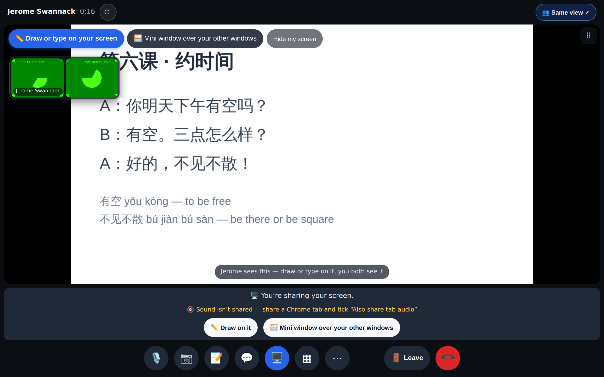
The sharer's own tab is now on her stage, with **✏️ Draw or type on your screen**, **🪟 Mini window** and **Hide my screen**.

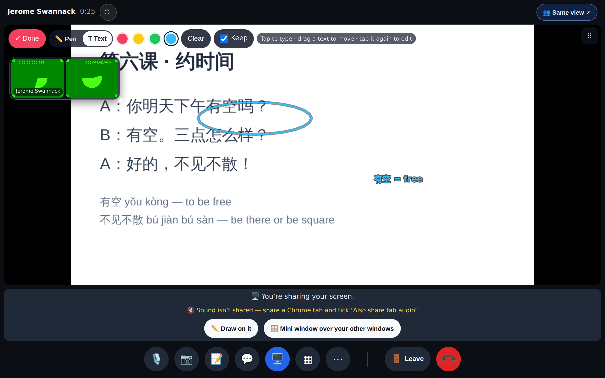
She circles a word and types "有空 = free" on her share.

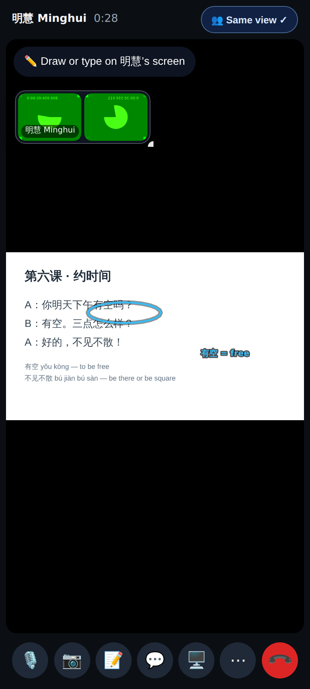
Student, phone: he sees the circle and the text on her shared screen.

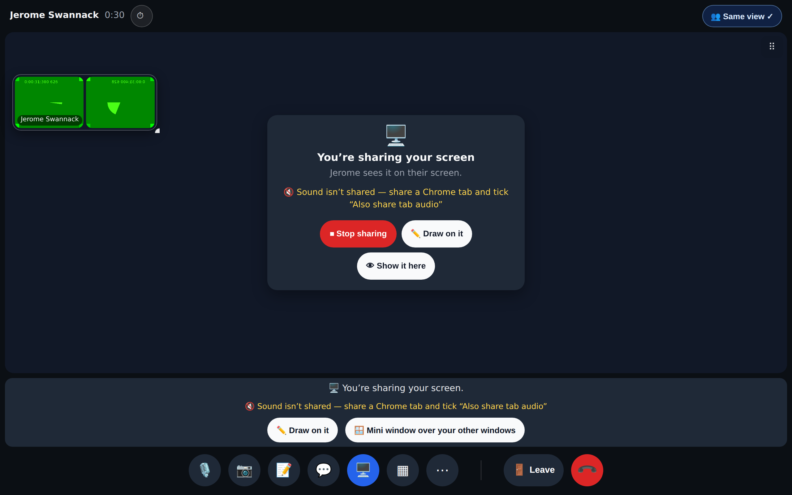
After Hide my screen: the compact card from round 6, with 👁 Show it here.

⋯ menu: ⏱ Timer (tutor only) and 🔔 Call sounds: on / off (per device).

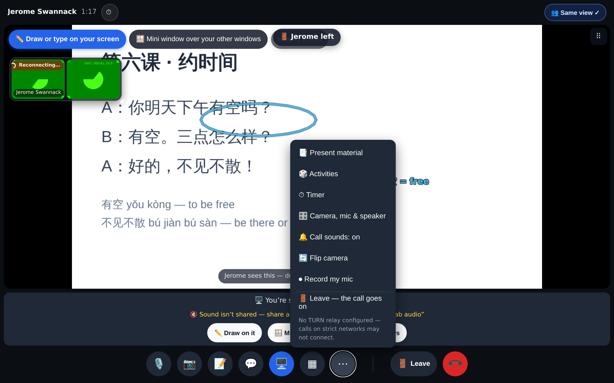
"🚪 Jerome left" shows 8 s after he leaves, so a reconnect stays silent.
