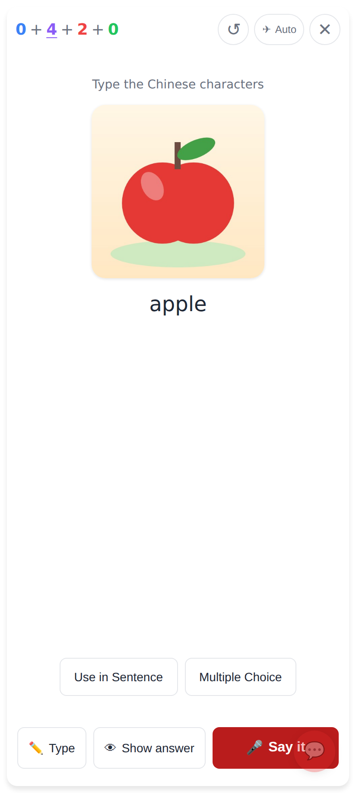
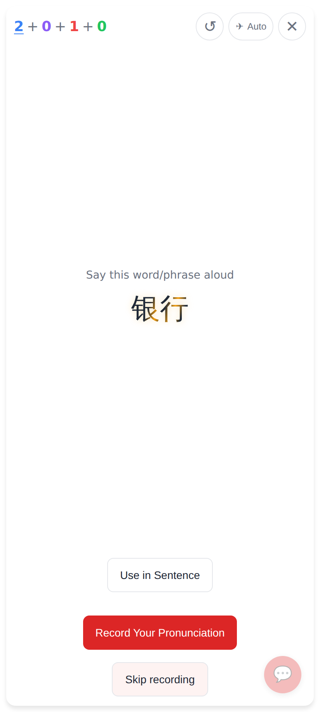
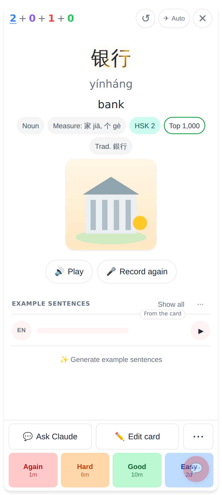
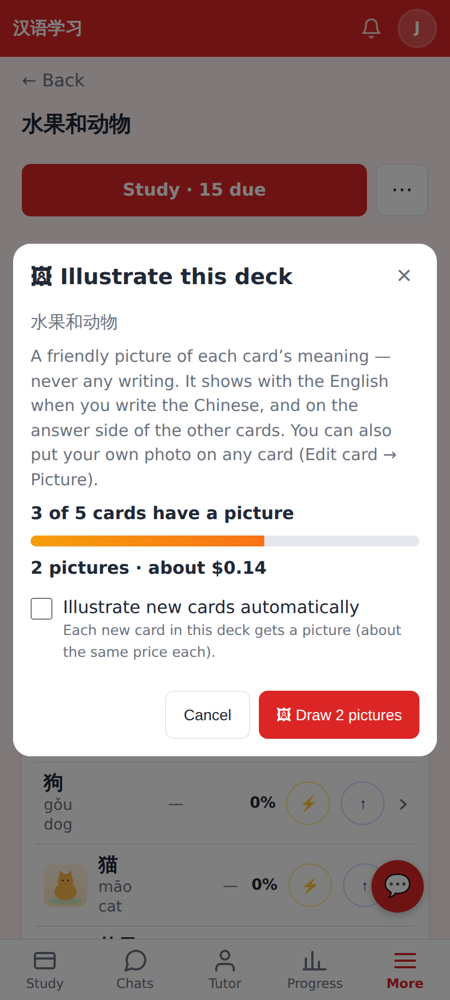
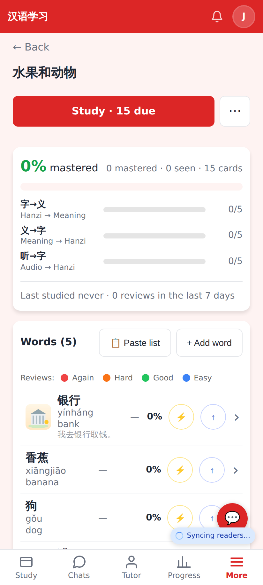
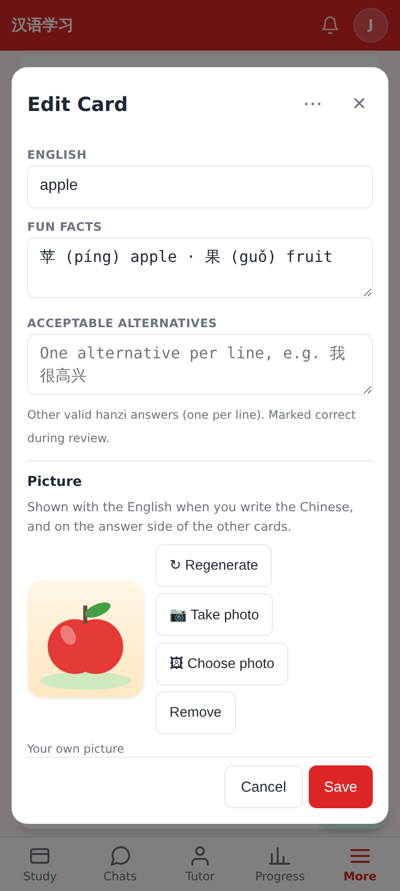
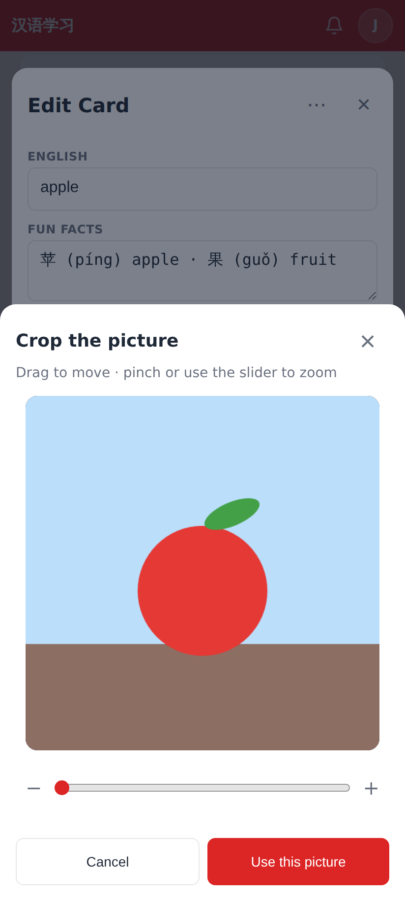

# Pictures on cards — screenshots

Phone viewport (412×915, 2×). The pictures here are drawn stand-ins uploaded through the real upload path (a generated picture shows the same way).

## Web

Meaning → hanzi: the picture is part of the clue, with the English.

Hanzi → meaning, question side: no picture (it would give the meaning away).

Hanzi → meaning, answer side: the picture under the meaning and word tags, a modest size so Play / Record again and the ratings stay on screen.

Deck ⋯ → 🖼 Illustrate this deck: progress, the cost before anything is drawn, the "Illustrate new cards automatically" switch.

Deck page: a thumbnail on rows that have a picture.

Edit card → Picture: ↻ Regenerate, 📷 Take photo, 🖼 Choose photo, Remove (saved at once).

Choose photo → square crop (resized to ≤ 800 px JPEG on the device).
