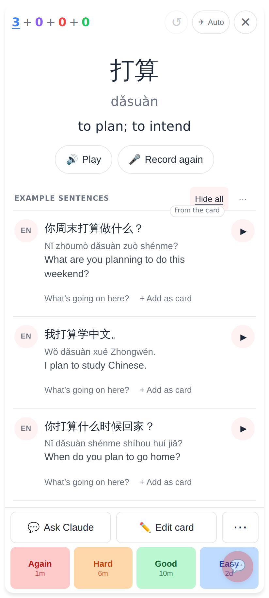
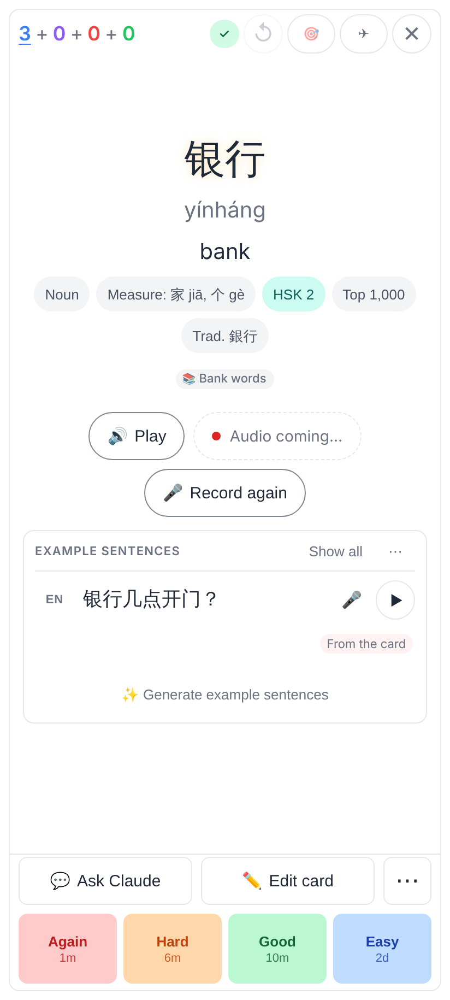
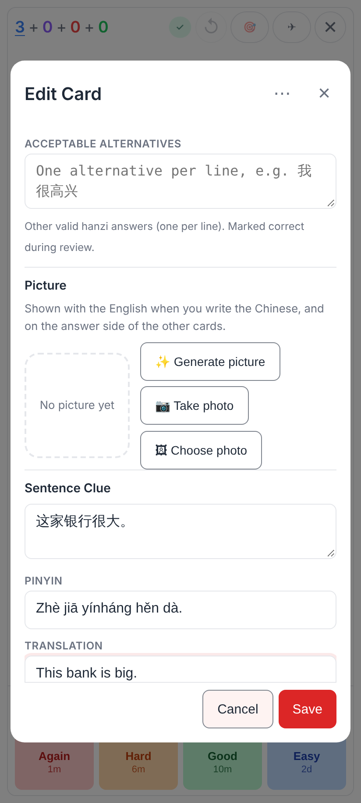
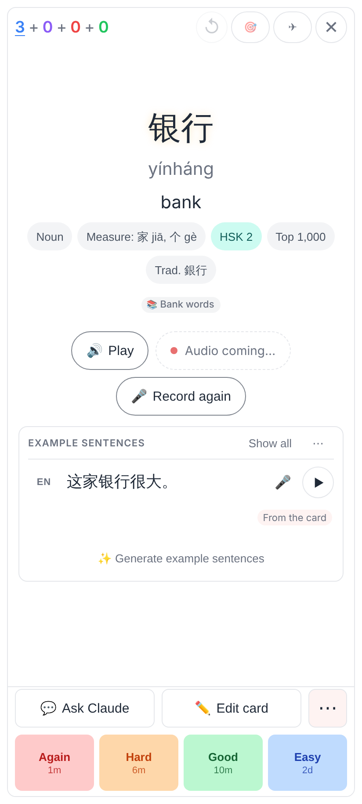
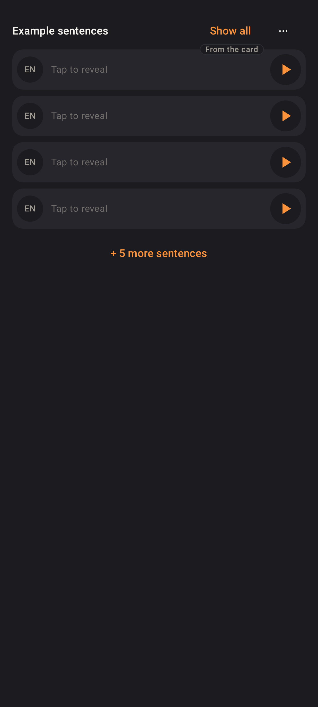
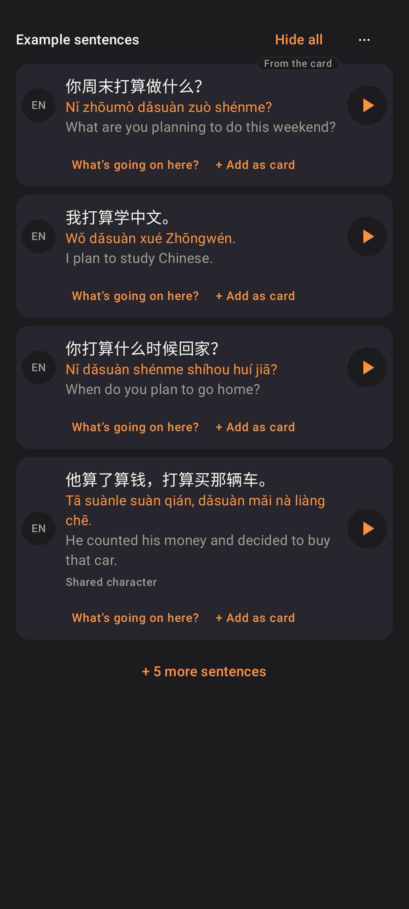

# The card sentence is a sentence row

Phone viewport 412×915 @2×. The point of this change is that nothing looks different: the card's own sentence
is still row 1 with "From the card". What changed is underneath. The row is now a real `note_sentences` row
(`<note>-card`, `is_card = 1`), not a row made up from the note's fields.

## Web (light)

Before: row 1 was made from the note's `sentence_clue` fields, beside the set.

After: row 1 is the note's card row (`<note>-card`), drawn from `is_card`. This note has no generated set yet.

Edit card: the card sentence is still edited here. Saving writes the note fields, and the worker moves the row with them.

After saving, row 1 shows the new sentence straight away and the old one is gone. The e2e test
`card-sentence-row.spec.ts` checks that the server's row matches too.

## Lab (dark)

The Lab draws the row exactly as before (`SentenceRowsLayoutTest`, unchanged). These two shots are from that
test on main. This container could not re-render them: the app module's Roborazzi build runs out of memory here.
The Android Lab Build CI job runs the same test against this branch.

