# Compact Ask Claude card sheet

Jerome's feedback (Nov 2026) on the study card's Ask Claude sheet. Web at 412×915 @2× (touch phone emulation),
Lab app via Roborazzi.

## Before (Jerome's screenshots, Lab, dark)

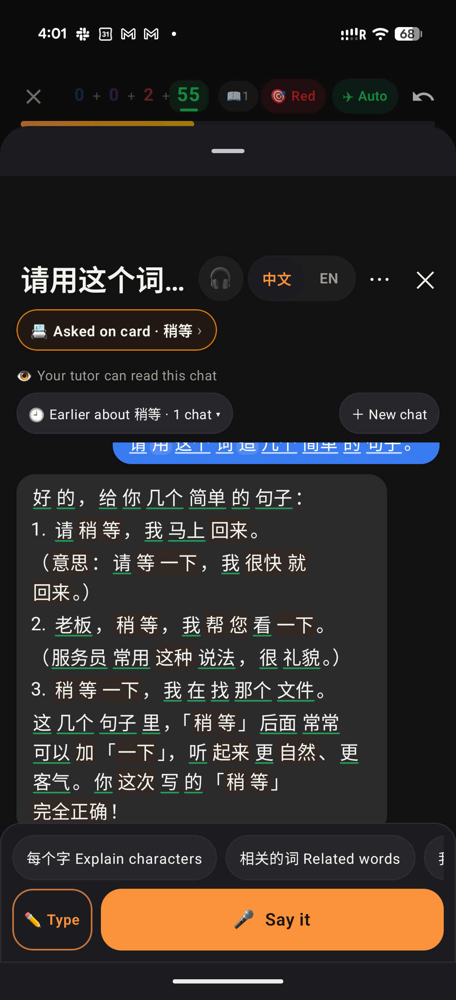
The big blank band under the grab handle, ✕, "Asked on card", "Your tutor can read this chat", the Earlier / New chat row, chips after messages.

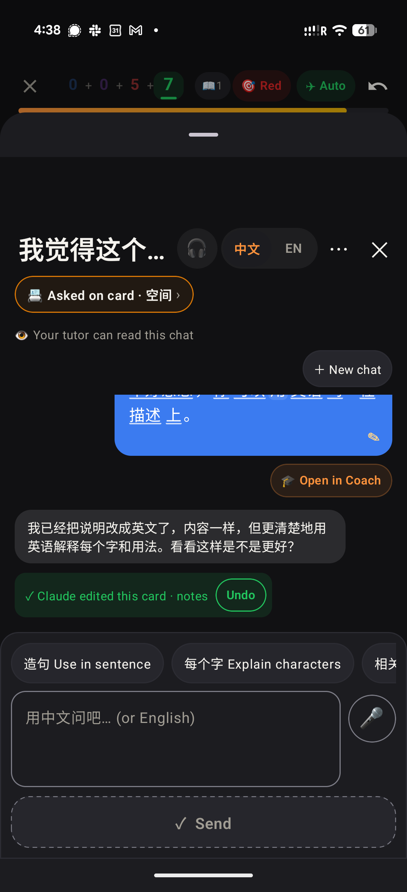
The second reply (asked for English, written in Chinese, with a card edit) had no word chips; the typed composer was a 3-line box + 🎤 + a full-width "✓ Send".

## Web

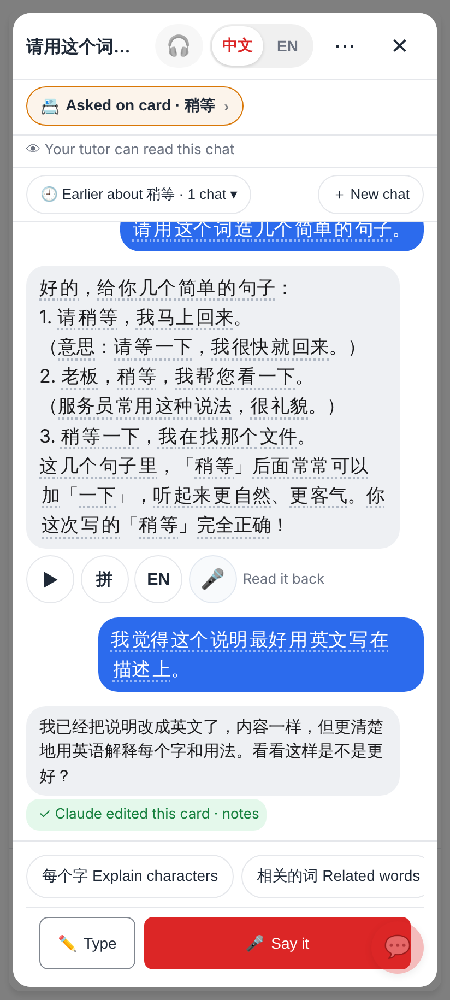
Before: chip / tutor line / Earlier row on top, the second reply is plain text (no chips, no ▶ 拼 EN 🎤), chips above Type · Say it.

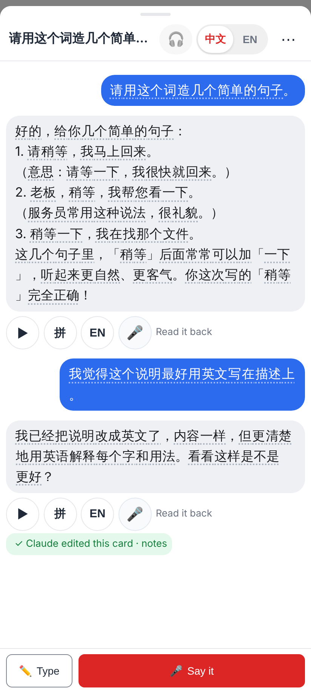
After: near full height, grab handle, one header row; Claude's replies full width; the second reply is word chips with its tools; no chips once the chat started.

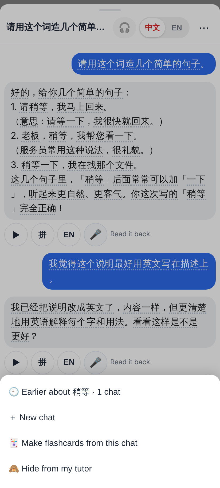
⋯ now holds 🕘 Earlier about 稍等 · 1 chat and ＋ New chat (plus Make flashcards, Hide from my tutor).

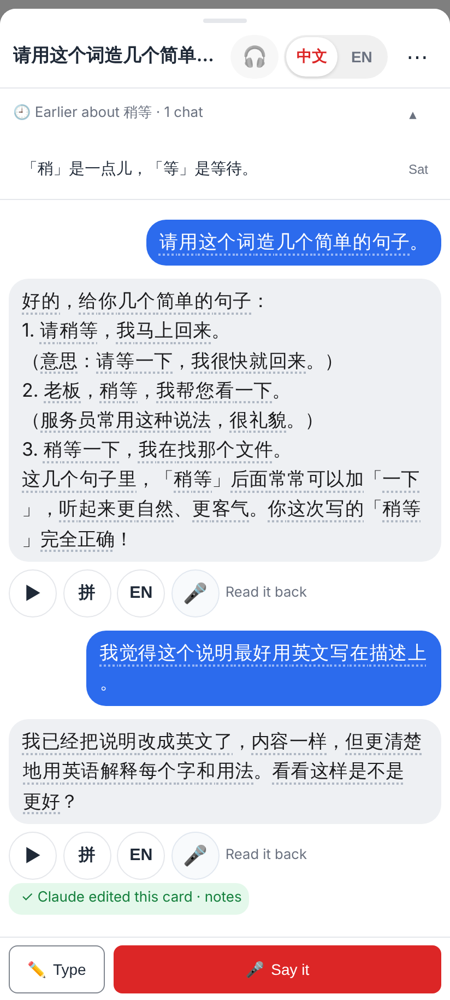
⋯ → Earlier opens the list under the header (▴ hides it).

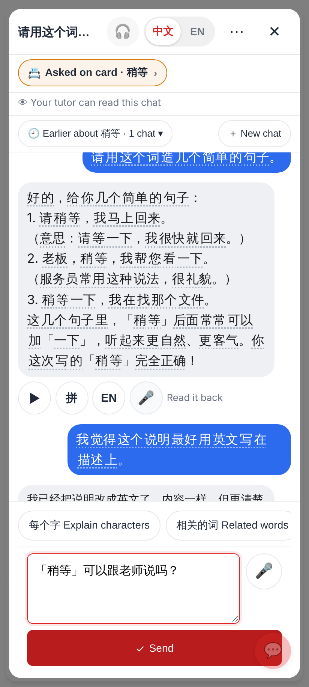
Before: typing = a 3-line box, 🎤, and a full-width ✓ Send under it.

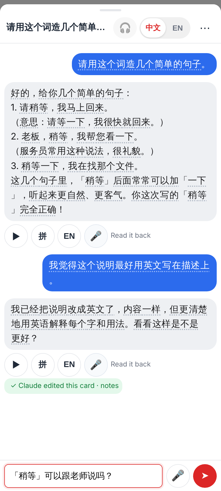
After: typing is one row — box (grows 1 → 4 lines) · 🎤 · ➤.

## Lab (Roborazzi)

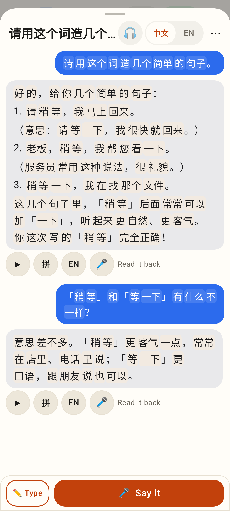
The 稍等 answer in the compact sheet, light.

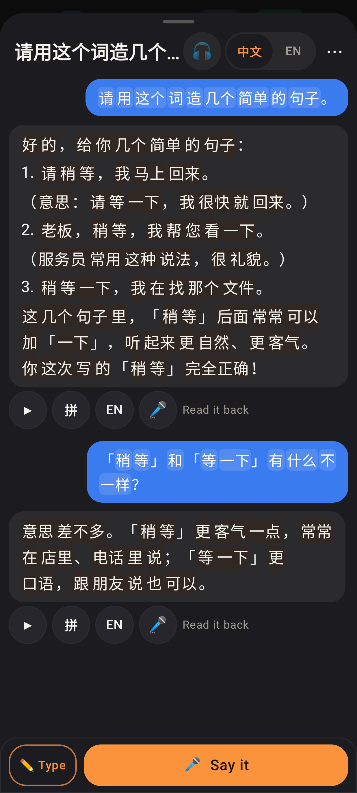
The same, dark.

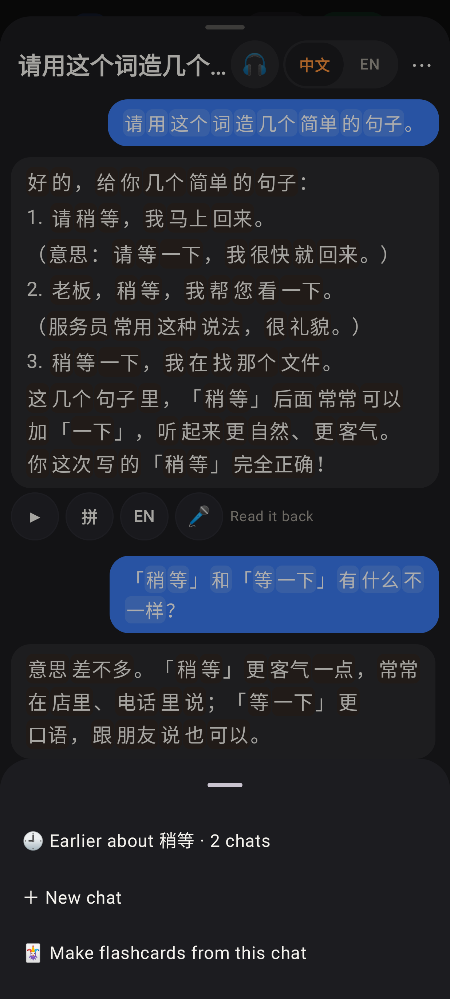
⋯ with Earlier / New chat first.

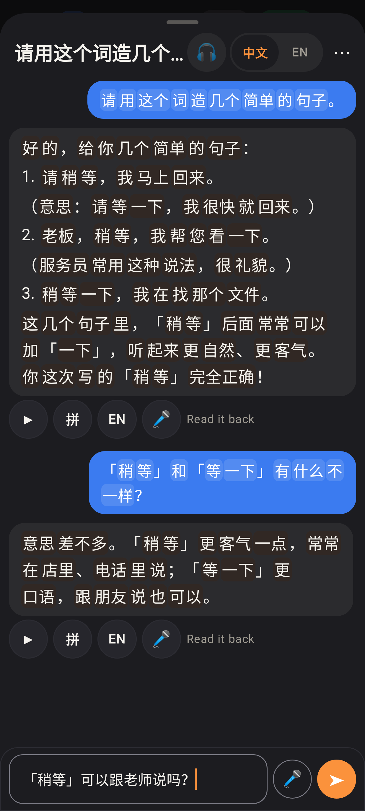
The one-row typed composer.

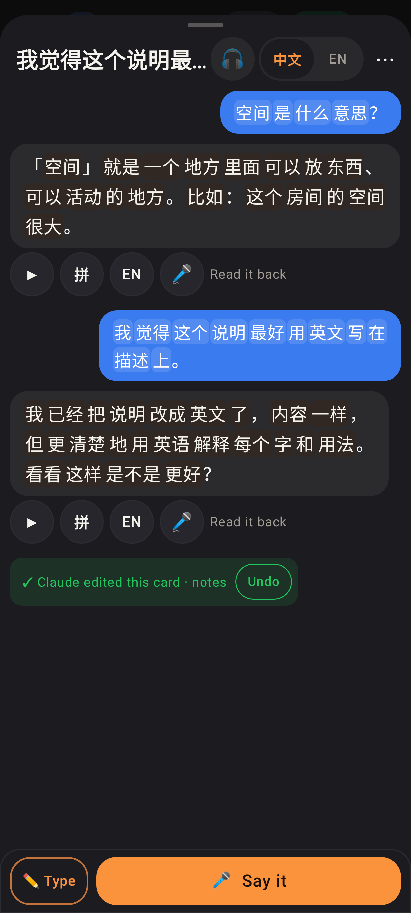
The reply after the card edit is word chips with ▶ 拼 EN 🎤.

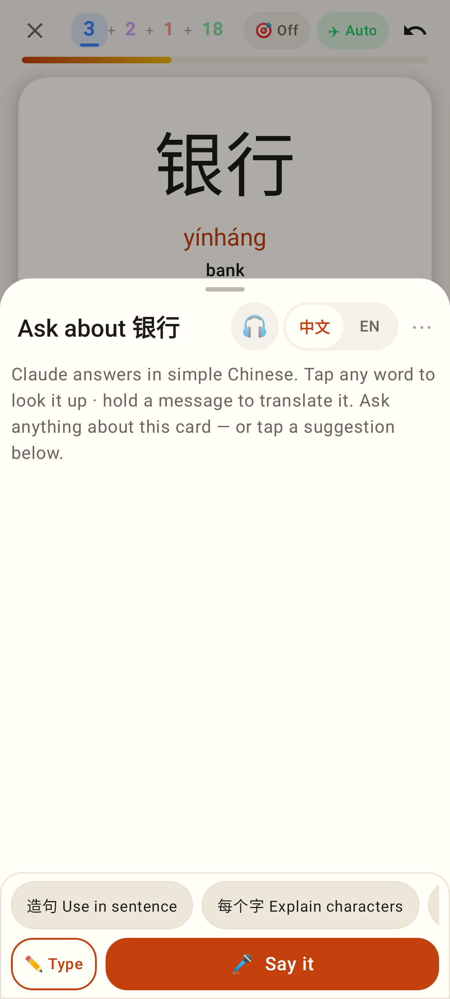
A new chat: the card's chips (only before the first message).
