# Word tags on the answer side — screenshots

Phone viewport (412×915 at 2×; Pixel Fold folded). Web = the PWA, Lab = the native app (Roborazzi).

## Web

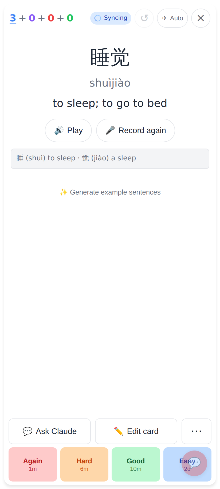
Before (or with Settings → Study → "Word tags on the answer" off): hanzi · pinyin · meaning.

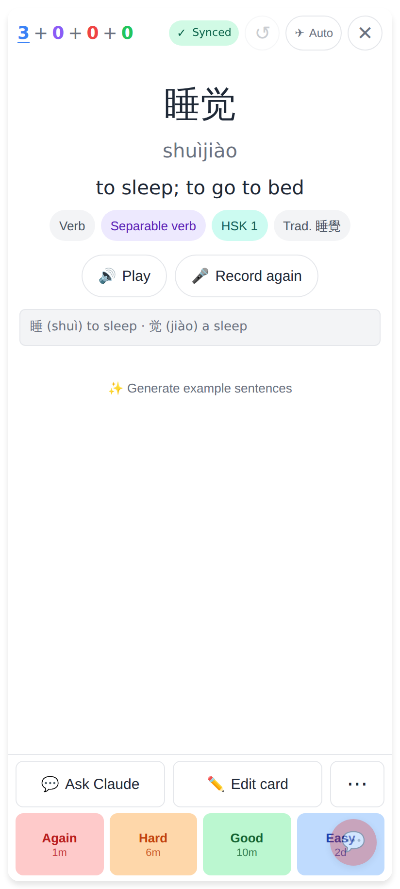
After: 睡觉 — Verb · Separable verb · HSK 1 · Trad. 睡覺 under the meaning.

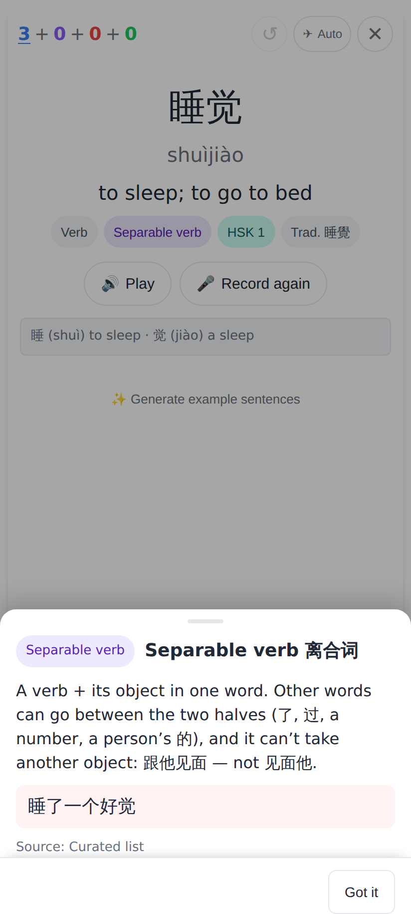
Tap "Separable verb": what it means, the split example 睡了一个好觉, the source.

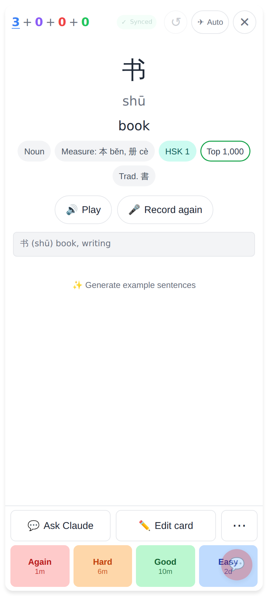
书 — Noun · Measure: 本 běn, 册 cè · HSK 1 · Top 1,000 (the explorer's green decal) · Trad. 書.

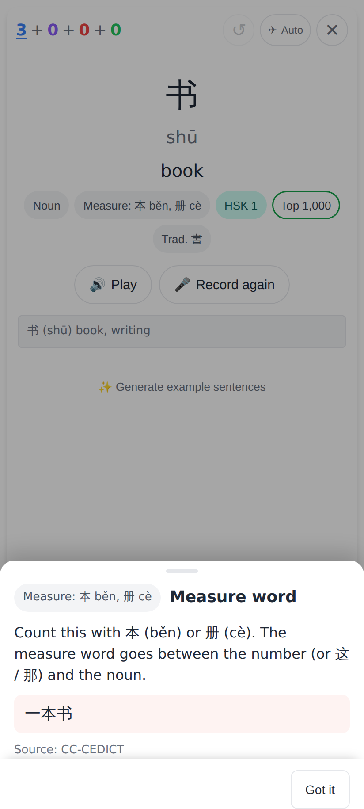
Tap the measure word: "Count this with 本 (běn) or 册 (cè)", example 一本书.

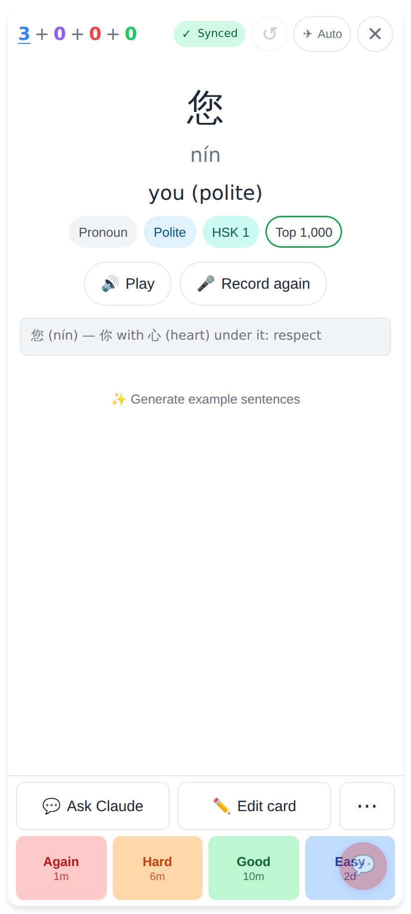
您 — Pronoun · Polite · HSK 1.

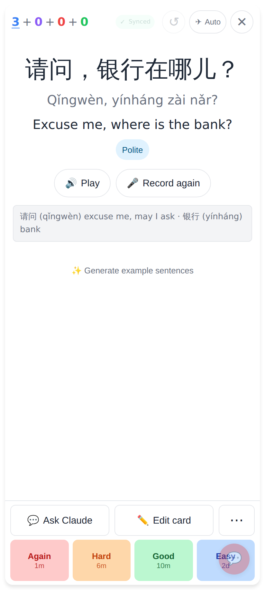
A sentence card gets only what applies: 请问，银行在哪儿？ → Polite.

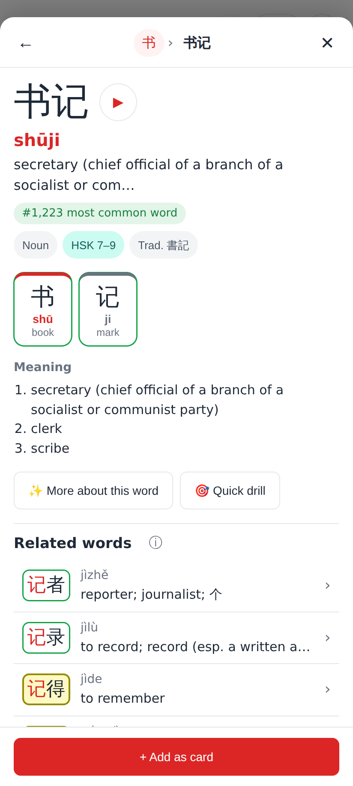
The explorer's Word view (书 › 书记): the same pills under the head, minus "how common" (its own chip).

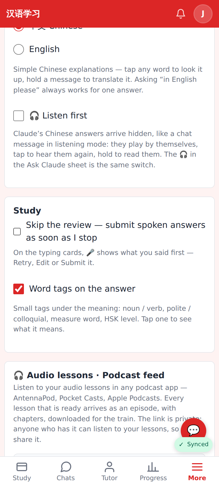
Settings → Study → "Word tags on the answer" (on by default).

## Lab app

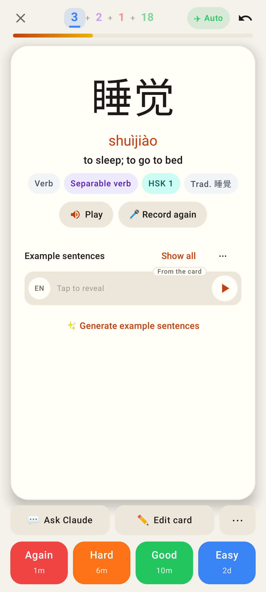
Answer side, light.

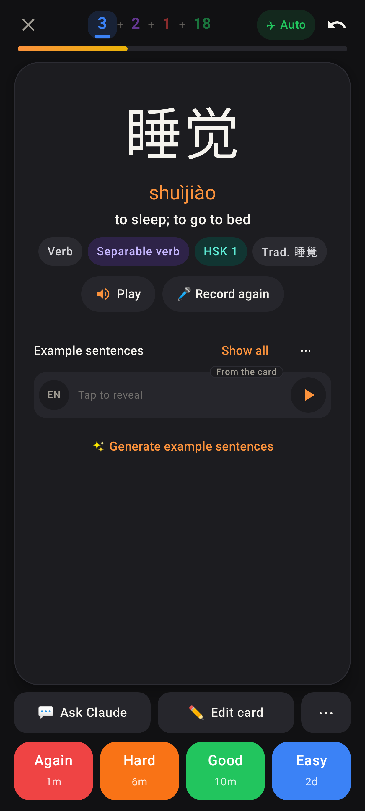
Answer side, dark.

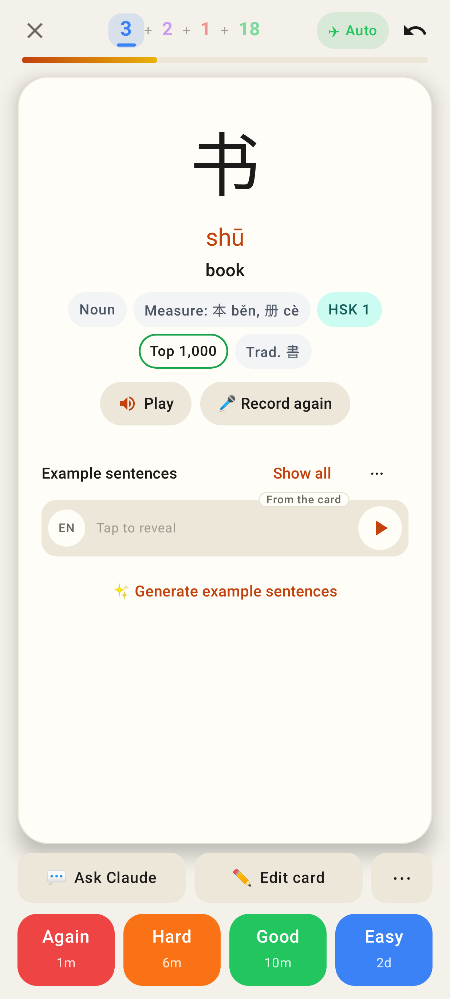
书 with its measure words and the Top 1,000 decal.

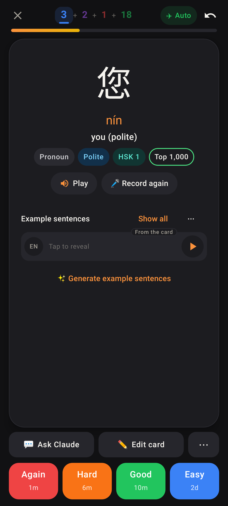
您 — Polite, dark.

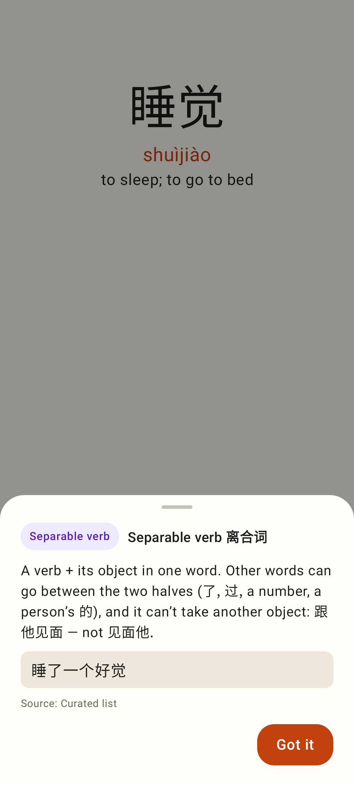
The explanation sheet (separable verb), light.

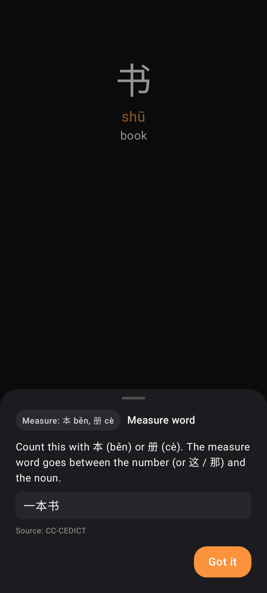
The explanation sheet (measure word), dark.

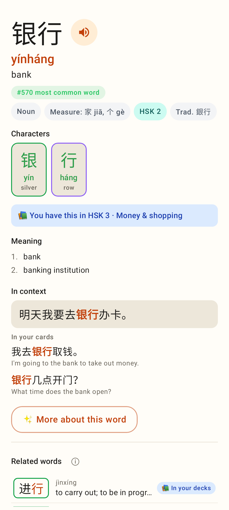
The explorer's Word view (银行): Noun · Measure: 家 jiā, 个 gè · HSK 2 · Trad. 銀行.

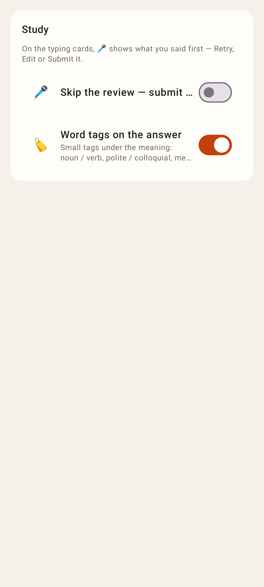
Settings → Study, light.

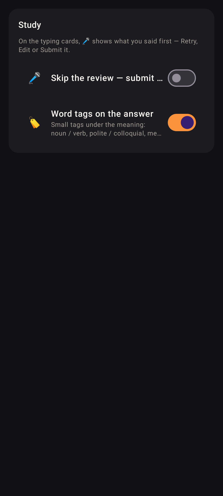
Settings → Study, dark.
