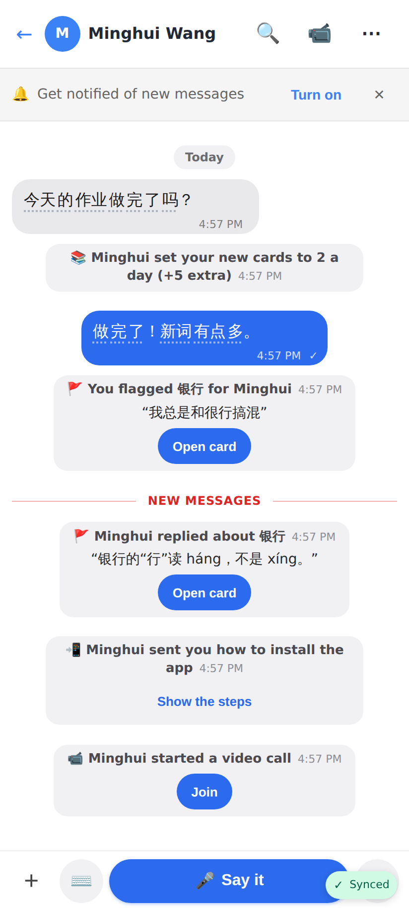
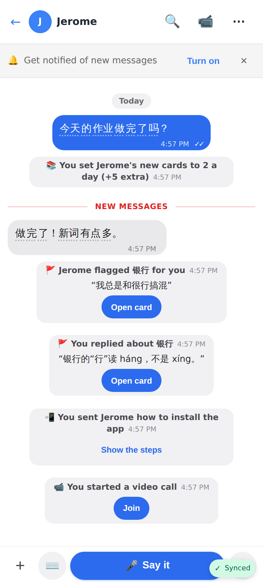
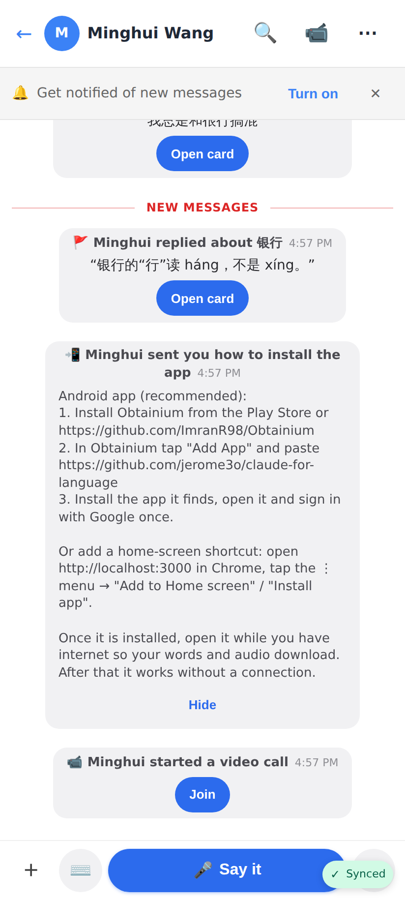
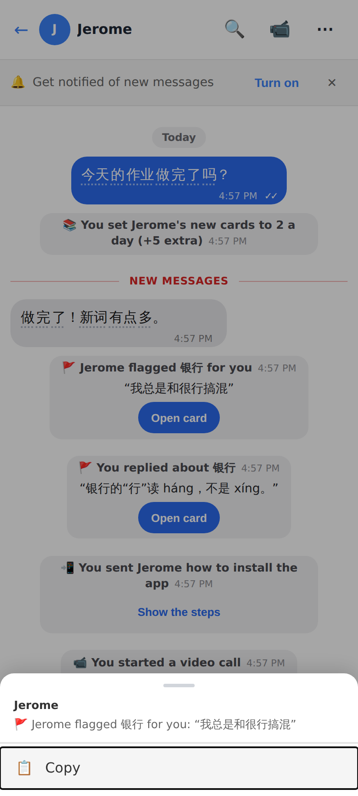
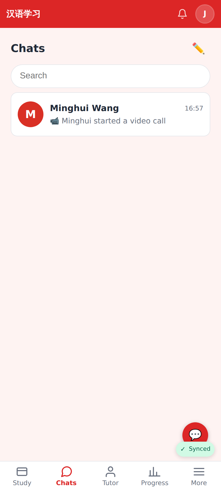
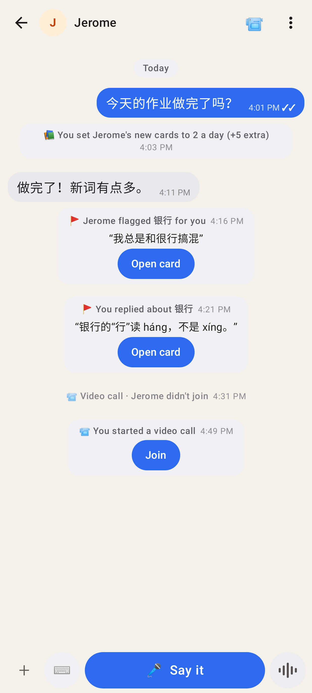

# Chat system messages (docs/CHAT.md "System messages")

Lines the app posts on someone's behalf are centred, muted rows in the third person, read from each side.

Web, the student: "Minghui set your new cards to 2 a day (+5 extra)", the flag / reply with Open card, the how-to, the live call with Join.

Web, the same chat from the tutor's side: "You set Jerome's new cards…", "Jerome flagged 银行 for you".

The install how-to with its steps folded open.

Long-press / right-click on a system row: Copy only, no reactions.

The Chats inbox preview reads it from my side (no "You: …", no "I").

Lab app, the student (incl. a missed call).

Lab app, the tutor ("Video call · Jerome didn't join").

Lab app, dark theme.
