# Chats tab — compact (PR screenshots)

Jerome: "The vertical space is too much; compress things down."

## Before

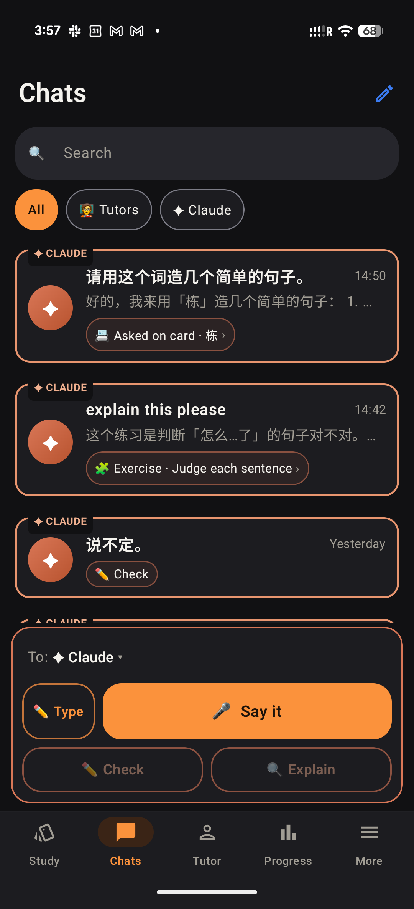
Lab app before (Jerome's own screenshot): outlined cards with "✦ CLAUDE" labels, previews, context pills, filter chips, "To: ✦ Claude" and Check / Explain always showing.

Web before, same data.

## After — web (412×915 @2×)

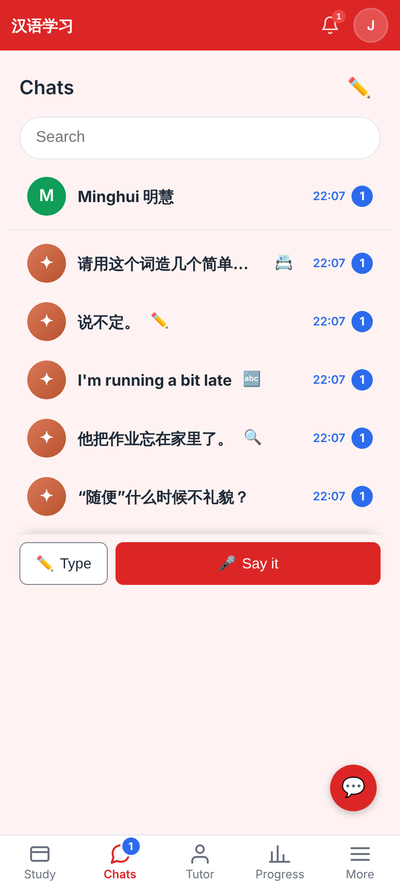
One-line rows (~60px): Minghui first, a thin divider, then the Claude chats with ONE context emoji each. No previews, no outlines, no filter chips; the box is one row (Type · Say it).

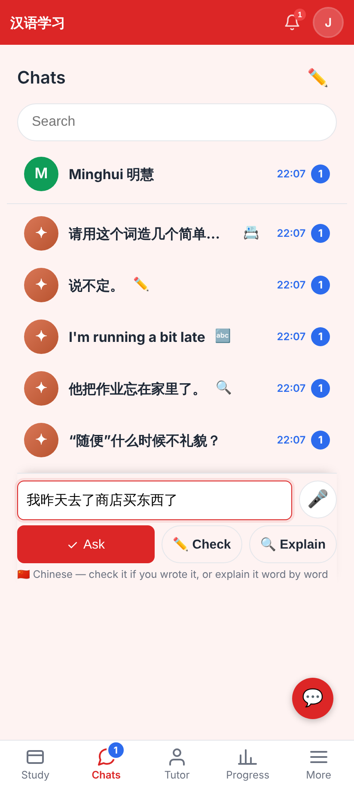
Typed Chinese: Check and Explain appear beside Ask — only now that there is text.

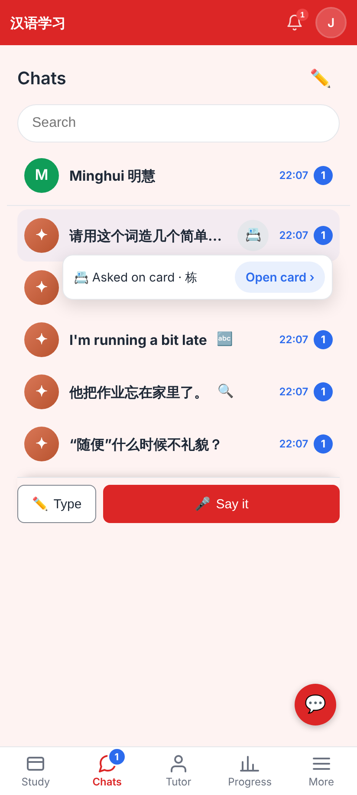
Tapping 📇 opens a small popover: "Asked on card · 栋" + "Open card ›".

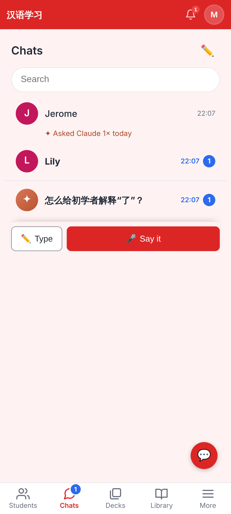
The tutor's view: the same layout — students, the divider, her Claude chats.

## After — Lab app (Roborazzi, light + dark)

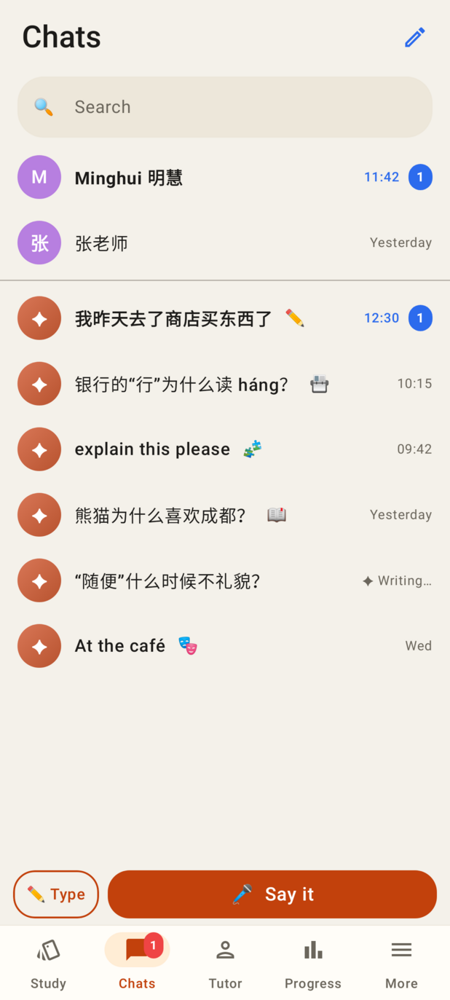
People first, divider, Claude chats (📇 card, 🧩 exercise, 📖 reader, ✏️ check, 🎭 practice); "✦ Writing…" where the time goes.

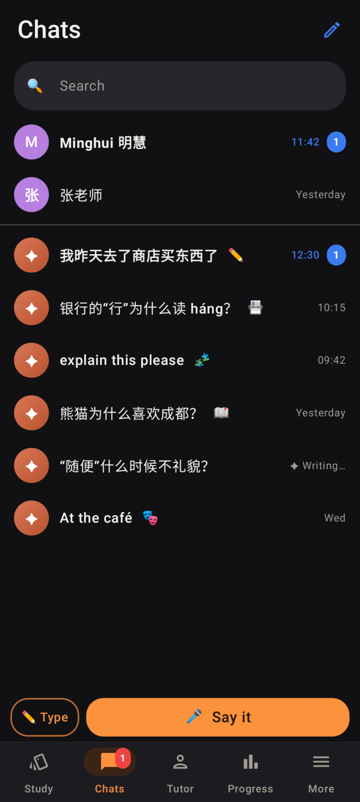
The same in dark mode — no orange outlines.

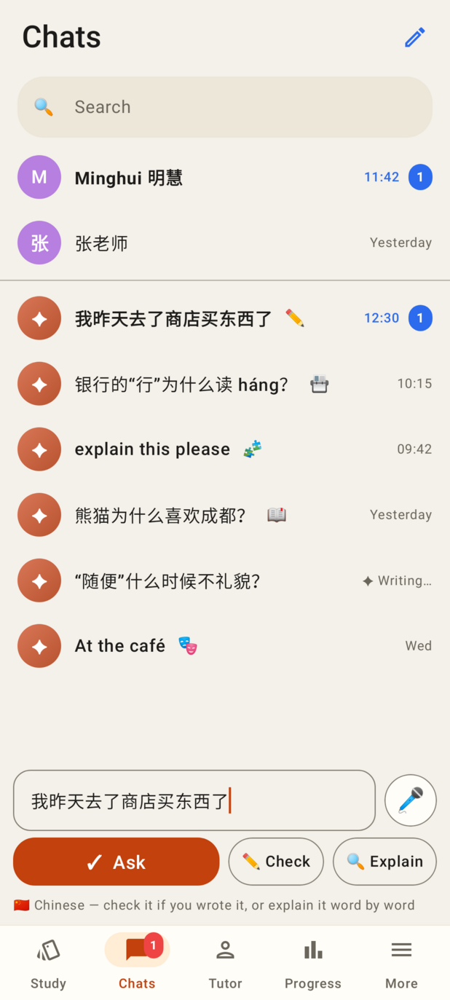
Typed Chinese: Ask · Check · Explain in one row.

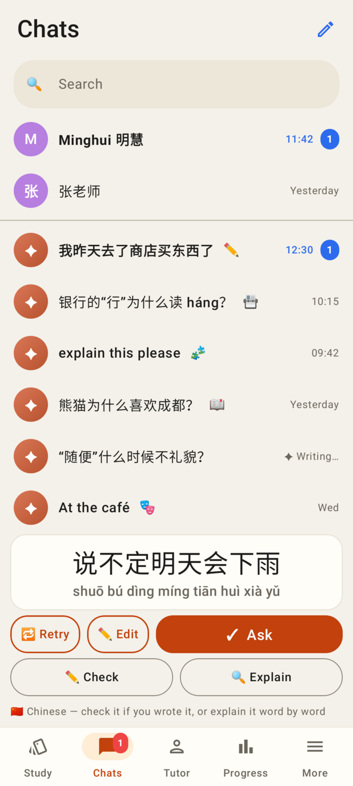
A finished take under review: Check · Explain appear under it.

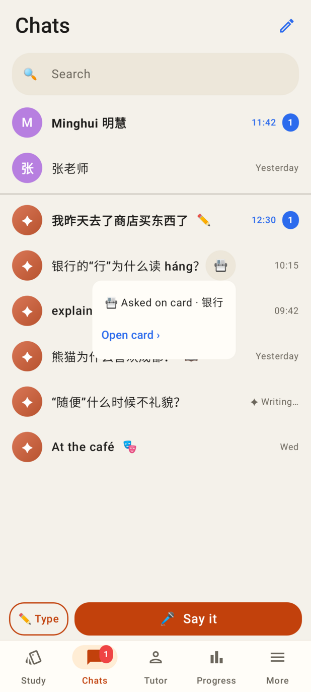
The 📇 emoji's popover with "Open card ›".

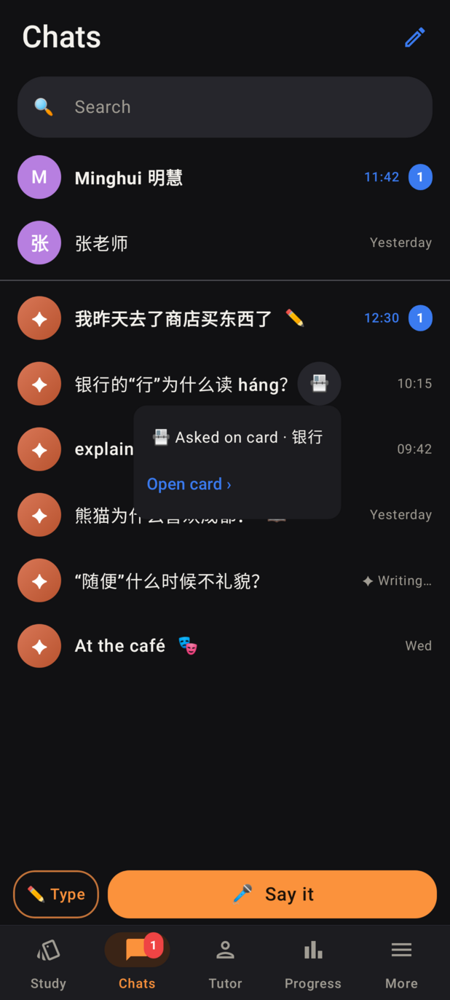
The popover in dark mode.

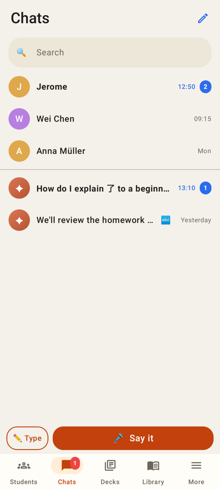
The tutor's view: students, the divider, her Claude chats (no fold).

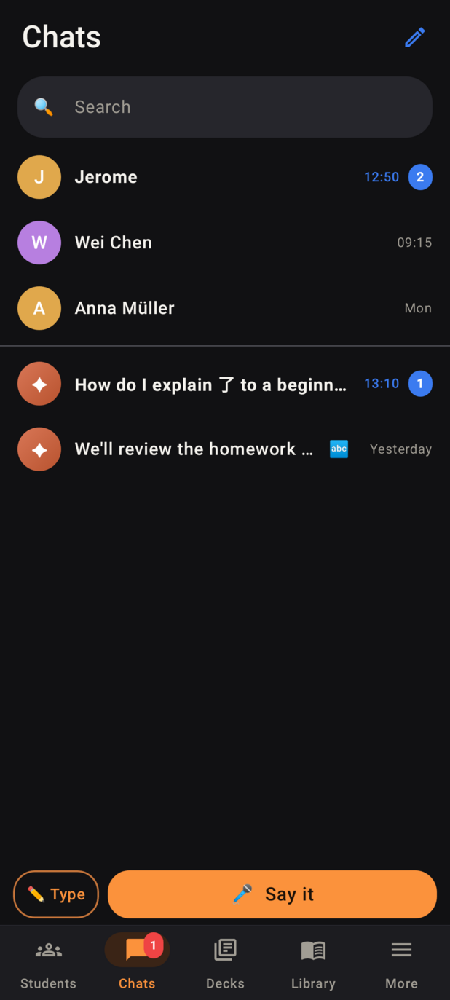
The tutor's view in dark mode.
