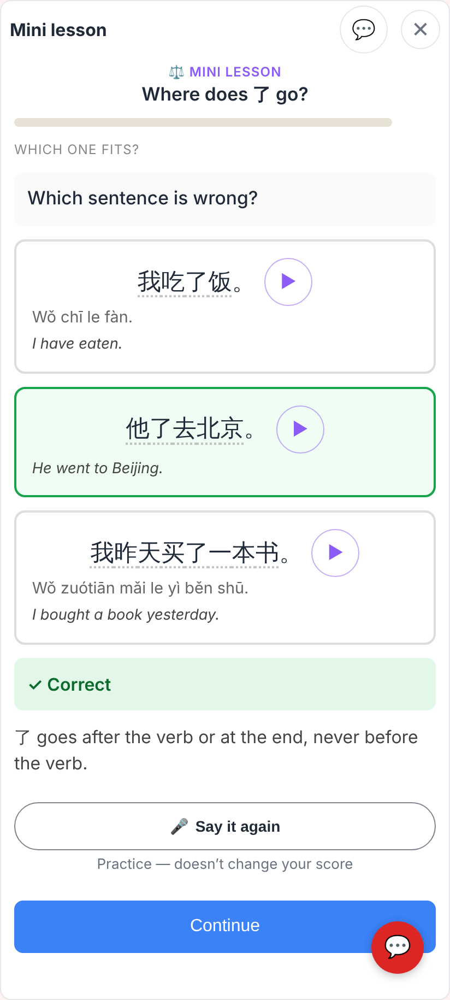
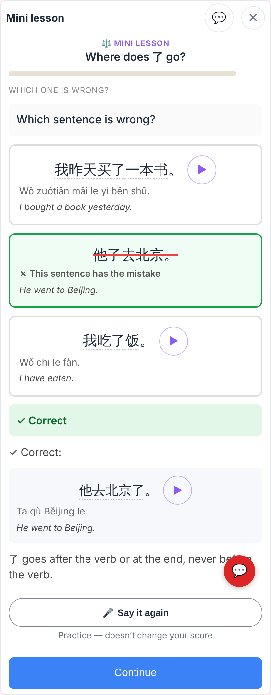
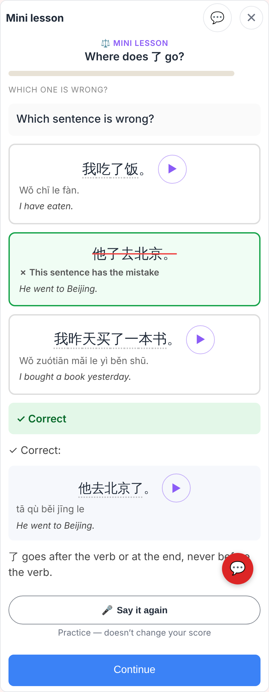
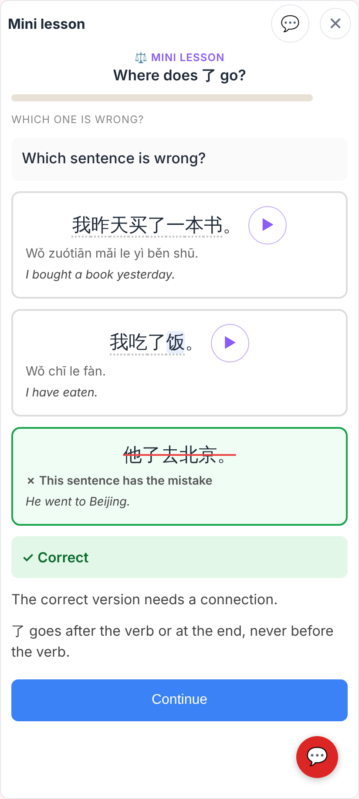
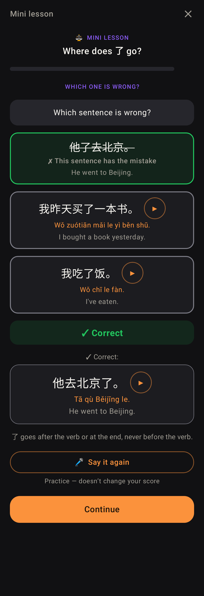
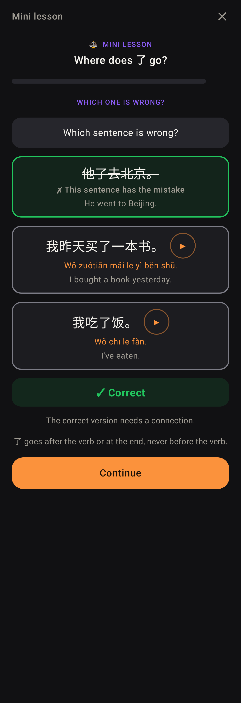

# "Which sentence is wrong?" choices speak the correction

Phone viewport 412×915 @2× (full-page). Web light, Lab dark.

## Web

**Before:** the reveal treats the wrong sentence as the model answer. It has a ▶, and the pick plus the prefetch spoke `他了去北京。`.

**After, with a lesson `correction`:** the mistake is struck through, says "✗ This sentence has the mistake", and has no ▶. "✓ Correct:" shows `他去北京了。` with ▶, and that is the sentence spoken.

**After, older lesson:** the correction comes from `POST /api/lessons/choice-correction` (the E2E stand-in model).

**After, no connection:** "The correct version needs a connection." No ▶ and nothing spoken for the mistake.

## Lab app

**With the correction:** struck mistake without ▶, then "✓ Correct:" with ▶.

**Offline, older lesson:**

