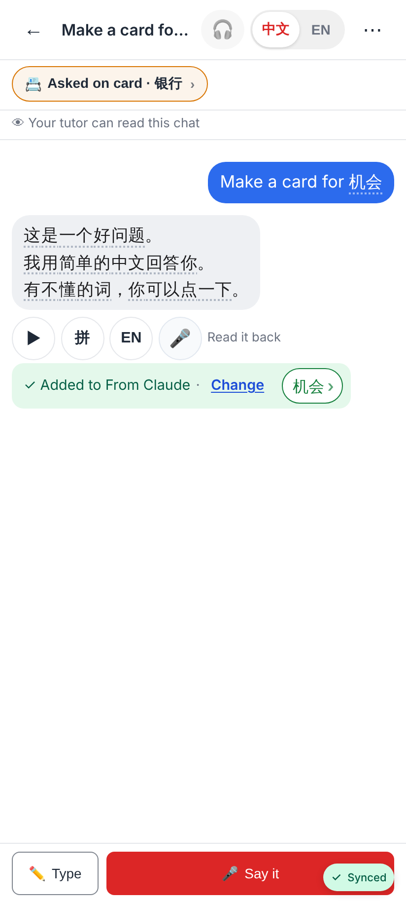
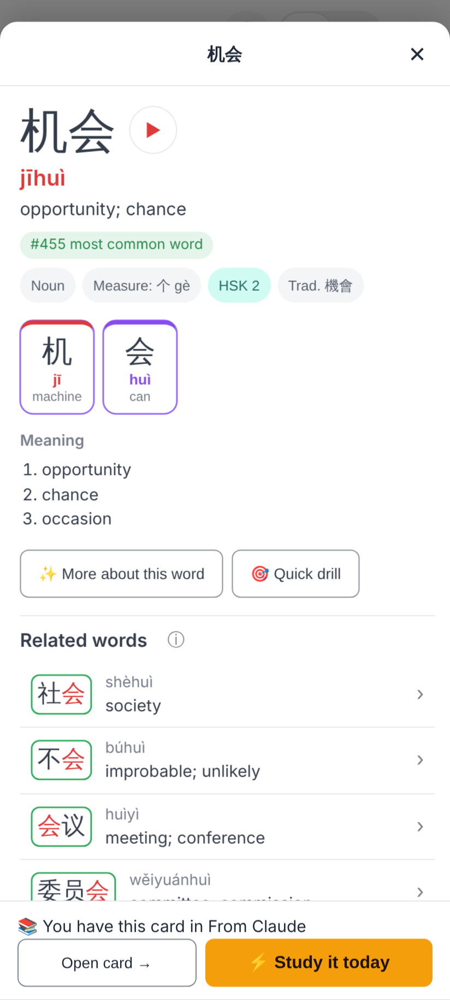
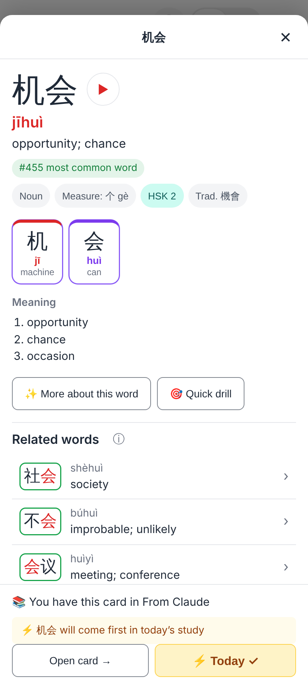
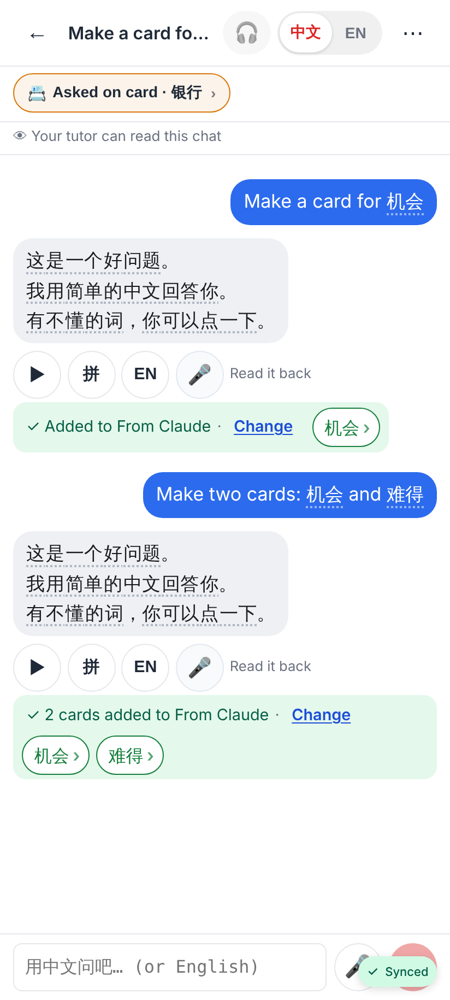
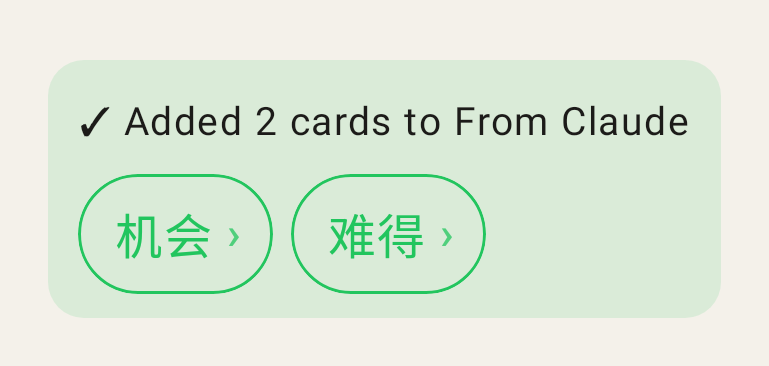

# Cards Claude added → tap a word → the explorer

Phone viewport 412×915 @2× (web, from `e2e/tests/claude-thread.spec.ts` with the E2E stand-in).

"✓ Added to From Claude · Change" with the card's word as a tappable chip (机会 ›).

A tap opens the language explorer's Word view on 机会: "📚 You have this card in From Claude" · Open card · ⚡ Study it today
(before the sync lands it says "✓ Added to From Claude" with the same two buttons — never "+ Add as card").

⚡ Study it today → "⚡ 机会 will come first in today's study", the button reads "⚡ Today ✓".

Several cards: one chip per word on the line, wrapping (机会 › 难得 ›).

Lab app (Roborazzi `claude-added-cards-01`): the same line and chips.
