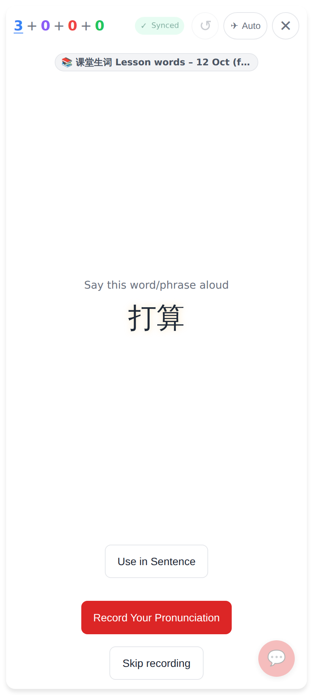
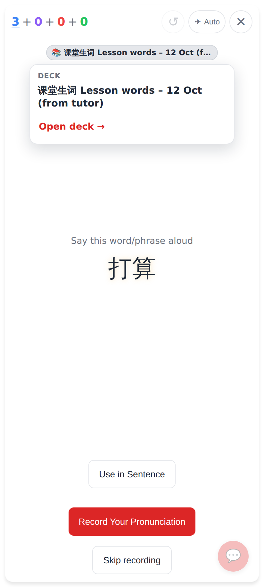
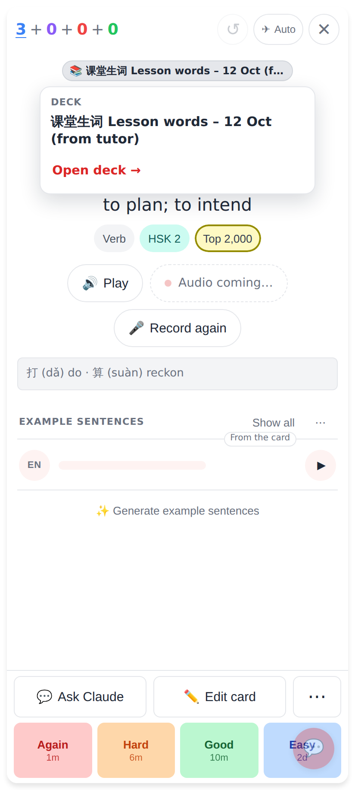
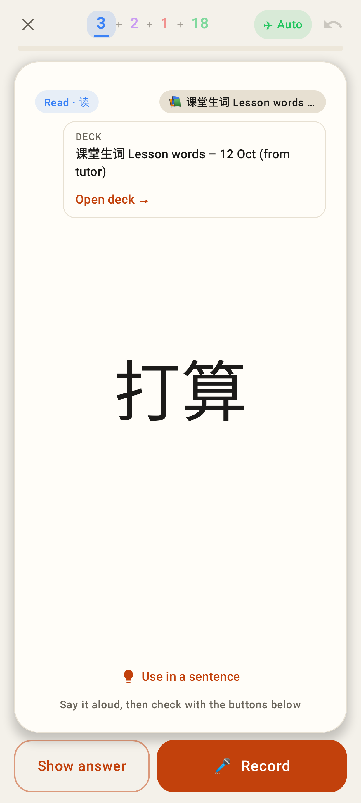
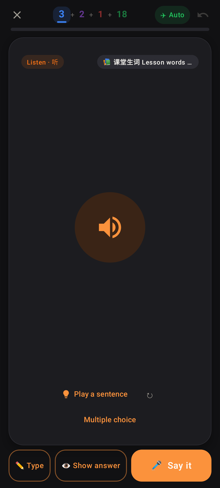

# Deck pill on the study card

Phone viewport (412 × 915, 2×). Deck name: "课堂生词 Lesson words – 12 Oct (from tutor)".

Before: the web card showed no deck name at all, and the Lab card had it as plain grey text at the top right.

Web, question side: 📚 pill under the top bar, one line, ellipsis.

Web, after a tap: the popover with the full name and Open deck →. The card is still on the question.

Web, answer side: a tap on the pill doesn't peek at the question.

Lab: the card-type chip and ⚡ stay whole; the deck pill takes the rest of the row and is cut.

Lab, after a tap: the popup with the full name and Open deck →.

Lab, dark theme.
