# Ask Claude on a card = the card's Claude thread

Web (412×915 @2×, from `e2e/tests/ask-claude-card-thread.spec.ts` with `ASK_CARD_SHOTS`, the worker's E2E stand-in model):

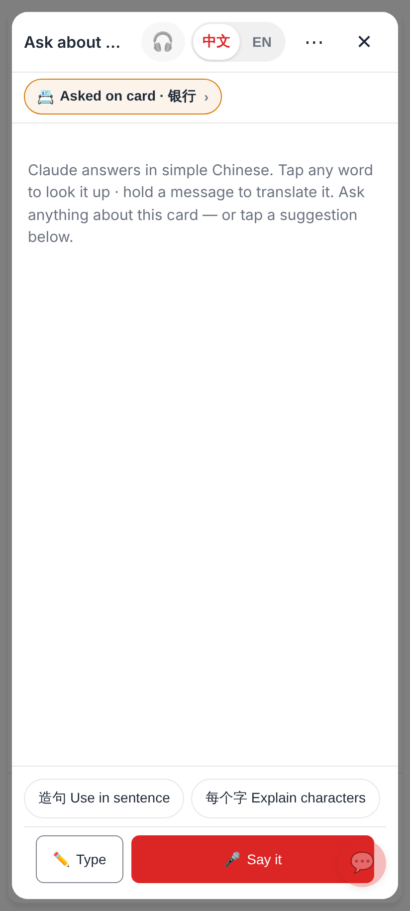
The study card's Ask Claude: the thread view as a sheet — "📇 Asked on card · 银行", 🎧 · 中文 | EN, the card's chips, Ask only (no Check / Explain).

The reply streams in.

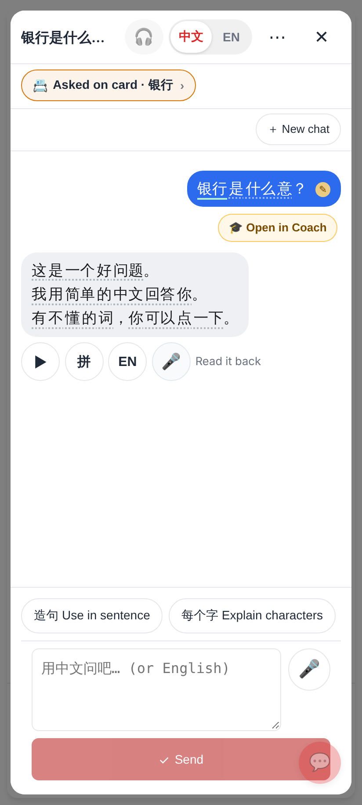
Word chips, ▶ · 拼 · EN · 🎤 Read it back; my Chinese question checked in the background: ✎ + 🎓 Open in Coach.

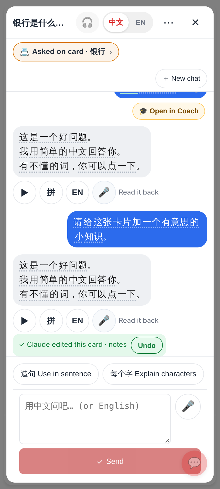
Claude's card tool (the stand-in adds a fun fact): "✓ Claude edited this card · notes  [Undo]" — replaces Approve / Reject; the card back shows the new notes, Undo puts them back.

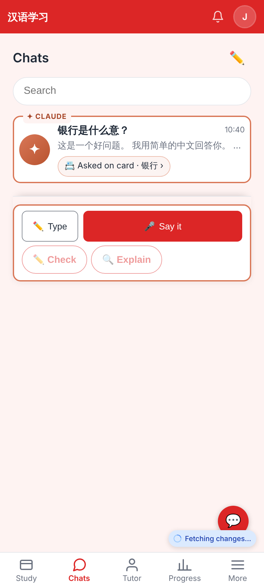
The thread in the Chats tab with "📇 Asked on card · 银行" (the chip opens the card hub).

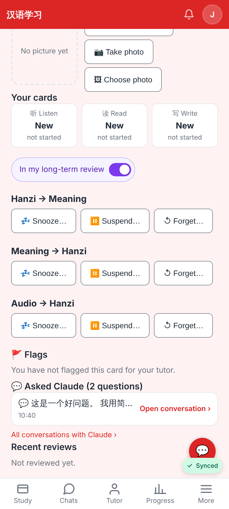
The card hub lists the card's conversations → "Open conversation".

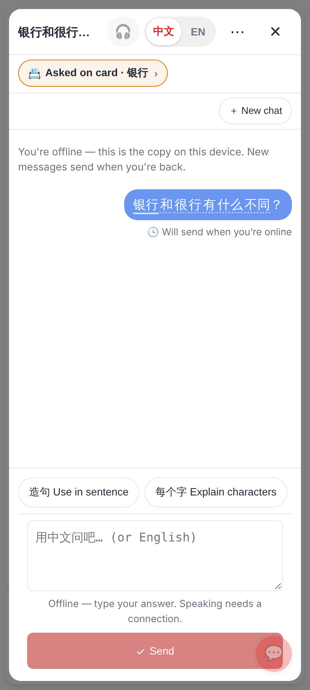
Offline: the question is queued — "🕓 Will send when you're online" — and sent when the connection is back.

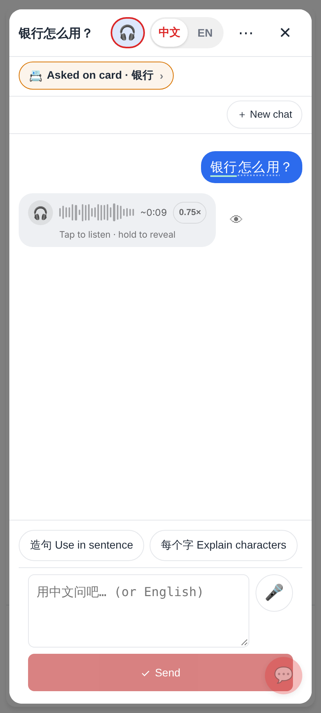
🎧 Listen first: the answer arrives hidden and plays by itself.

Lab app (Roborazzi, `CardClaudeSheetTest`):

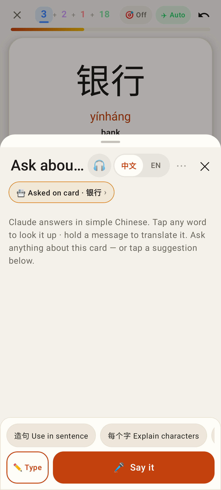
The sheet over the card: chips, Ask only.

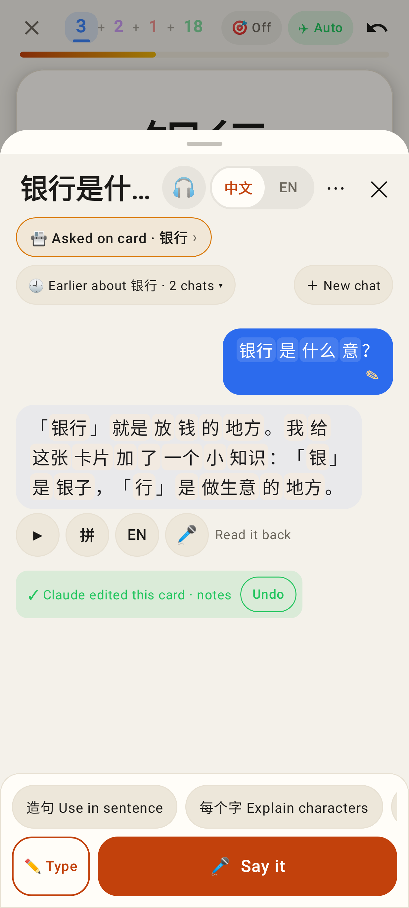
"🕘 Earlier about 银行 · 2 chats" / ＋ New chat, the ✎ on my question, "✓ Claude edited this card · notes · Undo".

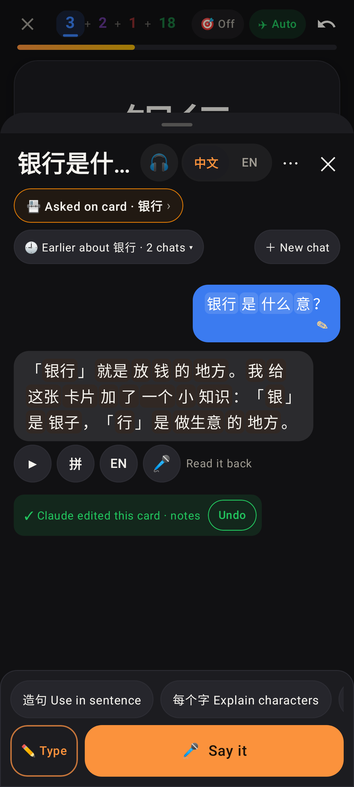
Dark.

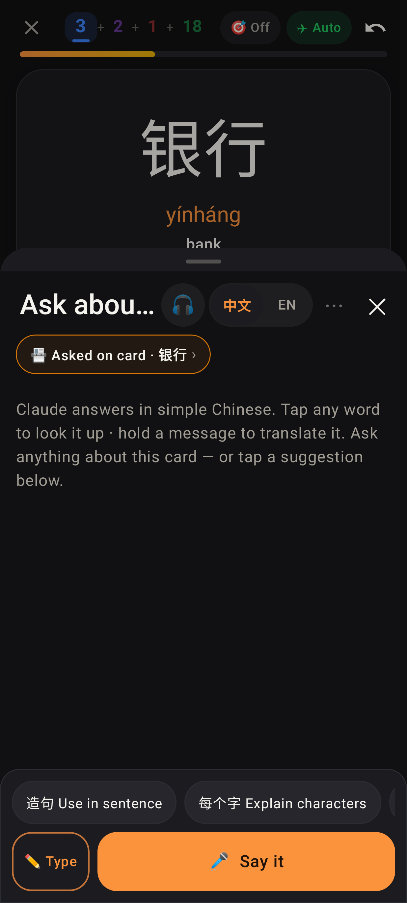
Dark, empty.

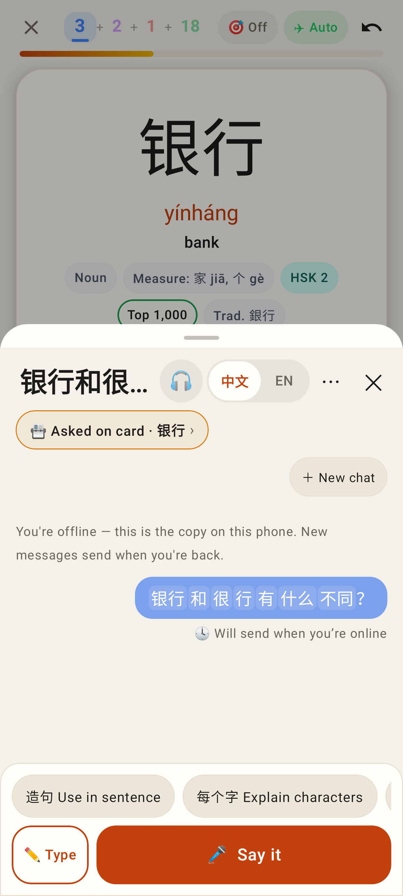
Offline: "🕓 Will send when you're online".
