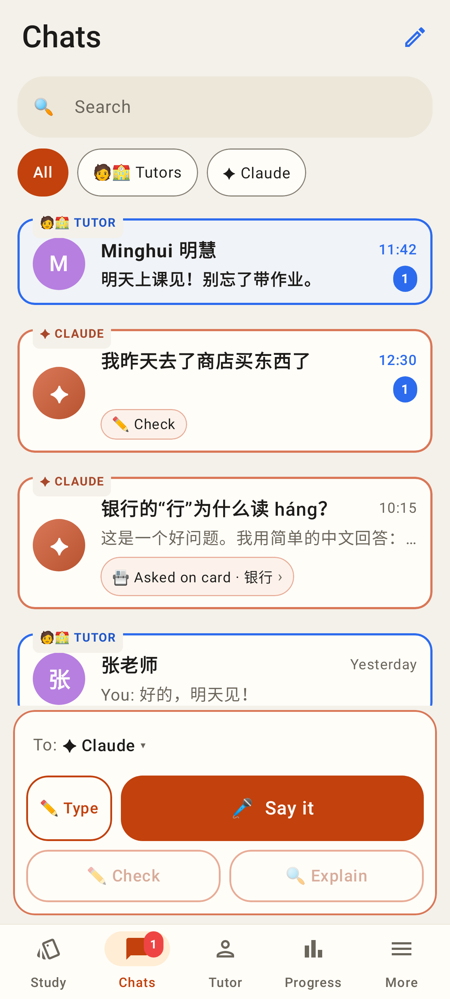
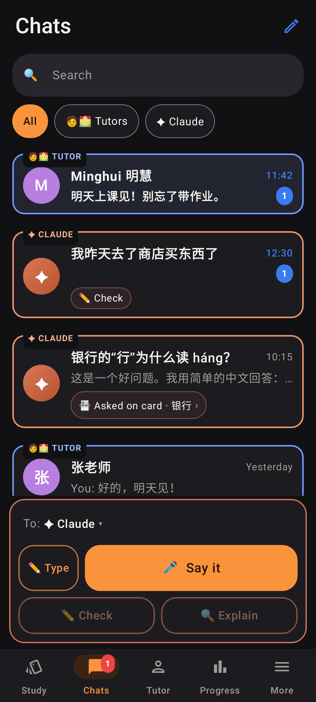
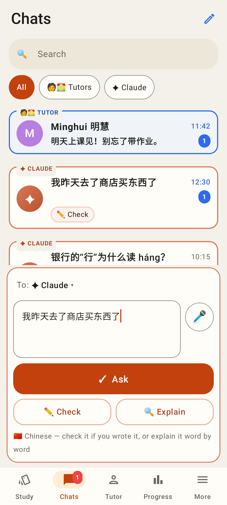
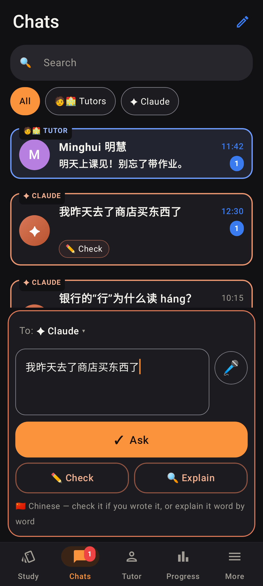
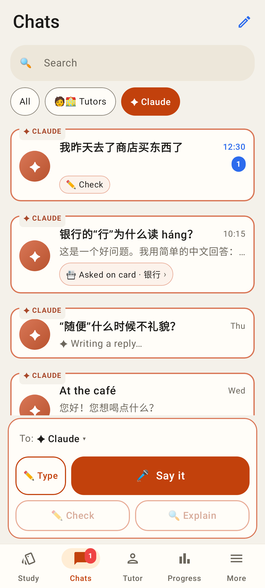
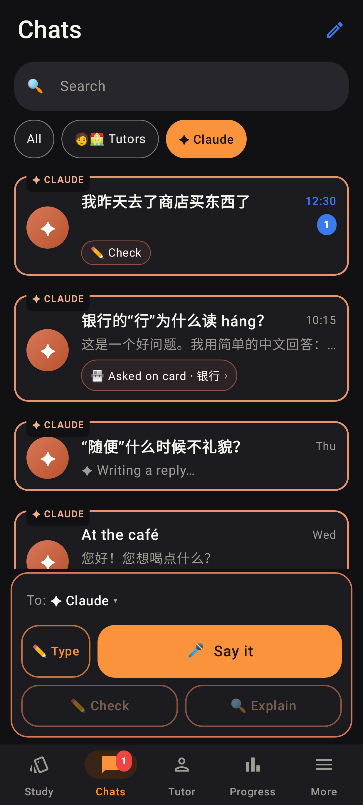
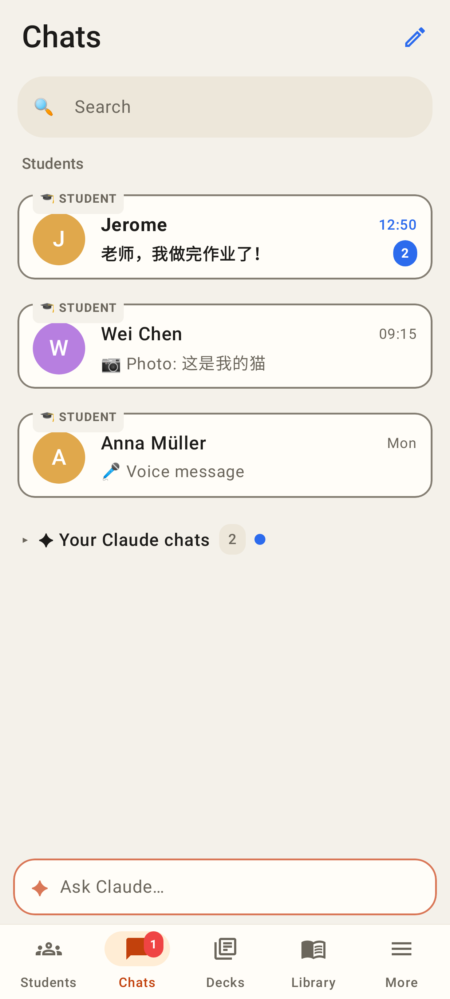
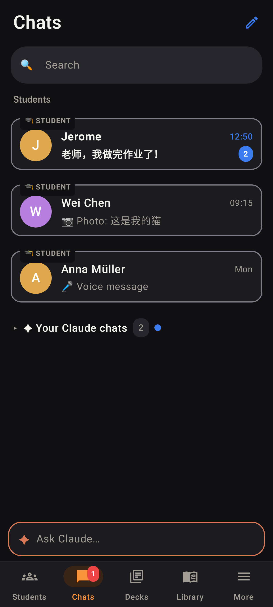
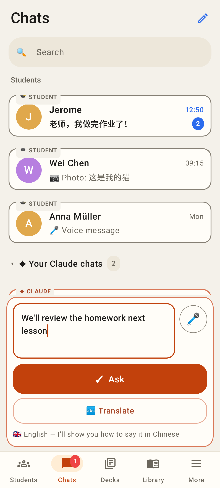
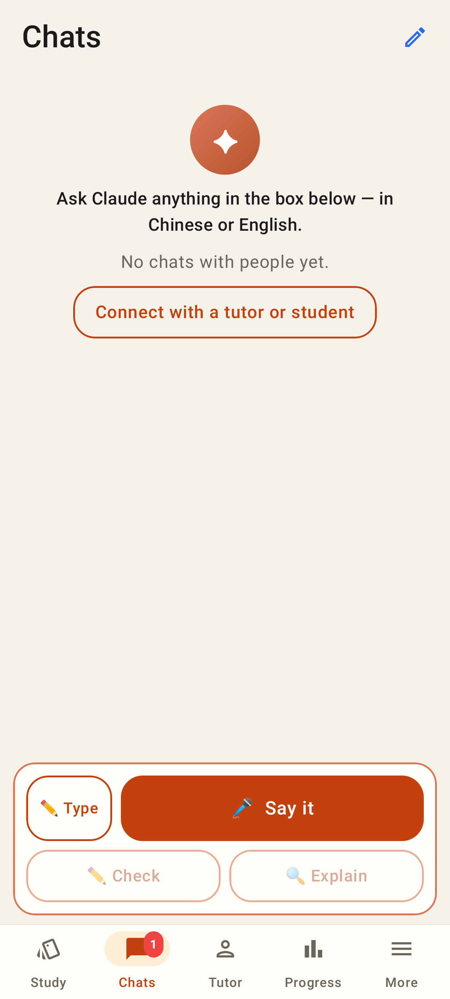

# Unified Chats tab — Lab app

Roborazzi shots at the Pixel Fold's folded screen (412×915 dp), light and dark. Learner Jerome, tutor
Minghui. Made by `android-lab/app/src/test/…/ui/chats/ChatsUnifiedTest.kt`.

The learner's Chats tab: Minghui's unread message pinned on top with "🧑‍🏫 TUTOR" written on its blue outline; Claude chats with "✦ CLAUDE" on the orange outline and their context chips (✏️ Check · 📇 Asked on card · 银行 ›); a reply being written; the old café practice chat shown once; the box at the bottom ("To: ✦ Claude ▾", voice-first).

The same in dark mode.

Chinese typed in the box: Ask is the main button, ✏️ Check and 🔍 Explain beside it.

The same in dark mode.

Filter = ✦ Claude: only the Claude chats.

The same in dark mode.

Minghui's view (tutor account): Students first (🎓 STUDENT outlines), "✦ Your Claude chats 2" folded with an unread dot, a single "✦ Ask Claude…" button.

The same in dark mode.

"Your Claude chats" unfolded and the box open with English: Ask + 🔤 Translate only.

Nothing yet: ask Claude in the box, or connect with a tutor.
