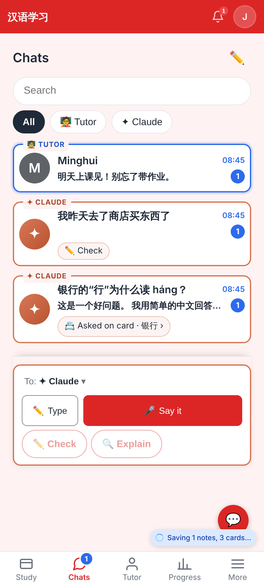
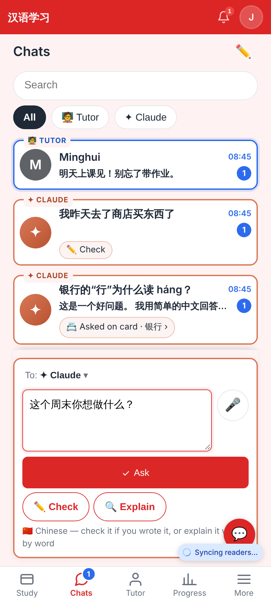
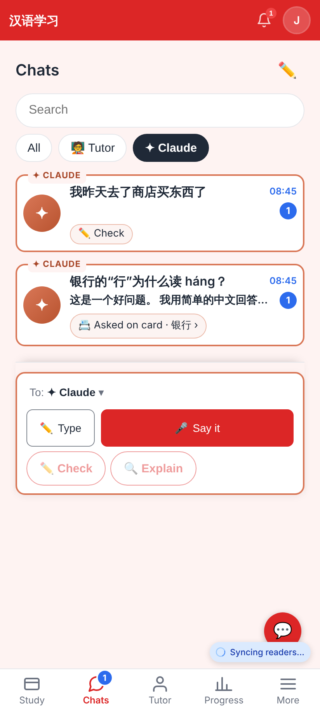
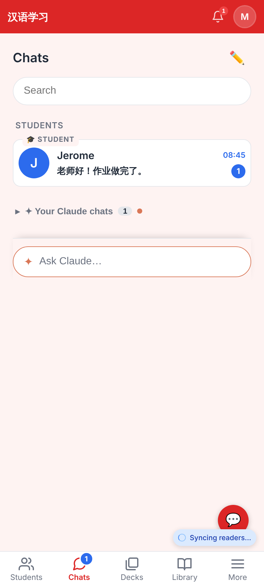
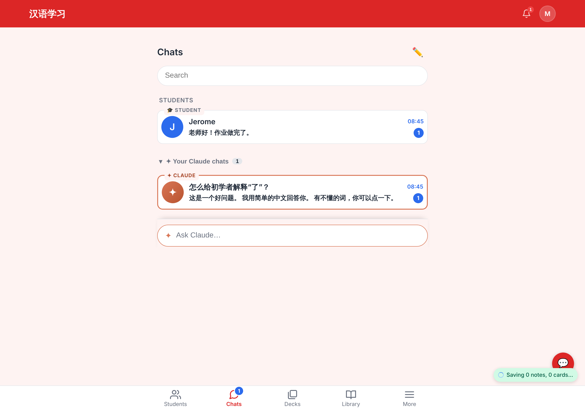

# Unified Chats tab — people and Claude in one list (web)

Phone shots at 412×915 @2×, one desktop shot at 1280. Learner Jerome, tutor Minghui. Made by
`e2e/tests/claude-chats-tab.spec.ts` with `CHATS_TAB_SHOTS=<dir>`.

The learner's Chats tab: Minghui's unread message pinned on top with the blue "🧑‍🏫 TUTOR" outline; two Claude chats with the orange "✦ CLAUDE" outline and their context chips (✏️ Check · 📇 Asked on card · 银行 → the card); filter chips; the box at the bottom ("To: ✦ Claude ▾", voice-first).

Chinese typed in the box: Ask is the main button (Enter), ✏️ Check and 🔍 Explain beside it.

Filter = ✦ Claude: only the Claude chats.

Minghui's (tutor account) view: Students first, "✦ Your Claude chats" folded away, a smaller "✦ Ask Claude…" box.

The same at 1280 px with "Your Claude chats" opened.
