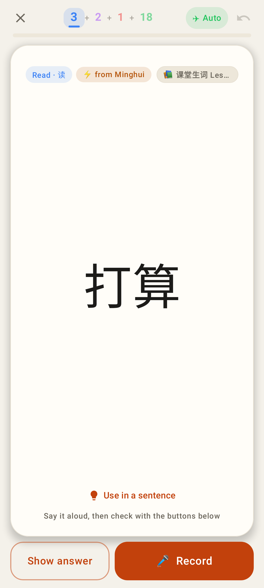
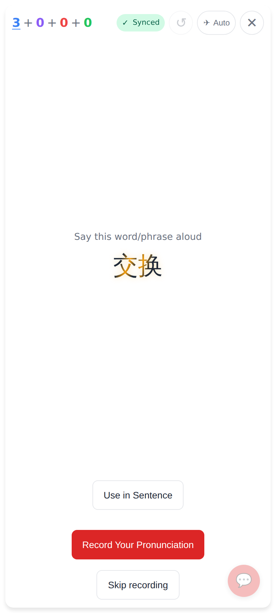
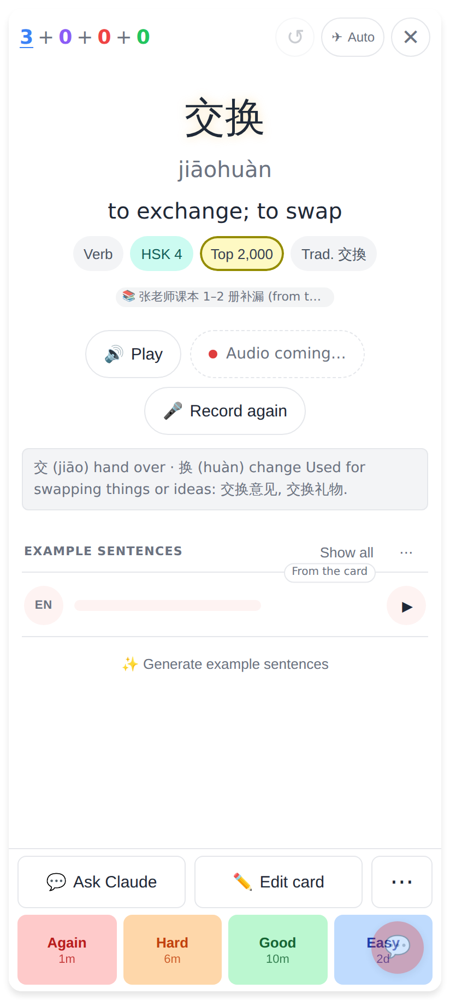
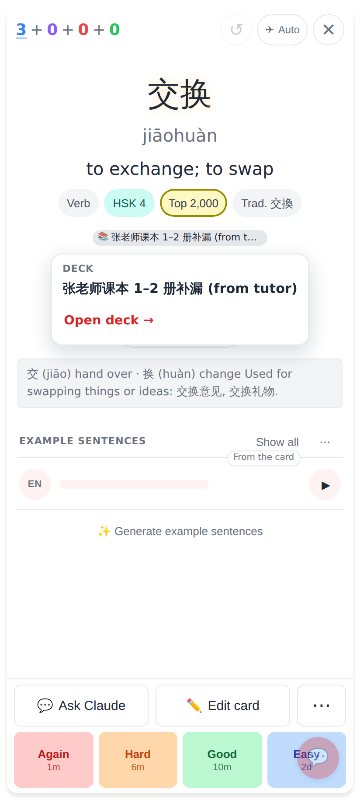
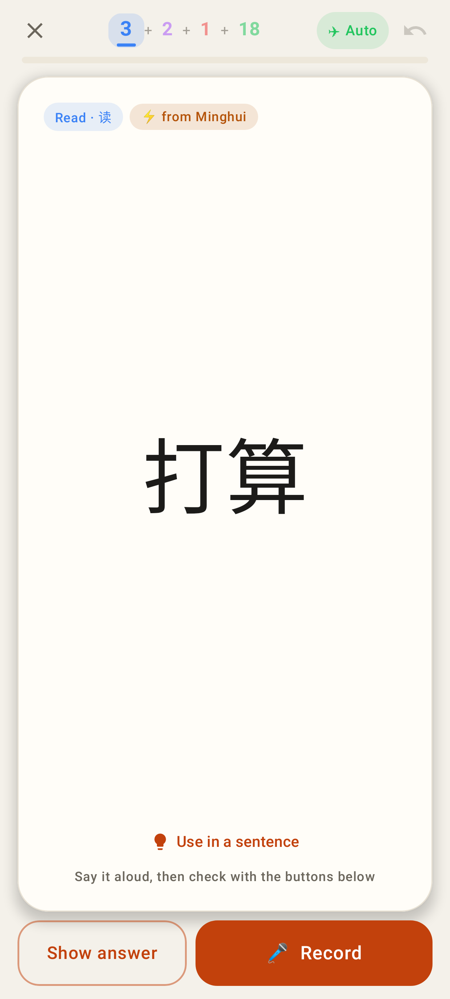
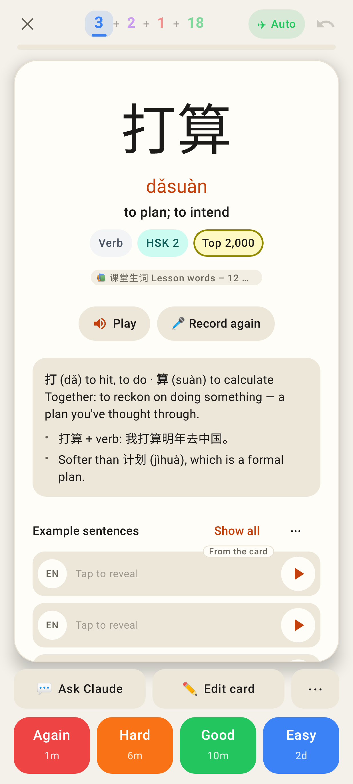
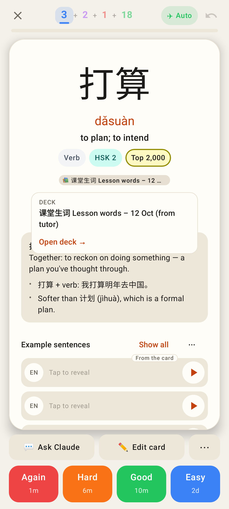
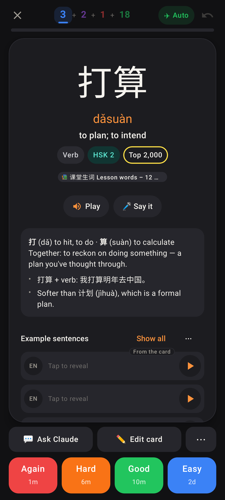

# Deck pill: smaller, answer side only

Phone viewport (412 wide). Before = PR #623.

Before (web): the 📚 pill under the top bar on the question.

Before (Lab): the pill in the question header beside "Read · 读".

After (web): the question side shows no deck.

After (web): a small, muted line under the meaning / word tags, above Play.

After (web): a tap shows the full name + Open deck →.

After (Lab): the question header is just the type chip (and ⚡).

After (Lab): the same small line under the word tags.

After (Lab): the popup, centred under the pill.

After (Lab, dark).
