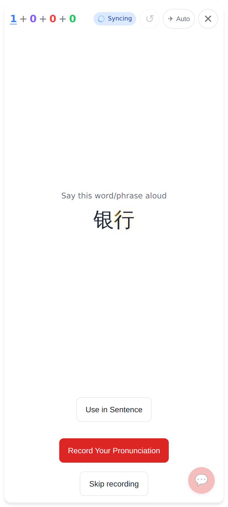
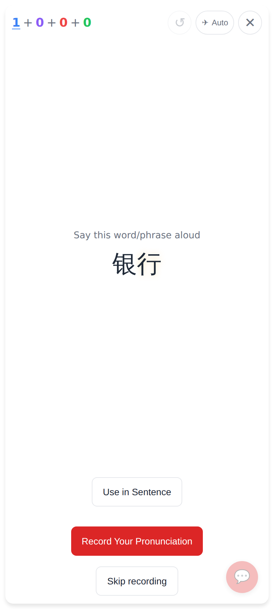
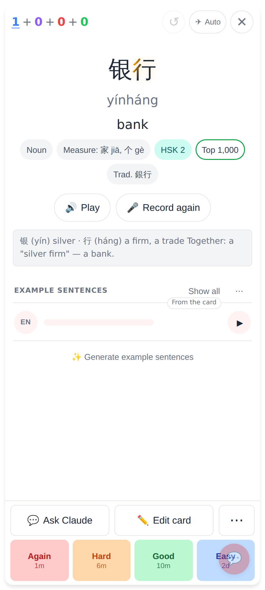
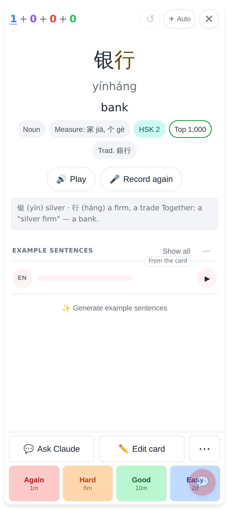
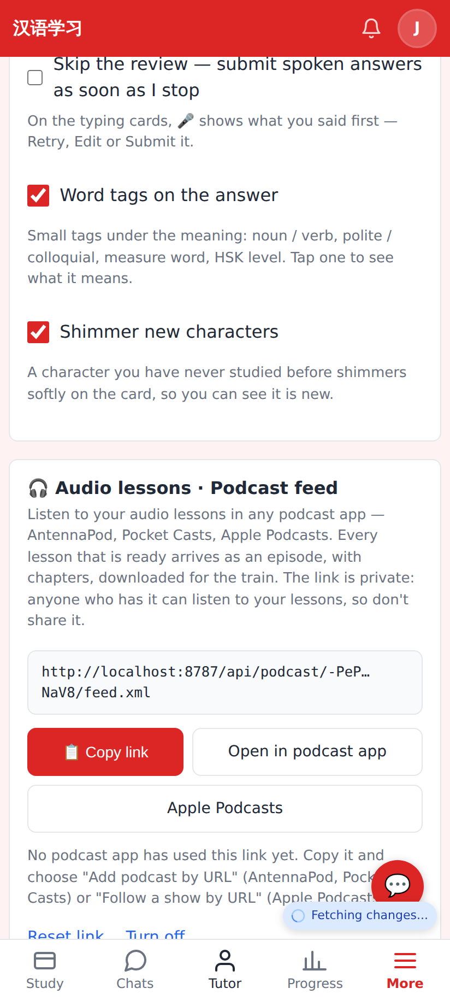
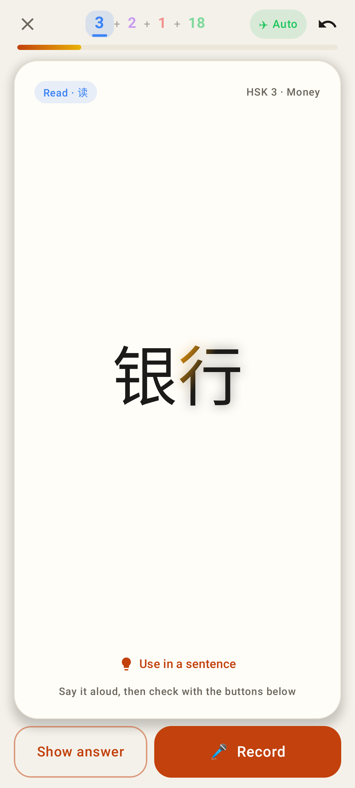
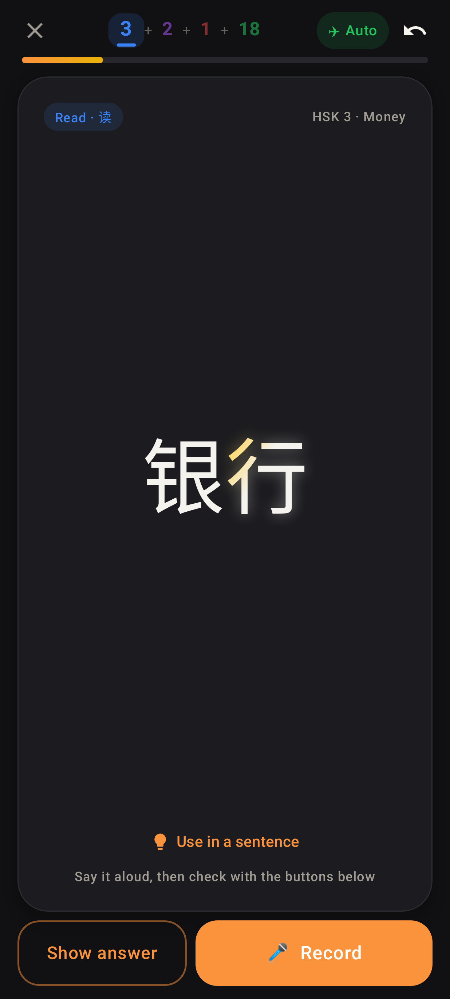
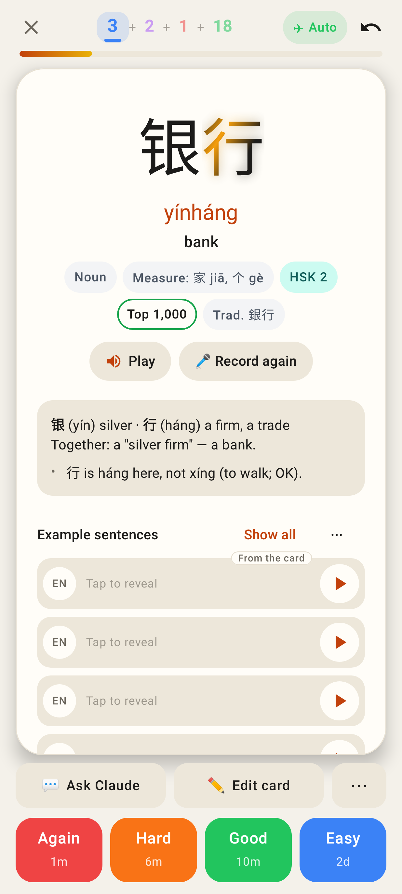
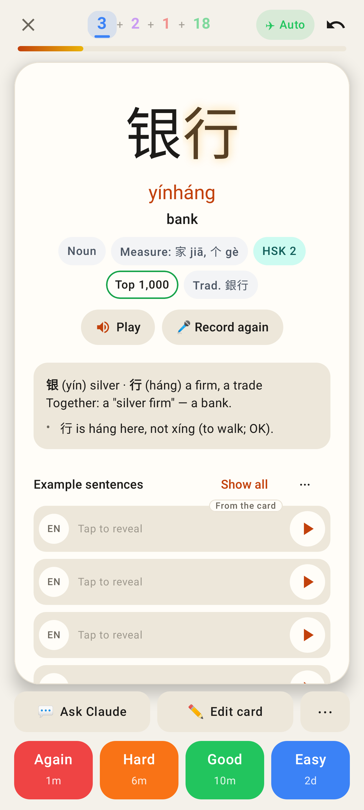
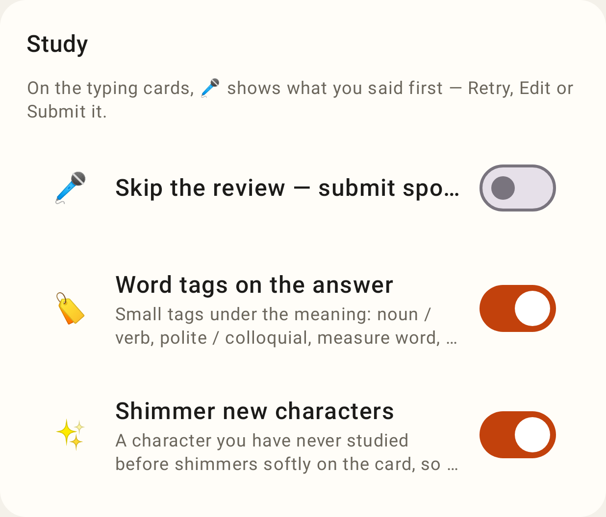

# New characters shimmer

银子 has been reviewed, so 银 is seen; the new word 银行 arrives and only 行 shimmers.
Phone viewport (412×915, 2×). Mid-sweep frames are frozen at a point of the animation.

## Web

The read card's question: the warm band sweeping across 行, with a faint glow.

Between sweeps (most of the 3.6 s cycle): 行 keeps its own colour with the faint glow.

The answer side: still only 行, inside its own tap target for the explorer.

`prefers-reduced-motion`: no movement, a static warm tint and the glow.

Settings → Study → "Shimmer new characters" (on by default, per device).

The web study card has no dark theme, so there is no web dark shot; the CSS defines the paler sheen
for `data-theme="dark"`.

## Lab app

The Lab read card, mid-sweep.

Dark theme: a paler gold band.

The answer side.

"Remove animations" (animator duration scale 0): the static tint, on the answer side (the question face too).

Settings → Study → "Shimmer new characters".
