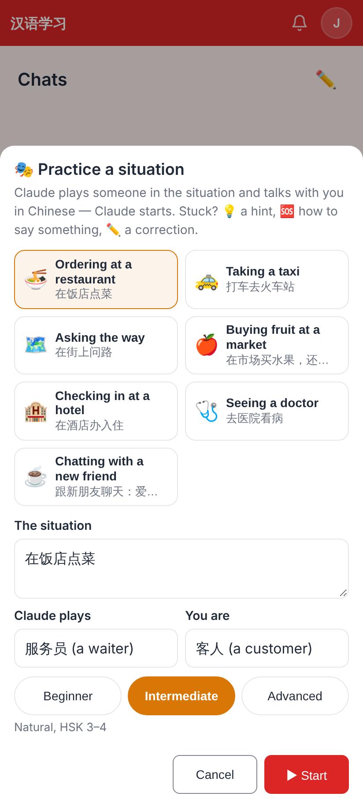
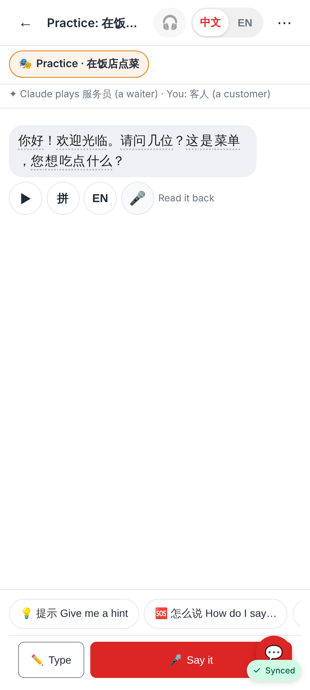
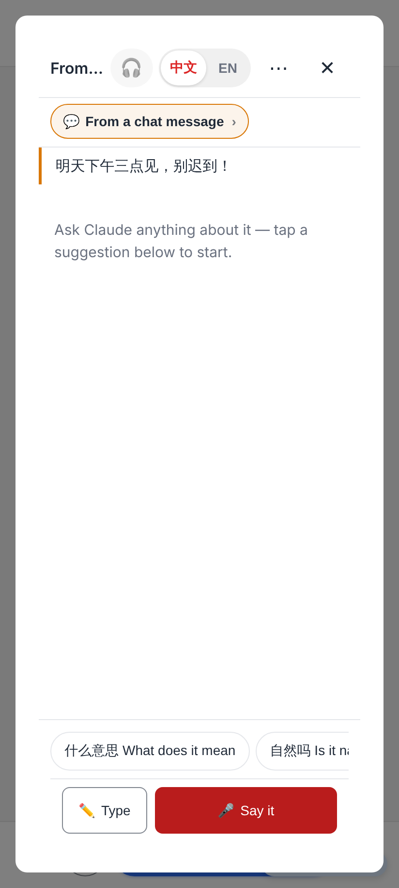
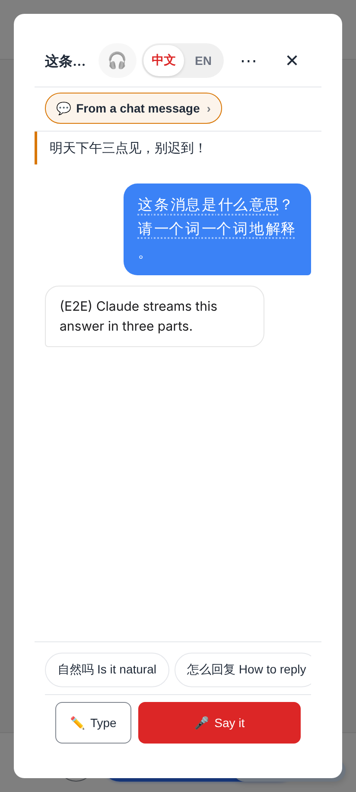
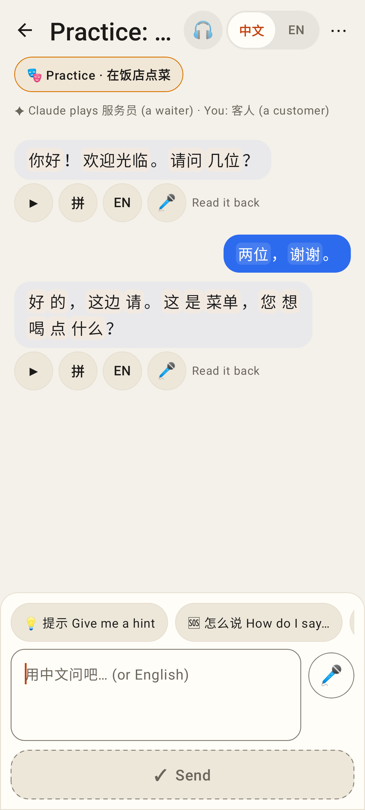
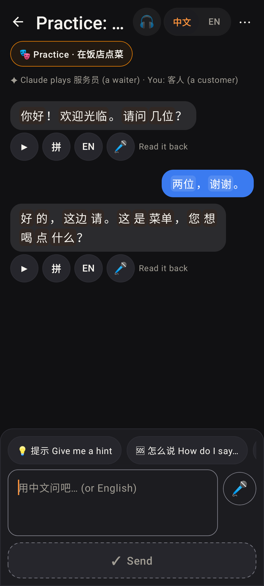
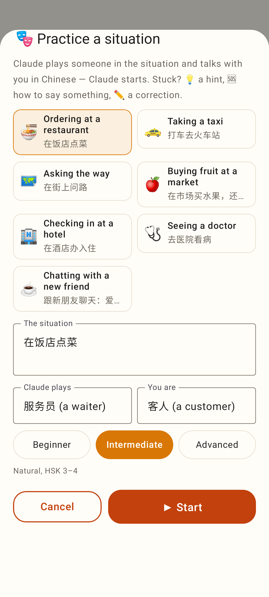
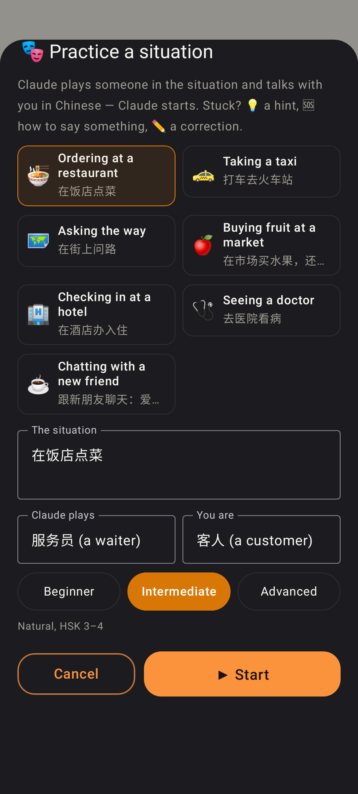
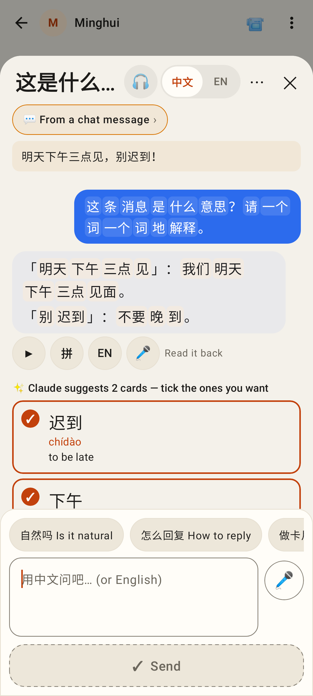
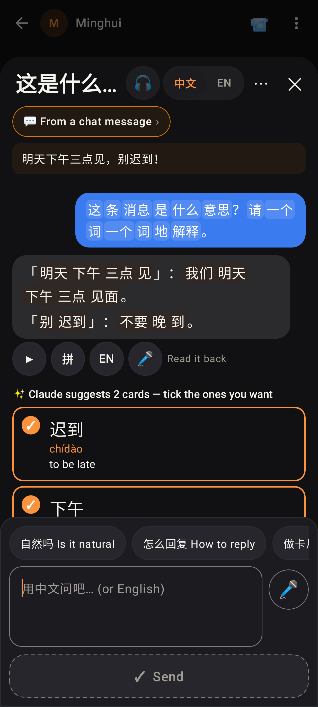

# Practice + Discuss with Claude as Claude threads

Web (412×915 @2×, from `e2e/tests/claude-practice-discuss.spec.ts` with the worker's E2E stand-in model):

Chats → ✏️ → 🎭 Practice a situation…: seven ready-made situations or your own, who Claude plays, who you are, a level.

The role-play thread: Claude spoke first (streamed), "Claude plays 服务员 · You: 客人" under the 🎭 chip, the help chips 💡 / 🆘 / ✏️, Ask only.

A tutor's message → message menu → Discuss with Claude: the message's Claude thread in a sheet over the chat, the message quoted, its chips.

The answer streamed into the sheet (opening it again resumes the same thread).

Lab app (Roborazzi, light + dark):

The role-play thread in the Lab app: roles line, help chips (🆘 fills the box), Ask only.

"🎭 Practice a situation" in the Lab app.

Discuss with Claude in the Lab app: the message quoted, the answer, Claude's proposed cards to tick and save.
