# Claude in a reader page / a mini lesson exercise

Web (412×915 @2×, the E2E stand-in model):

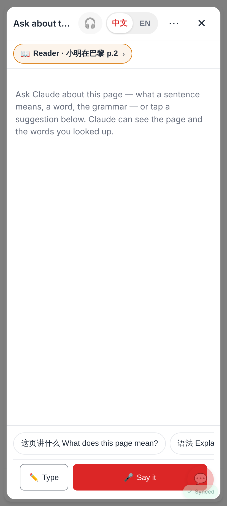
The reading view's 💬 → the page's Claude thread: "📖 Reader · 小明在巴黎 p.2", the page's chips, Ask only.

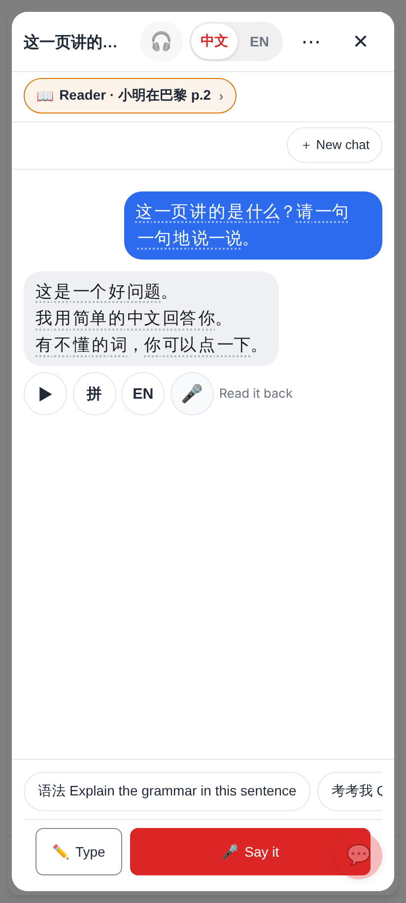
A chip's question, the reply streamed in.

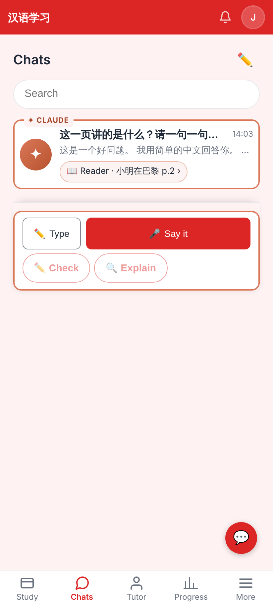
The thread in the Chats tab with its chip (→ the reader at that page).

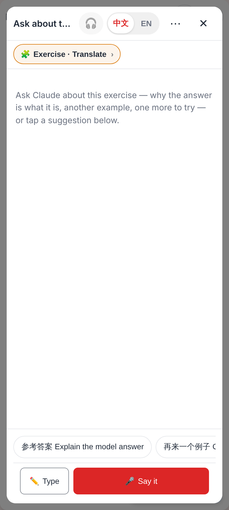
The lesson player's 💬 → the exercise's thread: "🧩 Exercise · Translate", the type's chips.

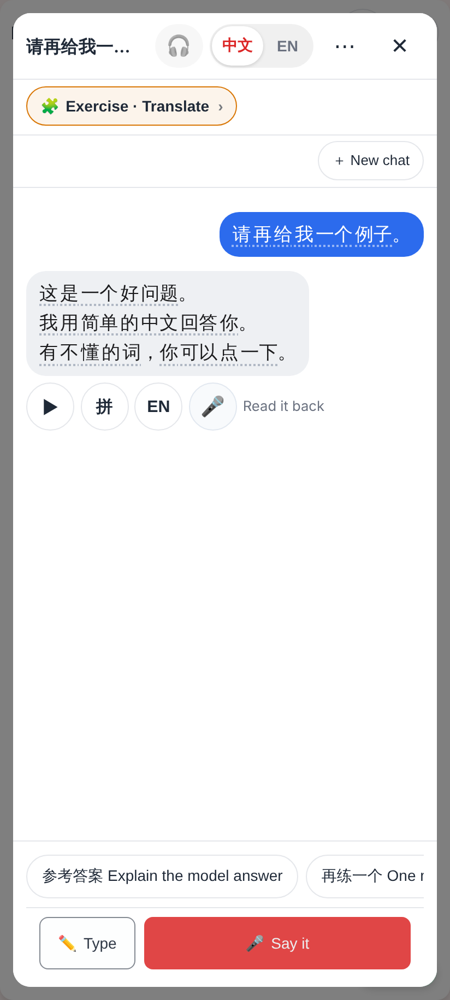
A reply in the exercise thread (＋ New chat once a thread exists).

Lab app (Roborazzi, light + dark):

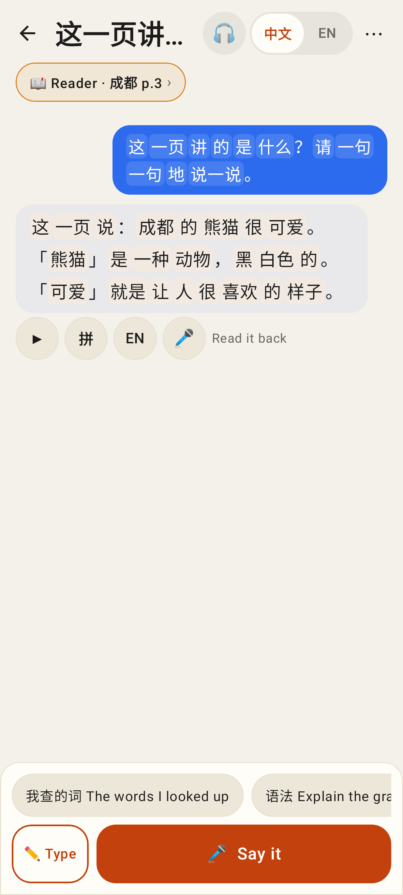
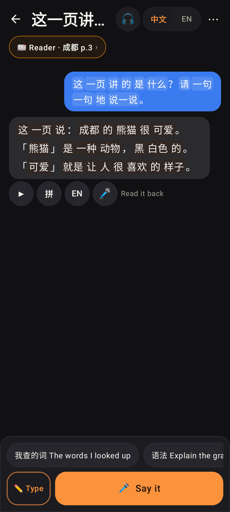
A reader page's thread.

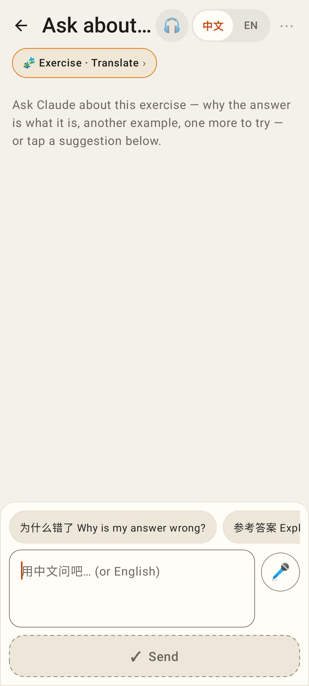
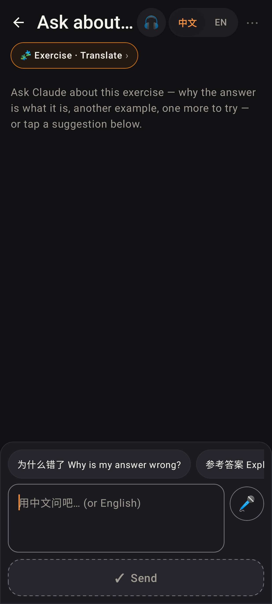
An exercise thread after a wrong answer: "Why is my answer wrong?" first.

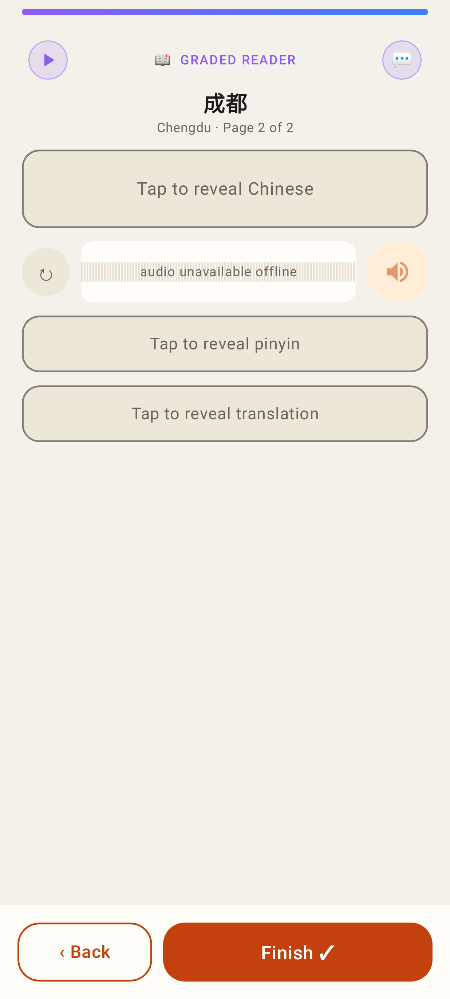
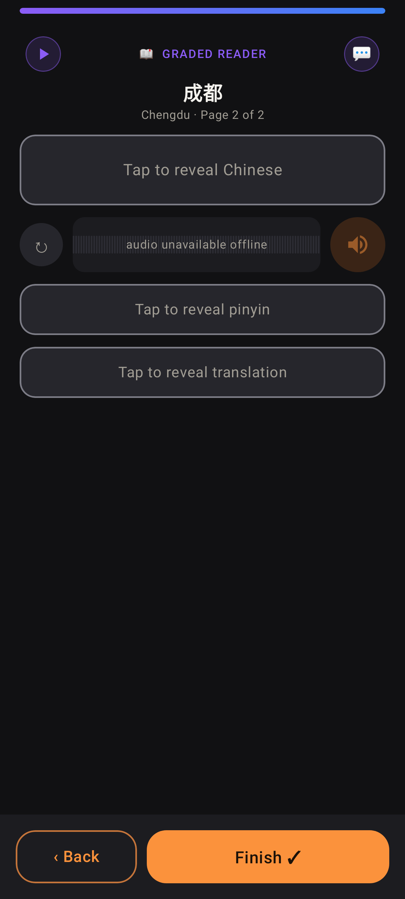
The reading view's 💬 at the end of the "GRADED READER" row.
