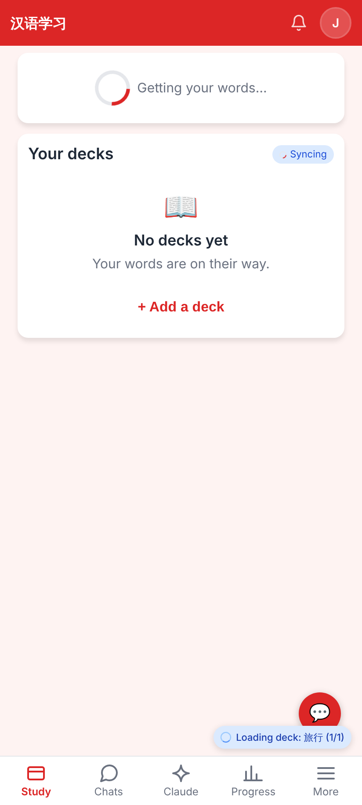
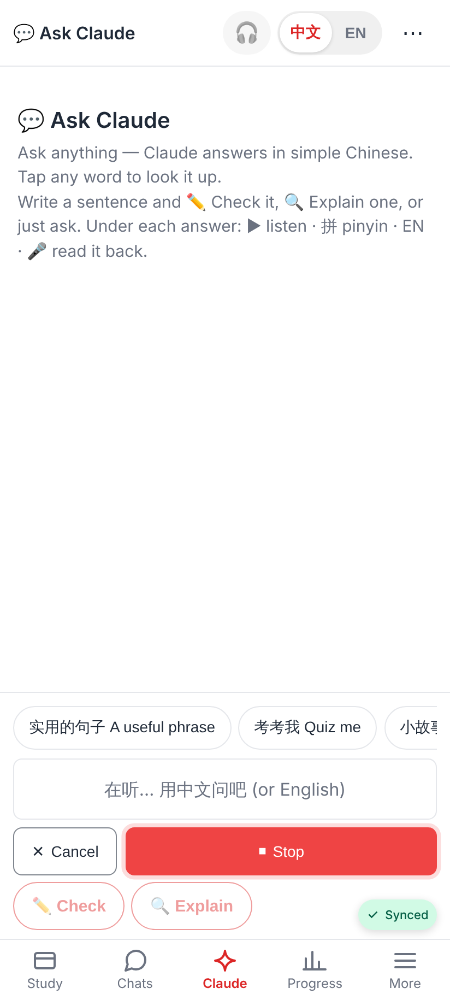
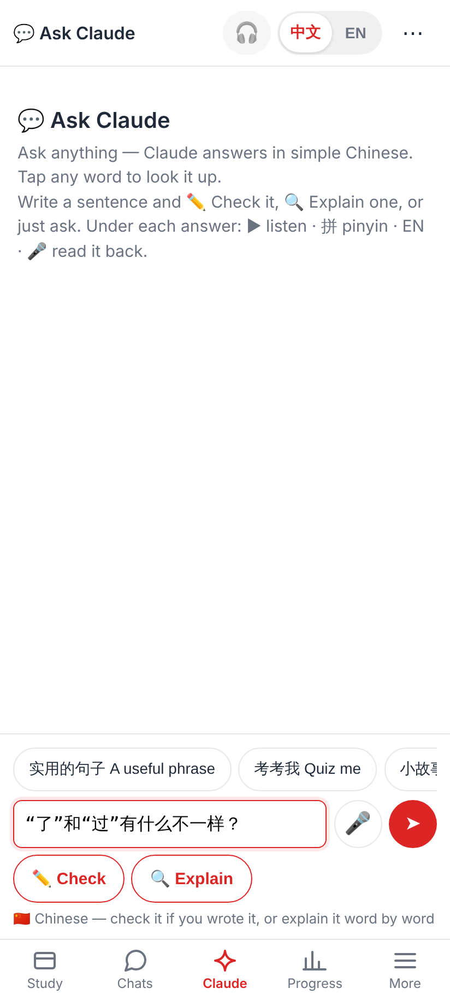
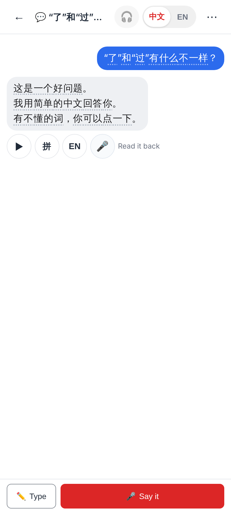
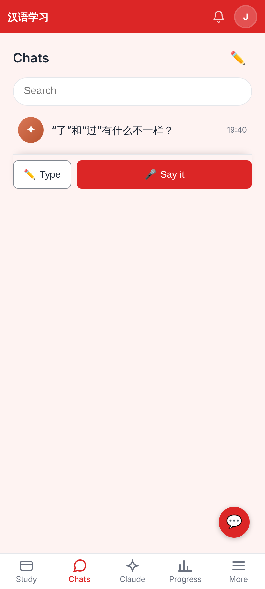
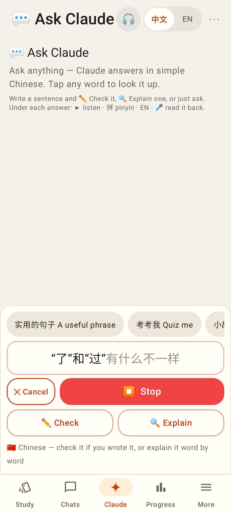
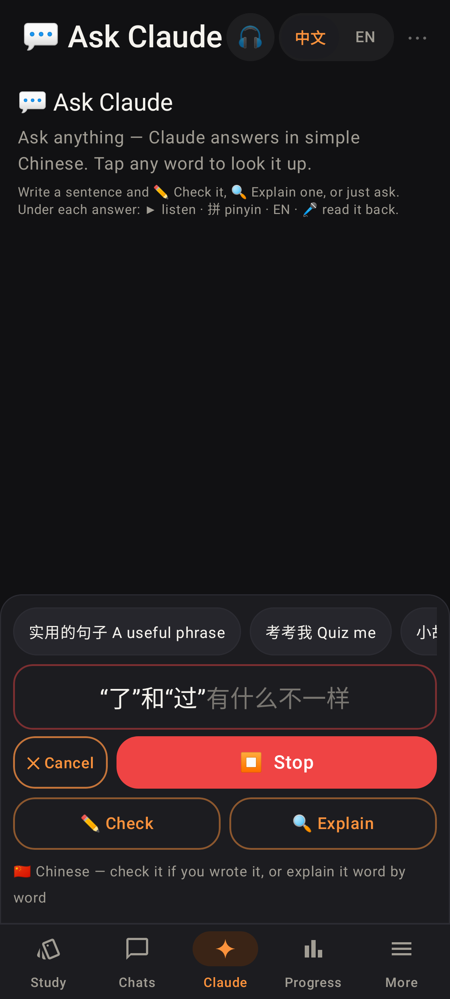

# ✦ Claude tab + the thread no longer jumps to the top

Web at 412×915 @2x (E2E stand-ins, fake microphone):

The learner's tab bar: Study · Chats · ✦ Claude · Progress · More.

Tapping ✦ Claude opens a new chat. The 🎤 is already listening ("在听… 用中文问吧"), the tab is lit and there's no ←.

Cancel and then ✏️ Type gives you the keyboard; Check / Explain show up for Chinese.

After the first message, the screen moves to a normal Claude thread (`/chats/claude/:id`).

That thread is listed in the Chats tab with the other Claude chats.

Lab app (Roborazzi, Pixel Fold folded):

The Lab app's ✦ Claude tab: a new chat with the 🎤 listening and the tab bar under it.

The same screen in dark mode.
