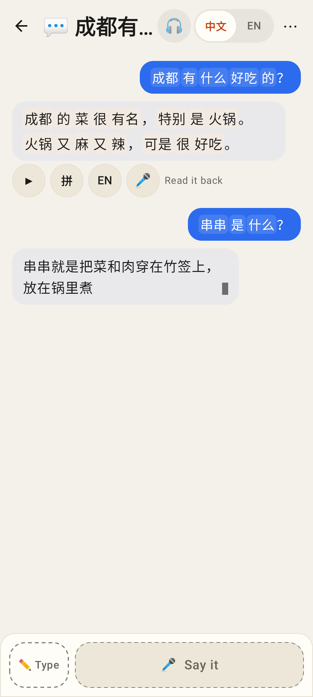
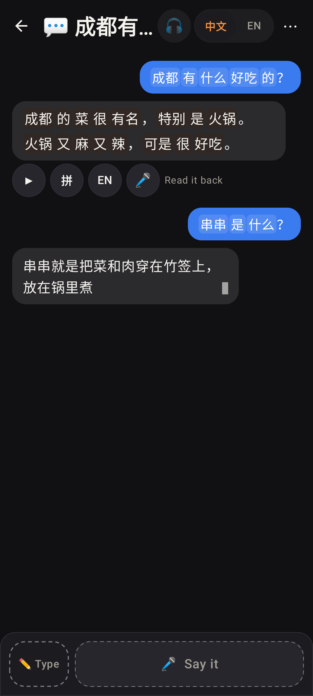
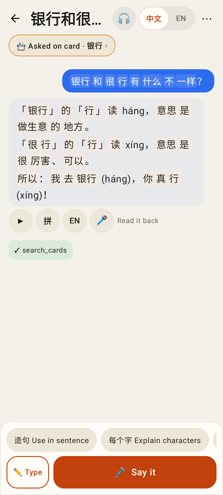
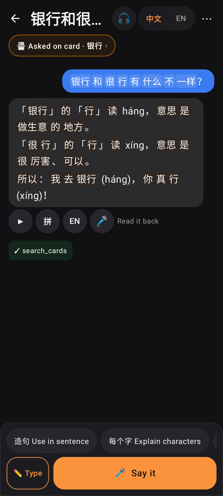
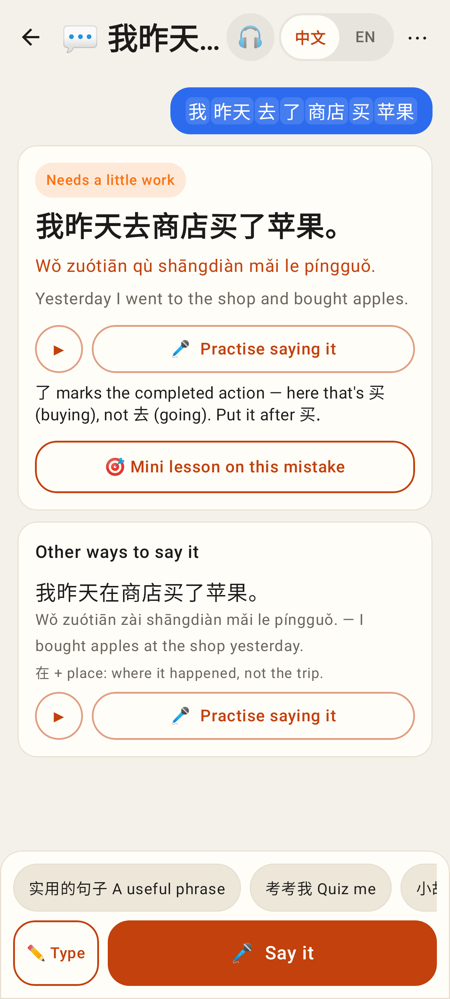
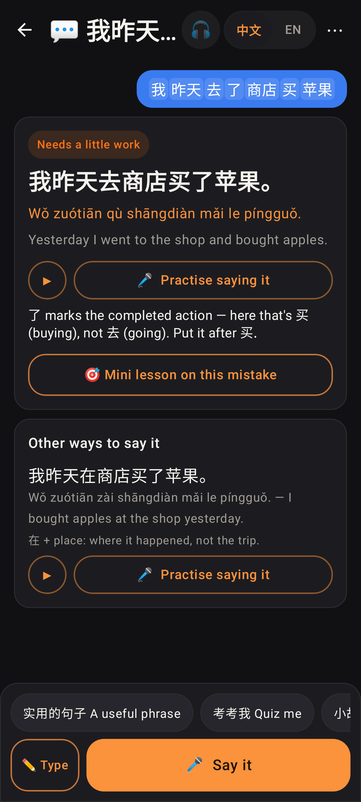
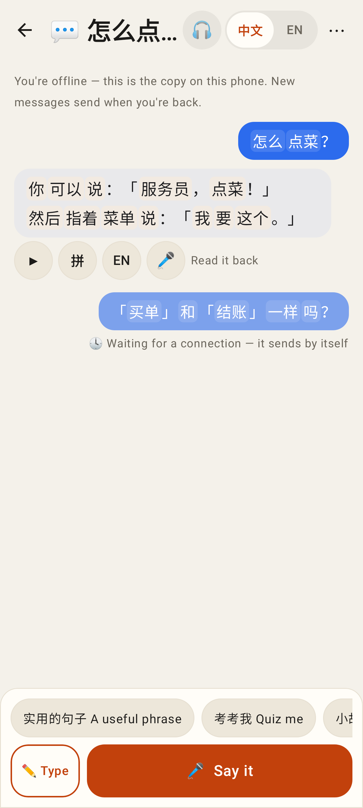
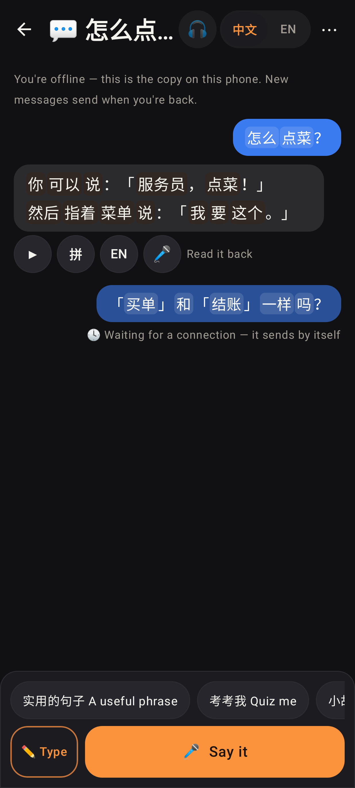
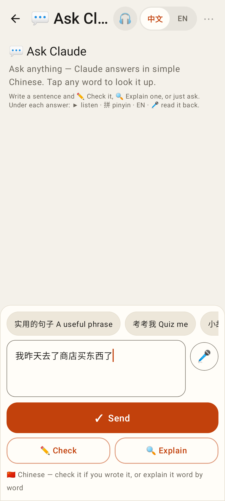
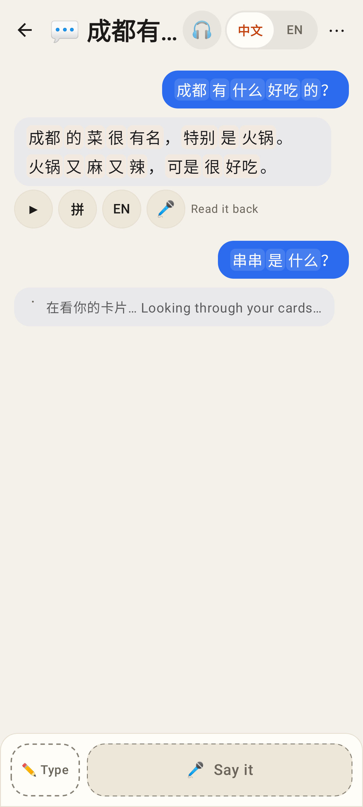

# Claude thread view — Lab app

Roborazzi shots of `ui/claude/ClaudeThreadScreen.kt` (phone, 412 dp), light and dark.

A plain chat: Claude's second reply streaming in (its text so far + a caret).

The same in dark mode.

Ask Claude on a card: "📇 Asked on card · 银行 ›" (opens the card hub), the answer with ▶ · 拼 · EN · 🎤, a tool result chip, the card's suggestion chips (≤ 3 after a reply), Ask only.

The same in dark mode.

A chat started with ✏️ Check: the Coach's own result card (🎤 Practise saying it, 🎯 Mini lesson on this mistake) inside the thread.

The same in dark mode.

Offline: the thread from the phone's copy, my question waiting in the outbox ("🕓 Waiting for a connection").

The same in dark mode.

A new plain chat with Chinese in the box: Send (Ask) + ✏️ Check / 🔍 Explain and the hint.

Claude looking through the cards before it writes ("在看你的卡片… Looking through your cards…").
