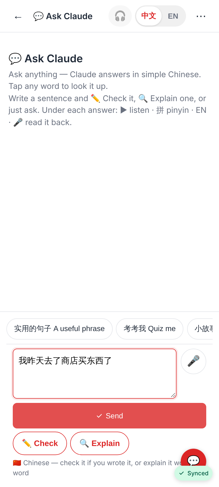
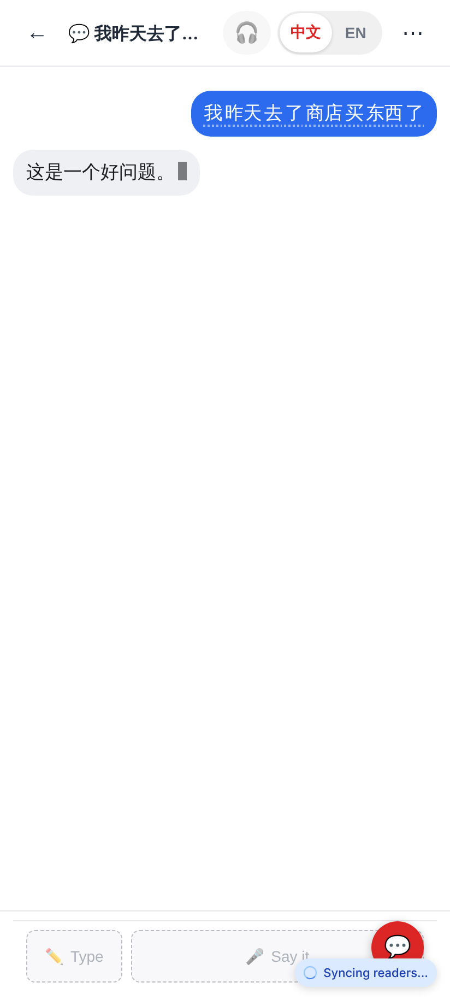
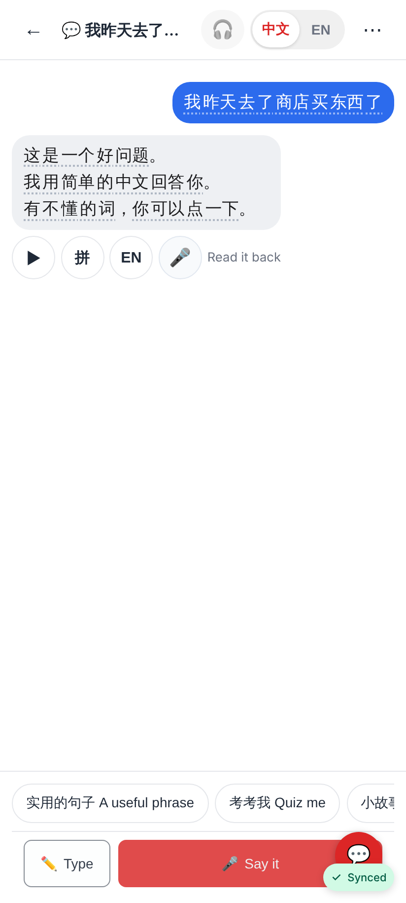
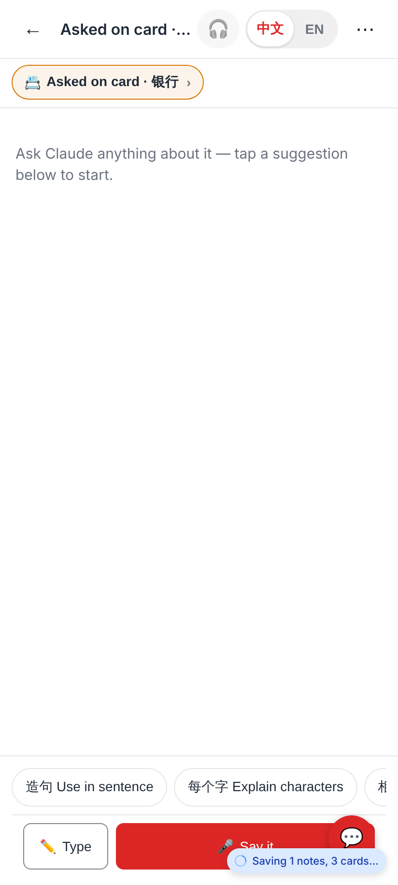
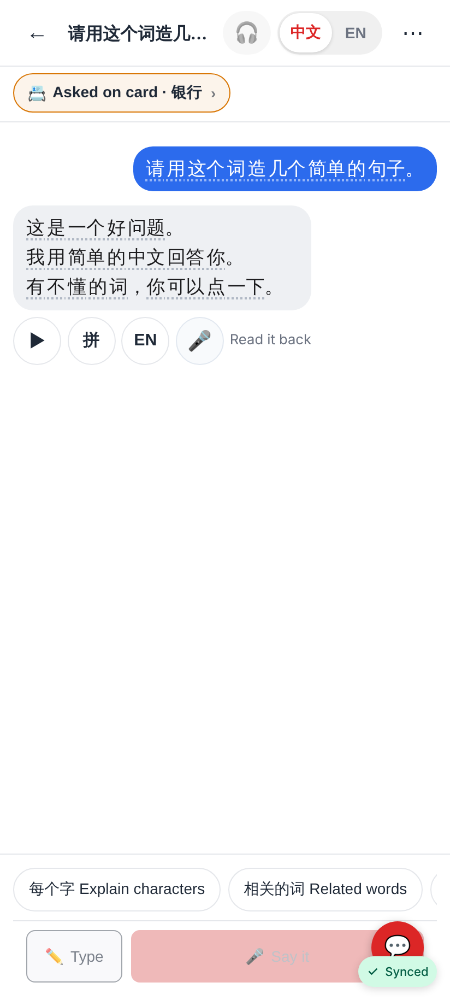
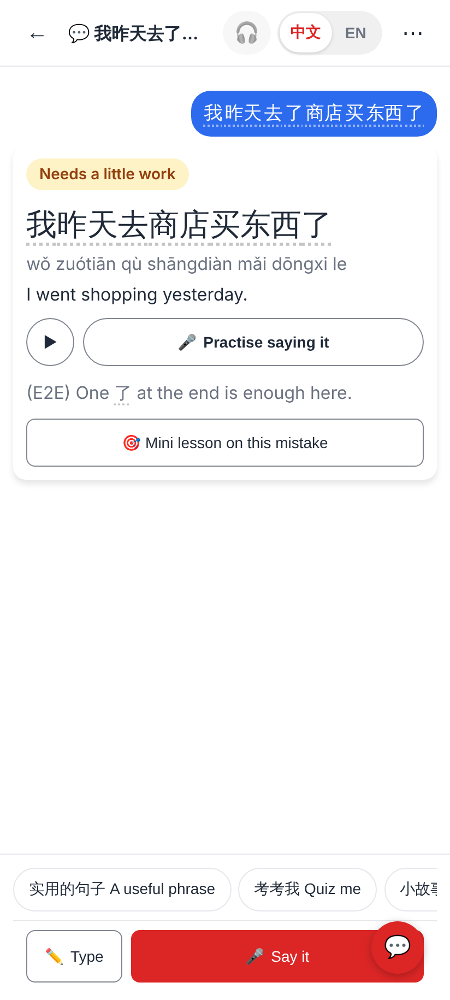
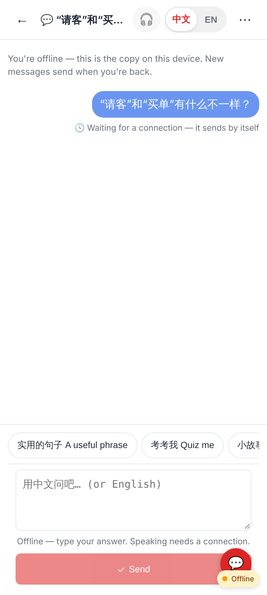
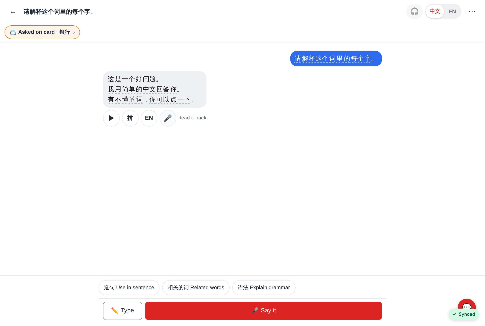

# Claude thread view — screenshots

Phone shots at 412×915 @2× (the Pixel Fold folded), one desktop shot at 1280 px. Data from the E2E
stand-in (the worker streams its answer in three chunks).

A new chat from the Coach's 💬 Ask Claude: suggestion chips above the box; for Chinese, ✏️ Check and 🔍 Explain sit beside Send (= Ask) with the hint line.

The reply streaming in (live `claude_turn` frames): its text so far with a caret.

The whole reply: word chips, ▶ · 拼 · EN · 🎤 Read it back, three suggestion chips after a reply.

Ask Claude about a card: "📇 Asked on card · 银行" under the header (→ the card hub) and the card's chips; Ask only.

After the "Use in sentence" chip: the streamed answer; the used chip is gone, at most three left.

`/coach?text=…&action=check` opens a thread started with ✏️ Check: the Coach's result card (correction, ▶ / 🎤 Practise saying it, 🎯 Mini lesson) inside the thread.

Offline: my message shows at once, "🕓 Waiting for a connection — it sends by itself"; it is sent when the connection comes back.

The same card thread at 1280 px: one centred column.
