# Claude chats: what the tutor sees (tutor Minghui, learner Jerome)

## Web (412×915, 2×)

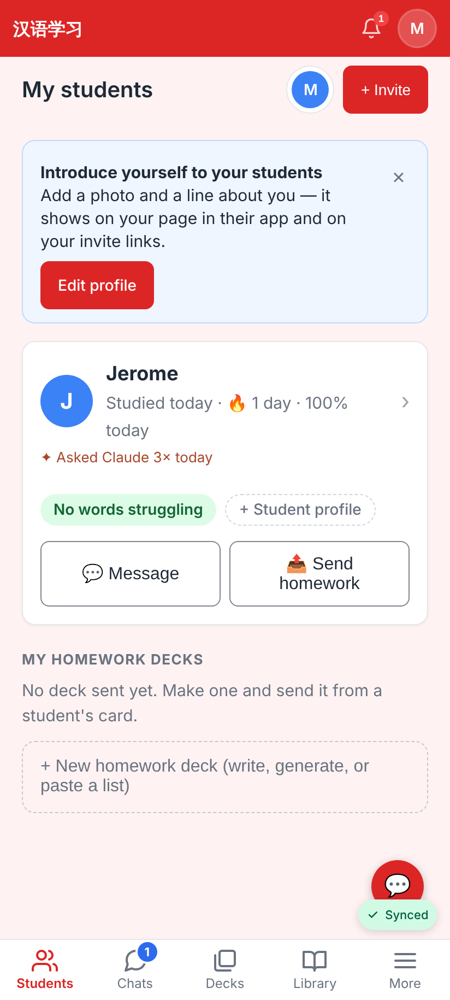
Minghui's Students dashboard: "✦ Asked Claude 3× today" under Jerome's status (his card questions + the role-play he shared; his plain chat stays private).

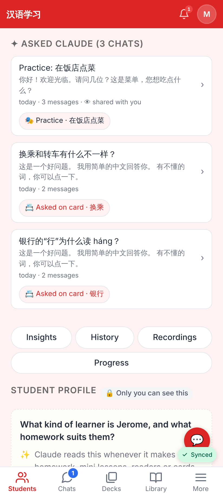
Jerome's student page → ✦ Asked Claude: the chats he lets her read, each with its context chip (📇 card → her card hub view; 🎭 practice, "👁 shared with you").

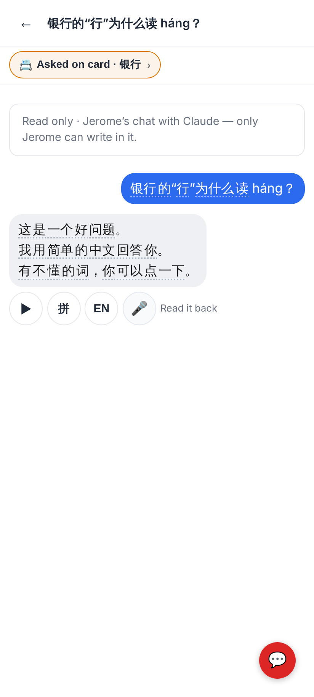
A card question opened read-only: no composer, no ⋯ / 中文 | EN; the card chip opens her view of the card.

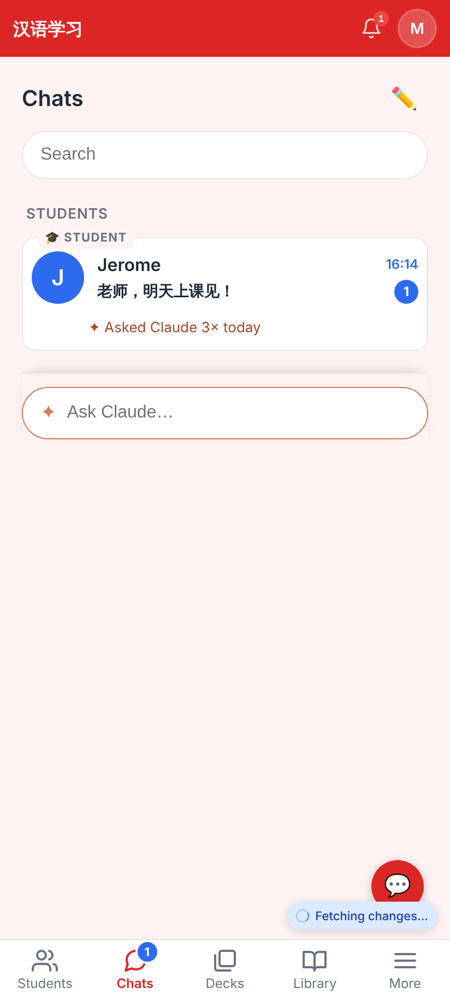
The tutor's Chats tab: the same "✦ Asked Claude 3× today" under Jerome's row.

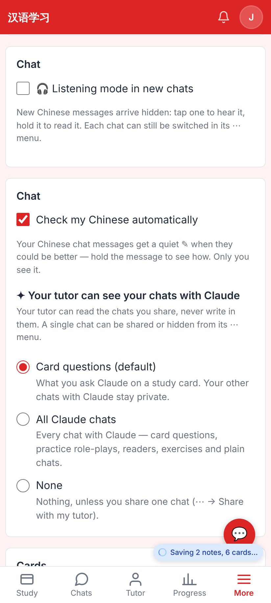
Jerome's Settings → Chat → "✦ Your tutor can see your chats with Claude": Card questions (default) · All Claude chats · None.

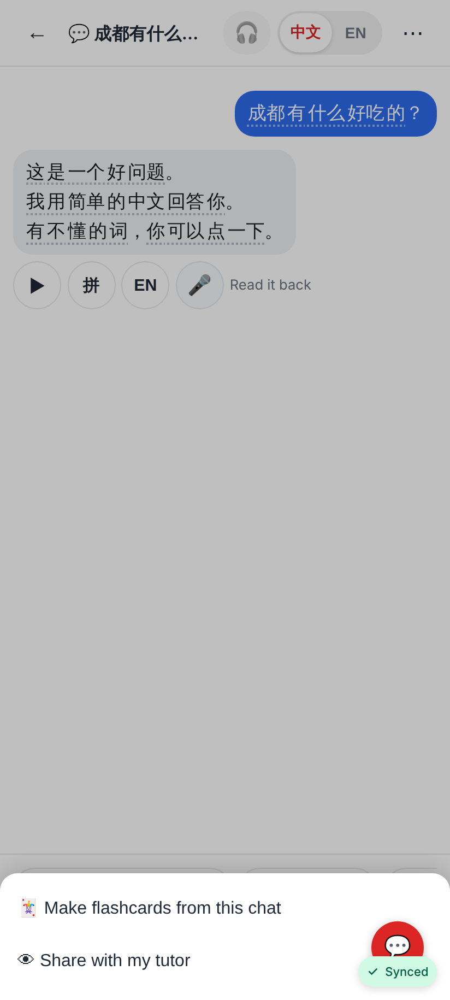
A plain chat's ⋯ → "👁 Share with my tutor" (private by default).

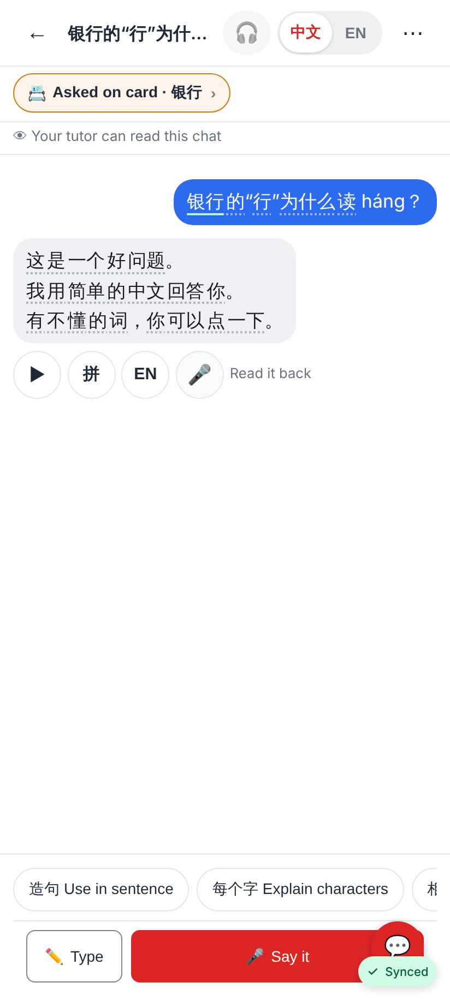
A card thread (visible by default) says "👁 Your tutor can read this chat" under the header.

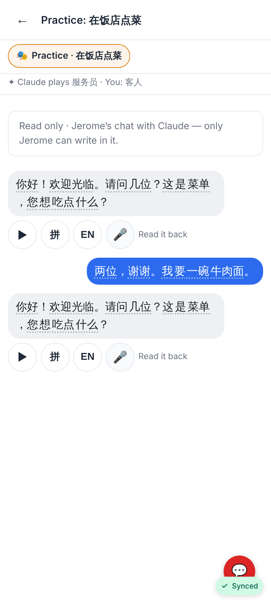
A role-play Jerome shared, read by Minghui.

## Lab app (Roborazzi)

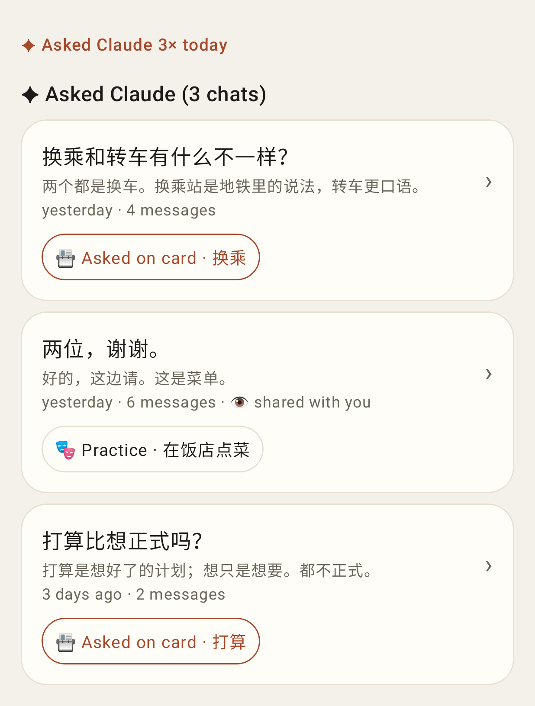 — ✦ Asked Claude 3× today + the student page section.
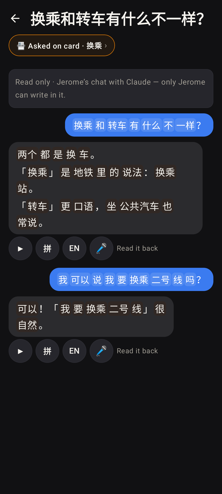 — the read-only thread, dark.
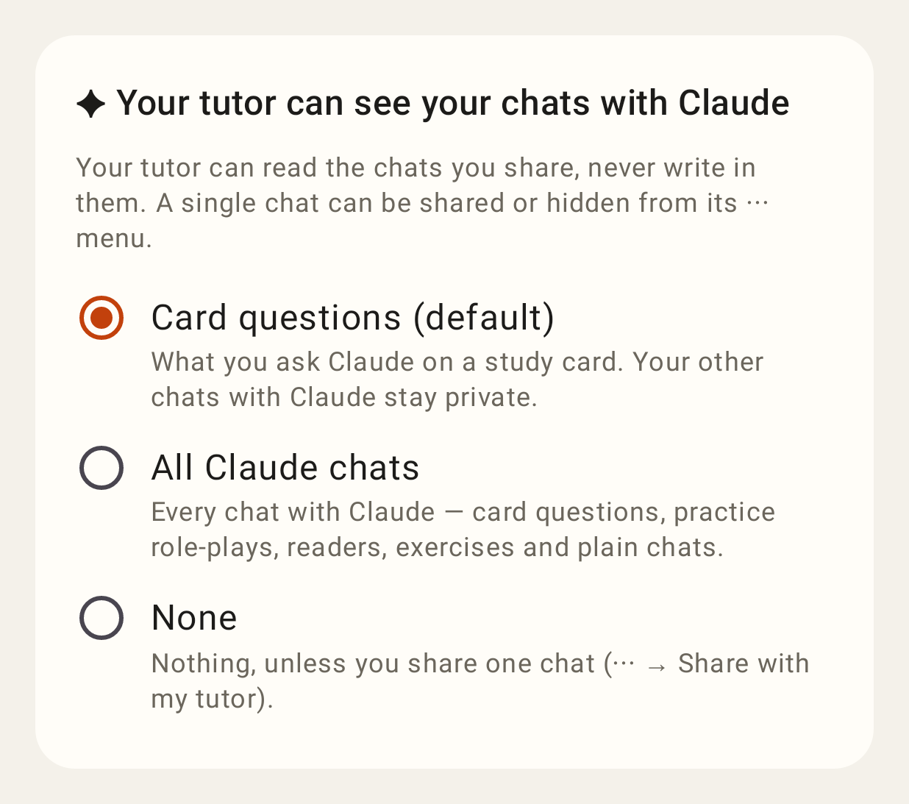 — Settings → "Your tutor can see", light.
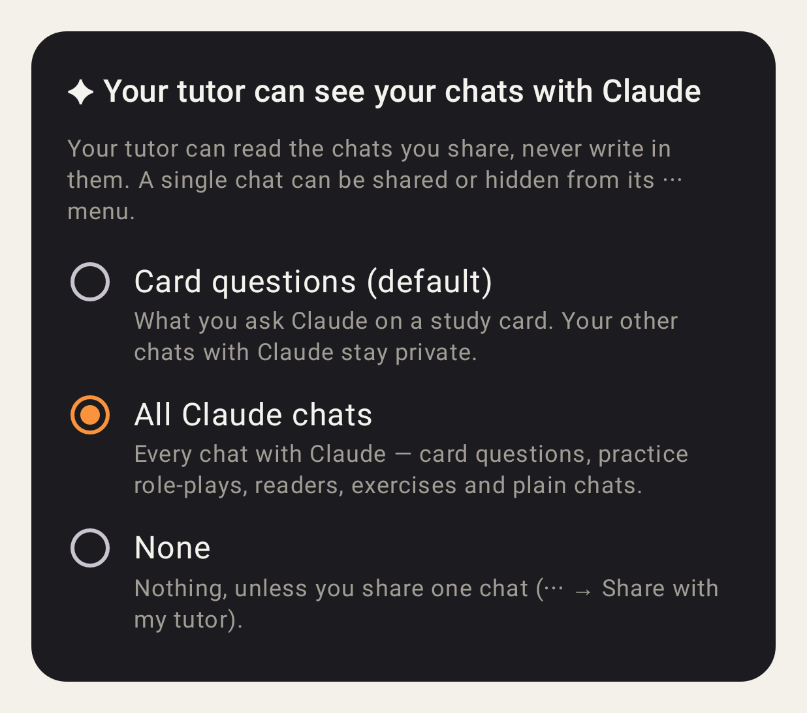 — the same, dark ("All" picked).
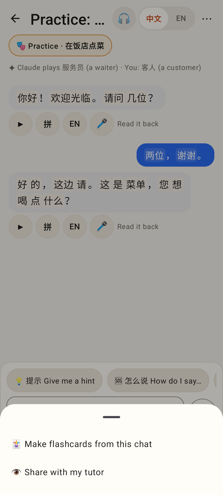 — a role-play's ⋯ → Share with my tutor.
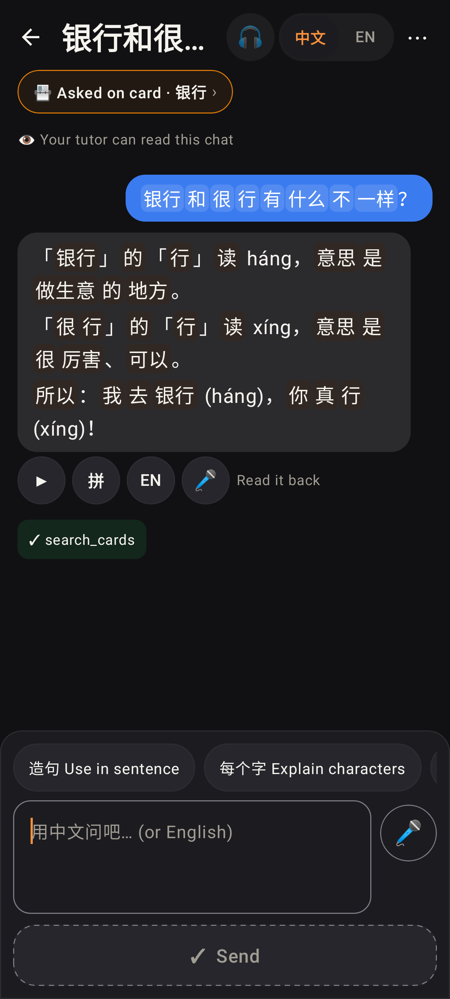 — a card thread: "👁 Your tutor can read this chat", dark.
