# 🎬 Clips (experimental) — Lab app

Roborazzi, Pixel Fold folded 412×915dp (and one unfolded).

**Neon · title with the hook + voice caption**

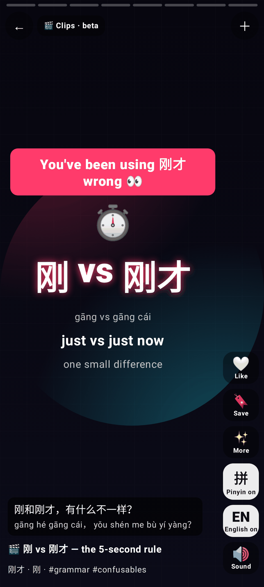

**Big word**

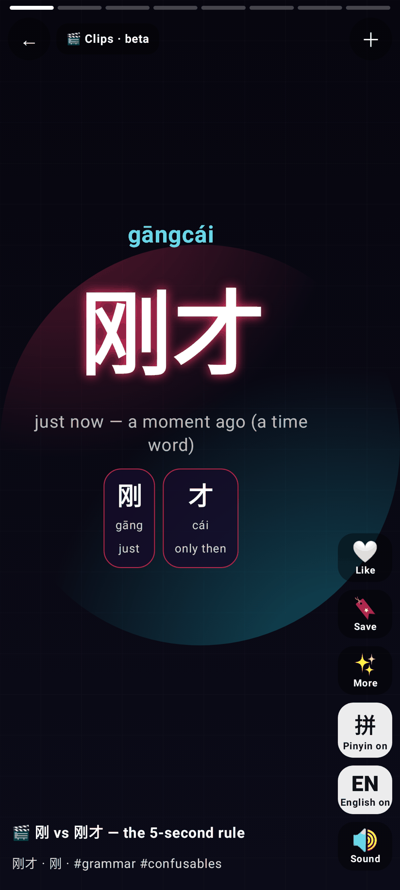

**Sentence with the highlight sweep**

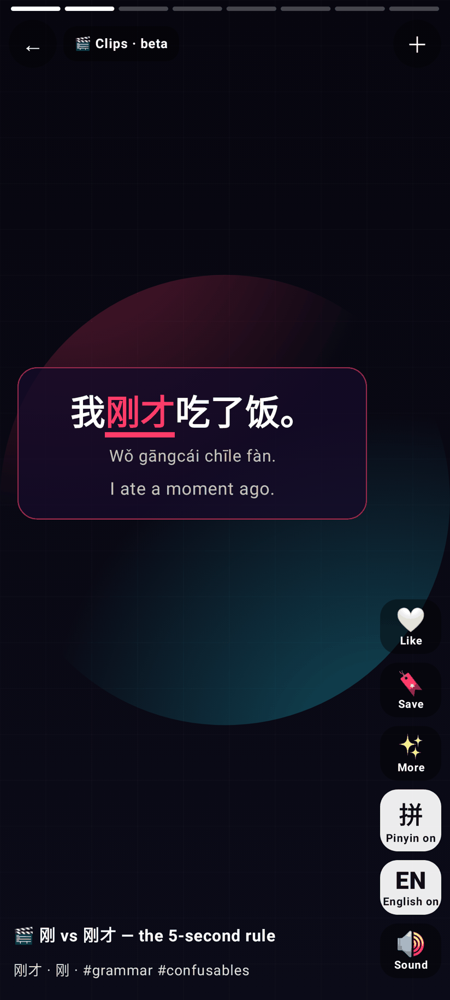

**Compare (A · VS · B + the rule)**

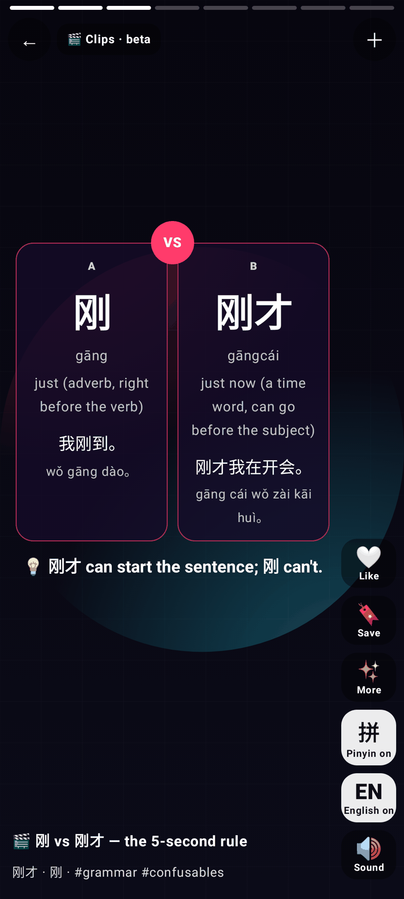

**Quiz waiting (timer bar)**

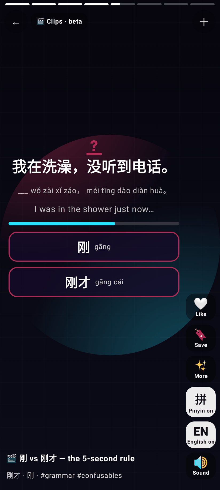

**Quiz answered wrong: ✗ / ✓ answer + explanation; Liked**

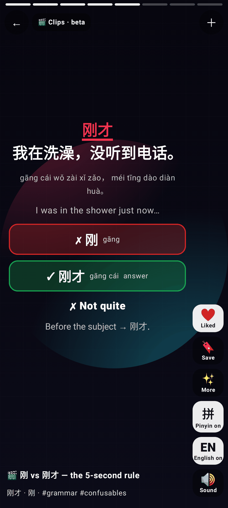

**Story bubbles (A left, B right)**

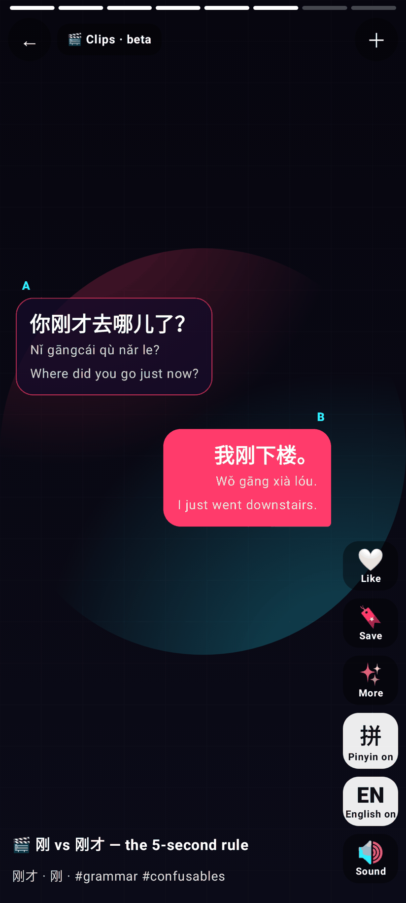

**List**

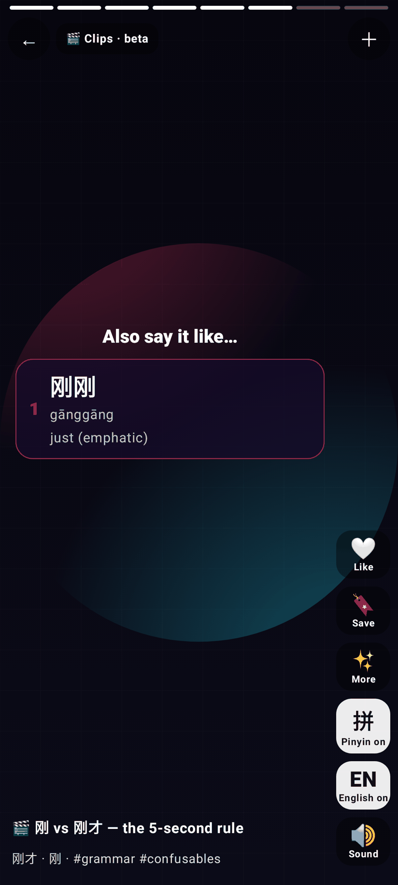

**Fact**

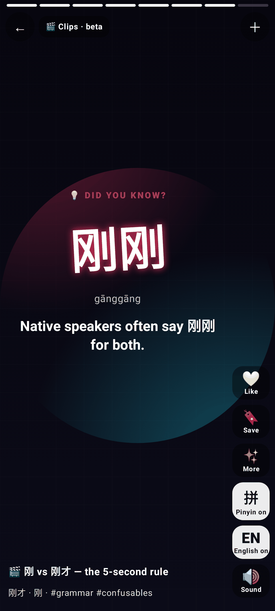

**End card**

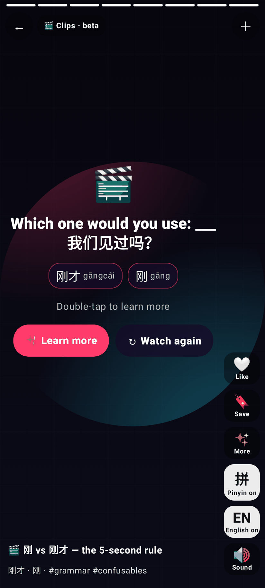

**Ink · named speakers, 旁白 centred**

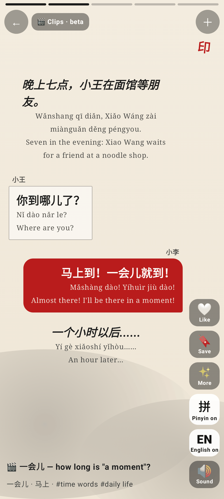

**Ink · big word**

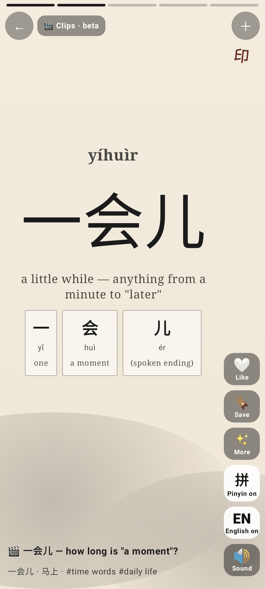

**Paper**

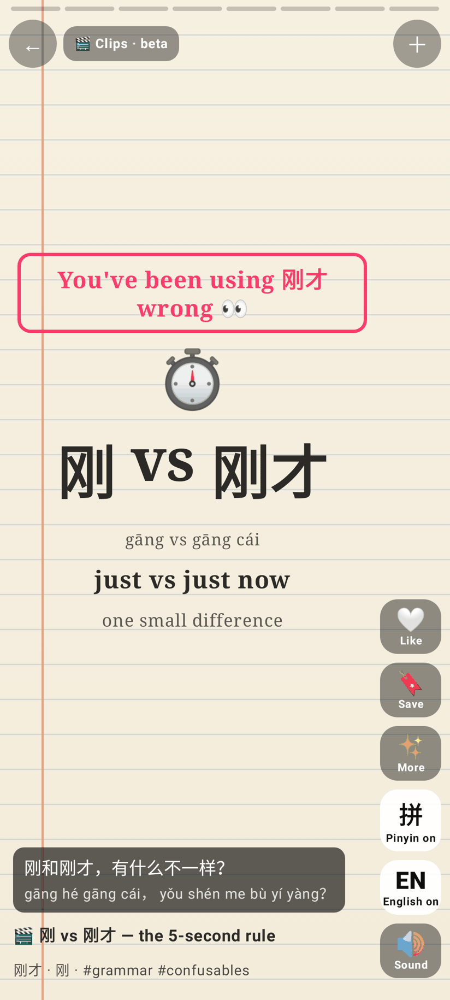

**Chalk**

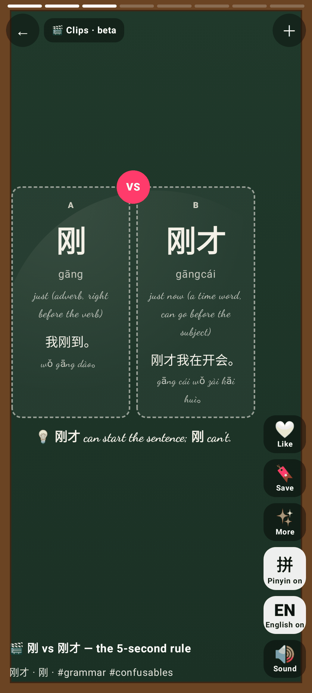

**Comic**

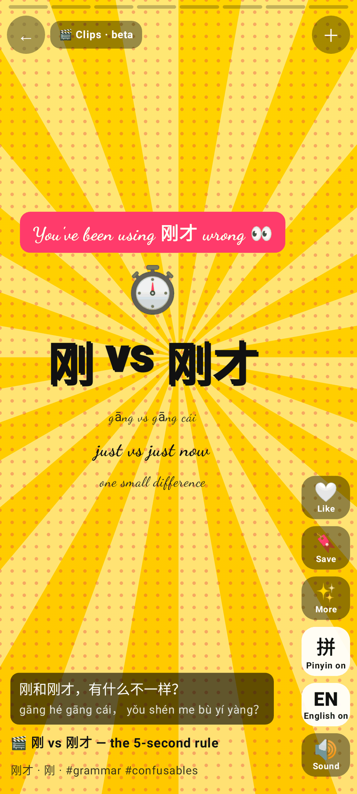

**Sunset**

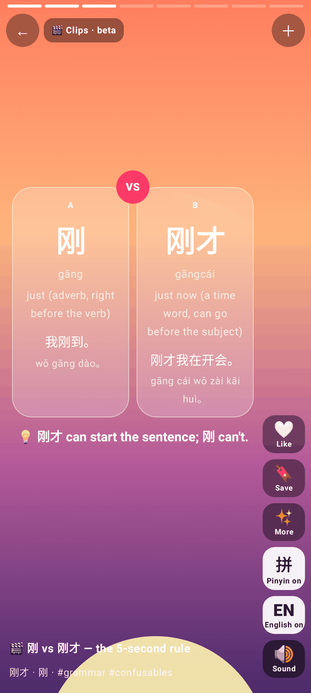

**Mono**

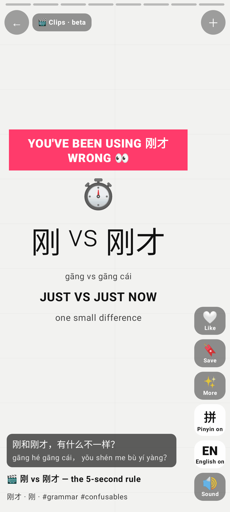

**Retro**

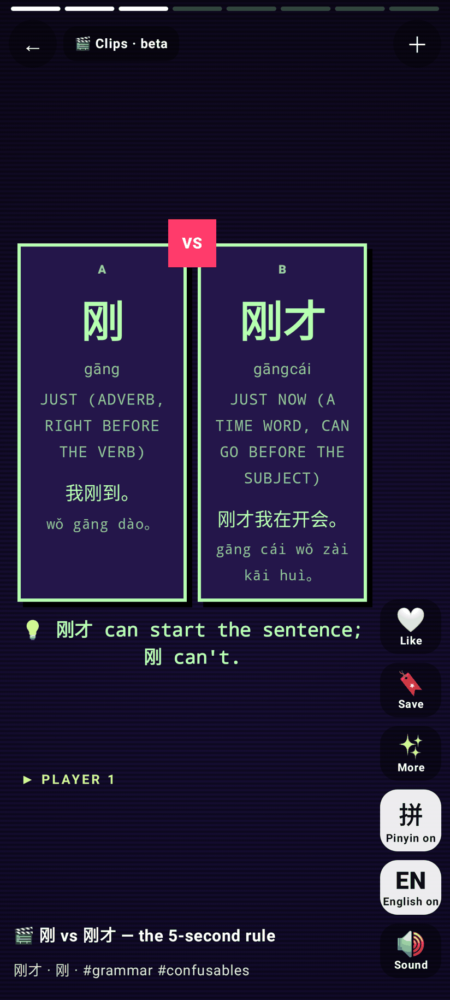

**Learn more sheet**

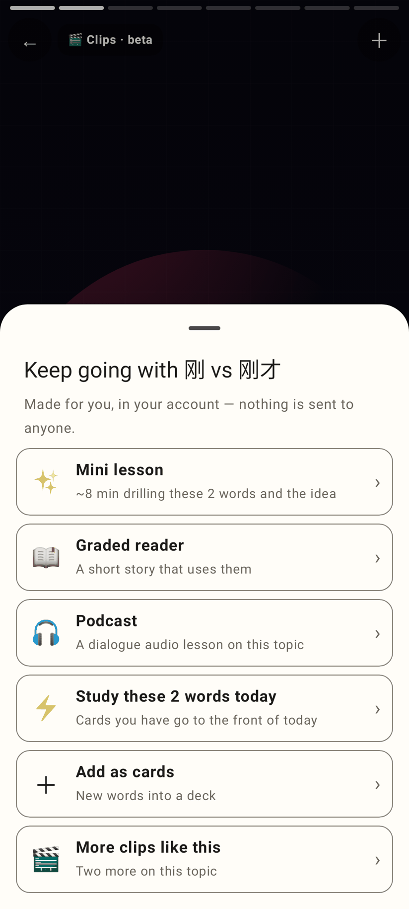

**Empty feed → Make 2 clips**

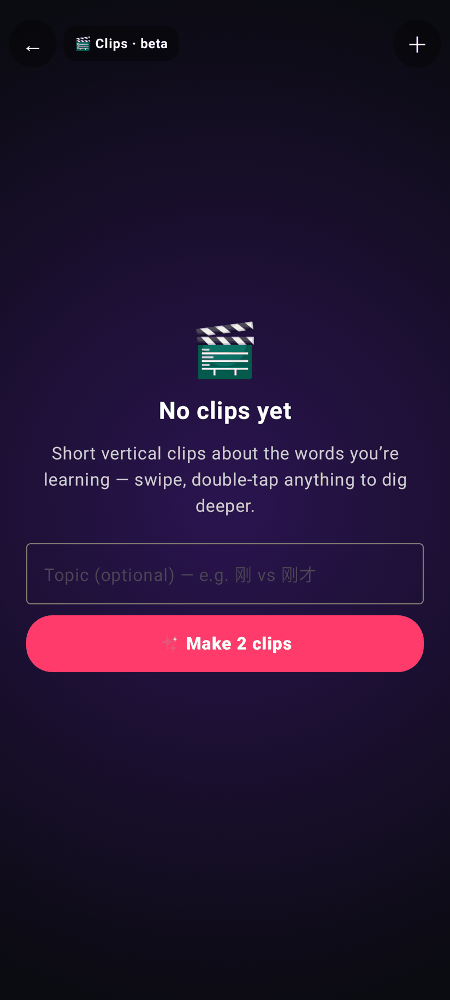

**Double-tap ❤️ burst**

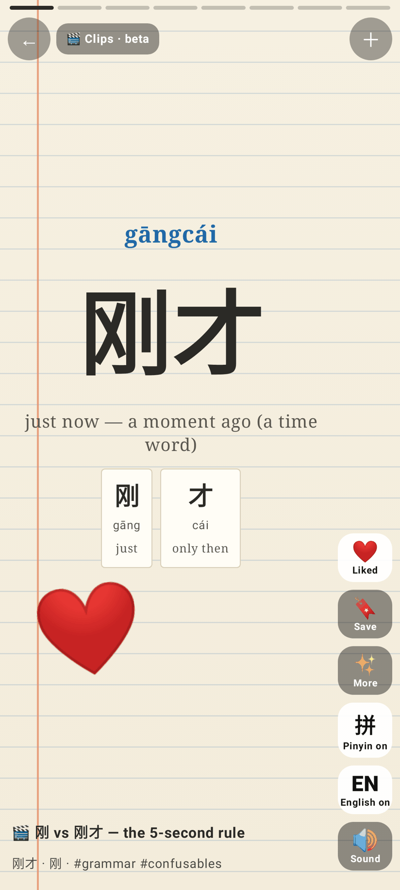

**Unfolded (841dp)**

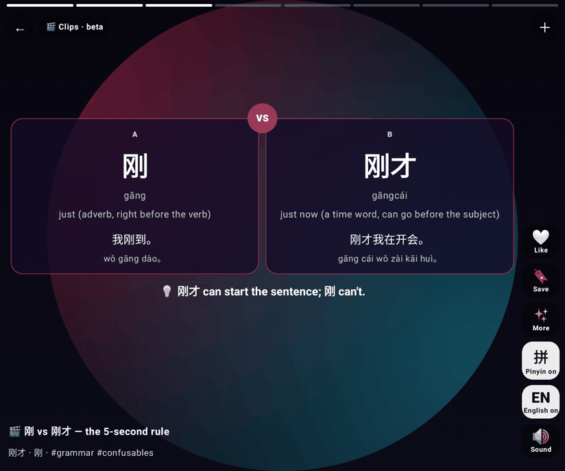
