# 💬 Ask Claude on the Sentence Coach — screenshots

Web (412×915 @2×, taken by `e2e/tests/coach-ask-chat.spec.ts` with `COACH_ASK_SHOTS`, E2E stand-in replies):

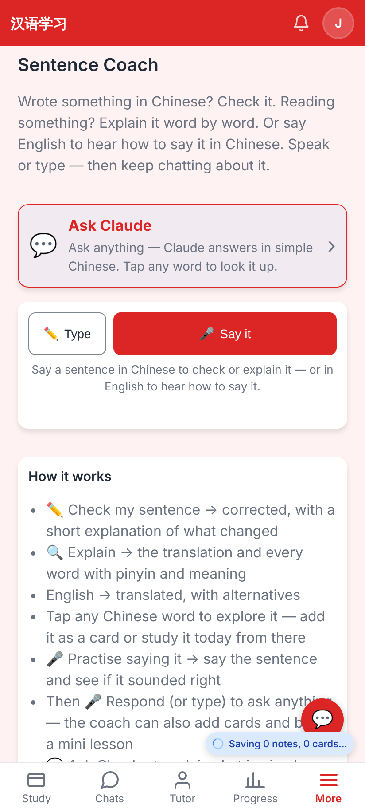
The Coach page: the new 💬 Ask Claude card above the sentence box.

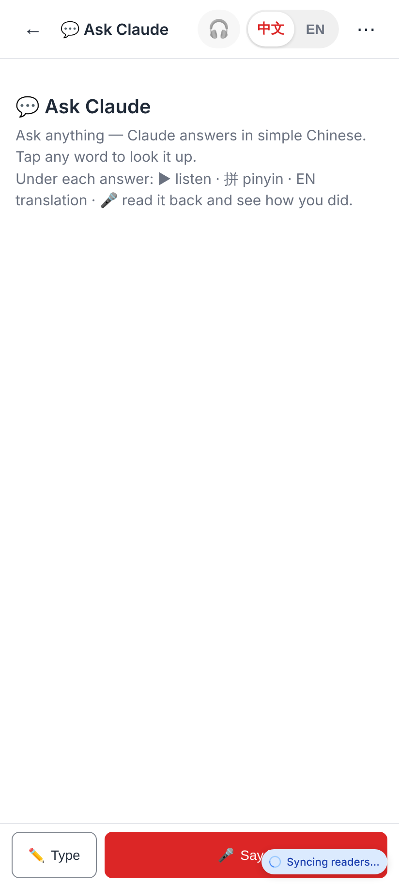
A fresh chat: just the voice-first composer, no deck pickers or chips.

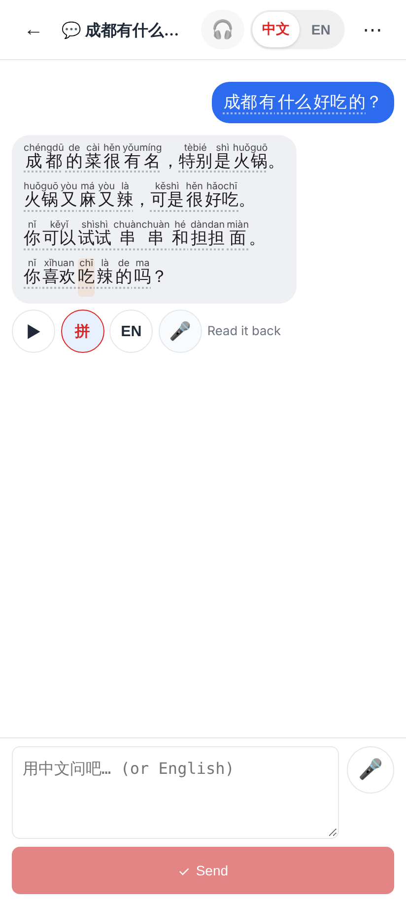
Claude answers in simple Chinese; every word is a chip; ▶ · 拼 · EN · 🎤 Read it back under the message (拼 on).

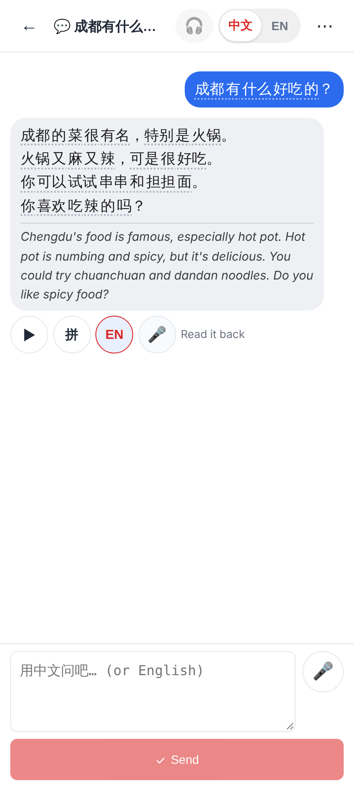
EN: the English under the bubble (made once, kept on the server).

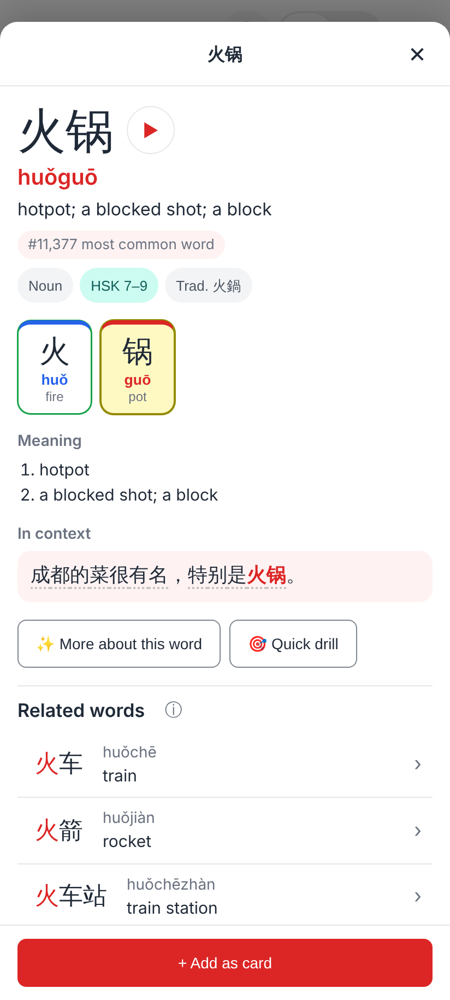
A tapped word (火锅) opens the language explorer — and is kept as a word to recap.

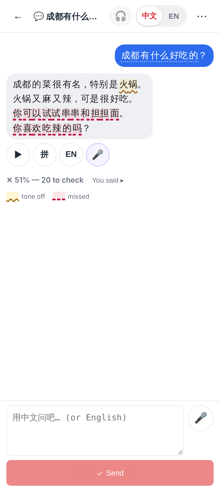
🎤 Read it back: the take judged against Claude's message (the readers' comparison) — tone off on 火锅 (heard 活过), the rest missed.

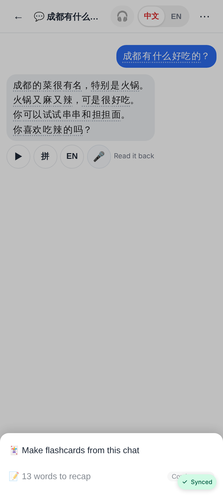
⋯: Make flashcards from this chat, and the words to recap (coming soon).

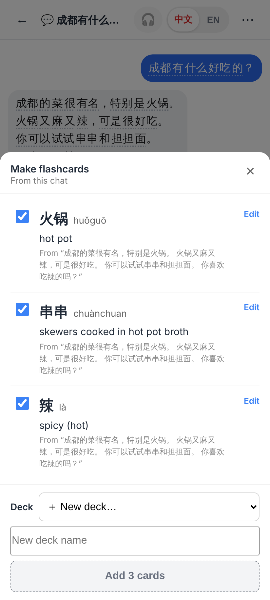
Make flashcards: the tapped / said-wrong words proposed first and ticked.

Lab app (Roborazzi, `ClaudeChatScreenshots`):

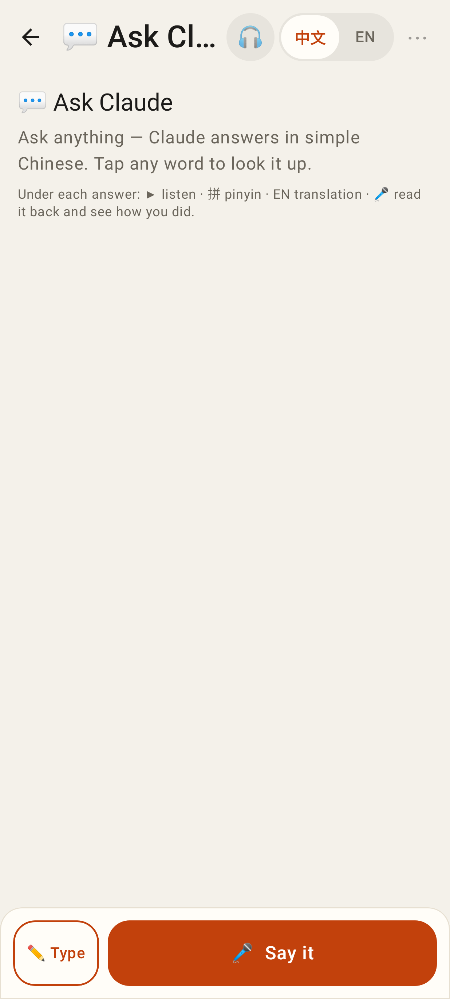
A fresh chat.

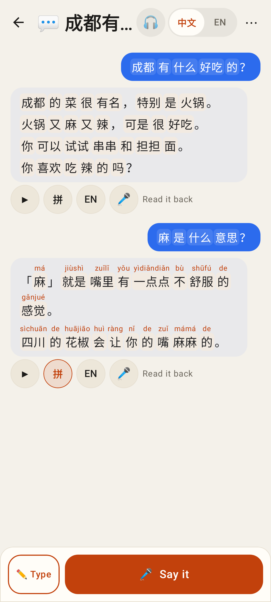
The chat (light) — 拼 on the second answer.

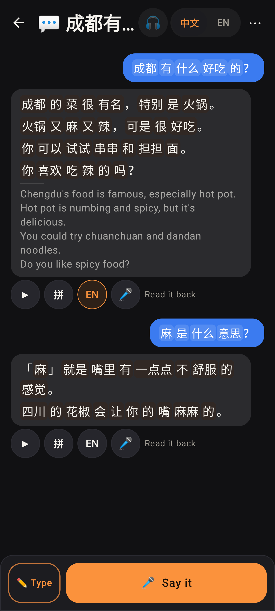
The chat (dark) — EN on the first answer.

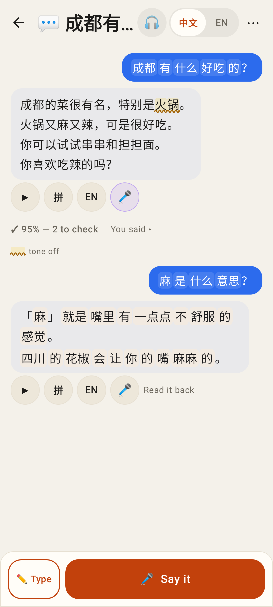
🎤 Read it back (light).

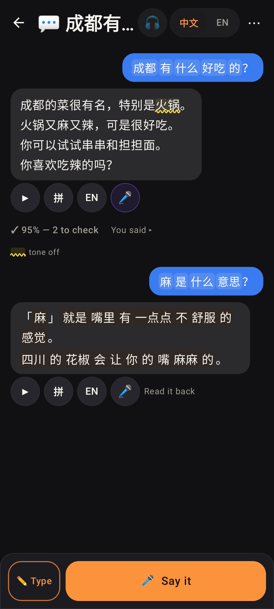
🎤 Read it back (dark).

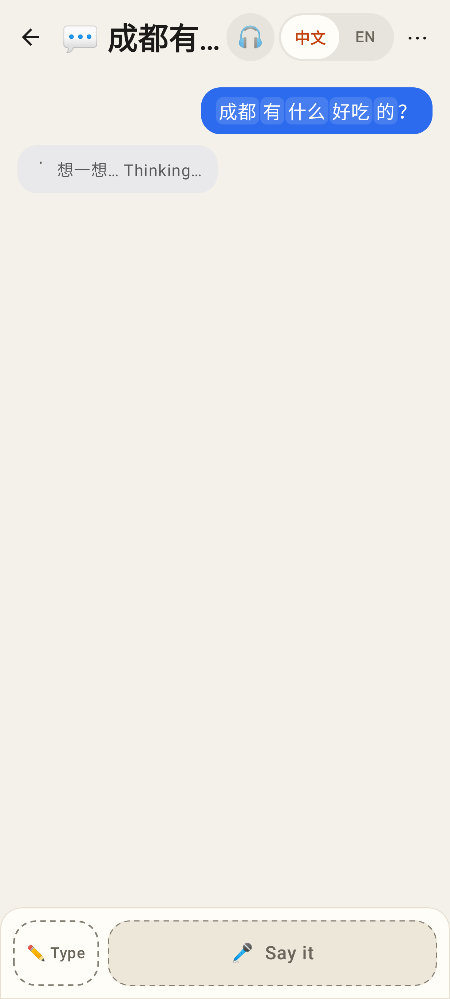
A reply being written in the background.

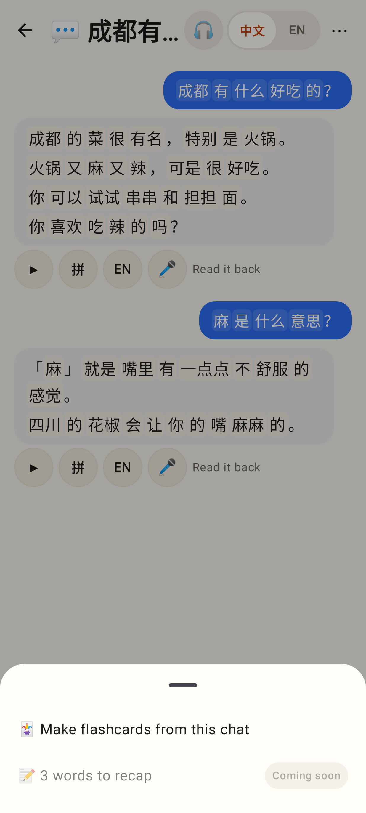
⋯: Make flashcards / words to recap (coming soon).
