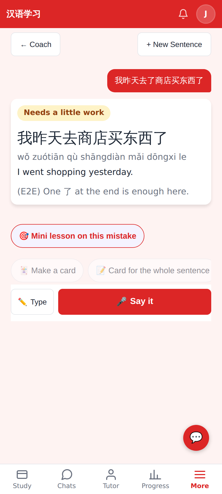
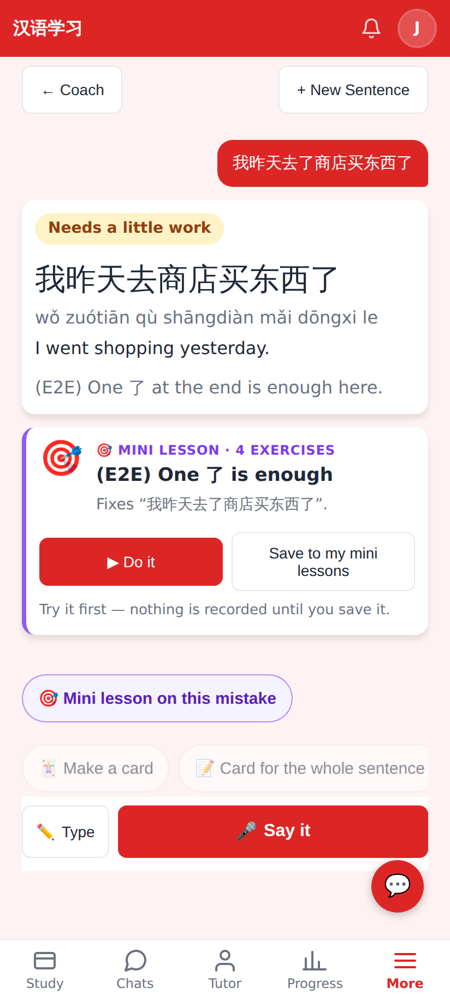
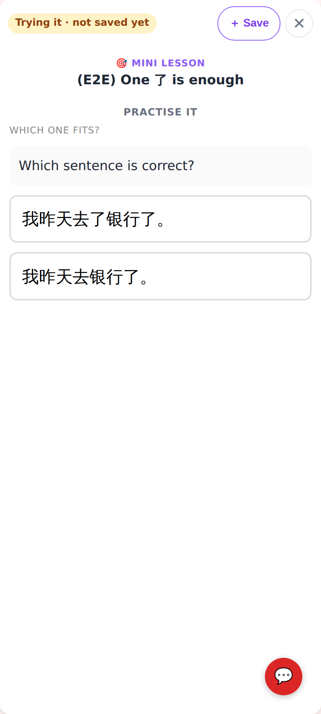
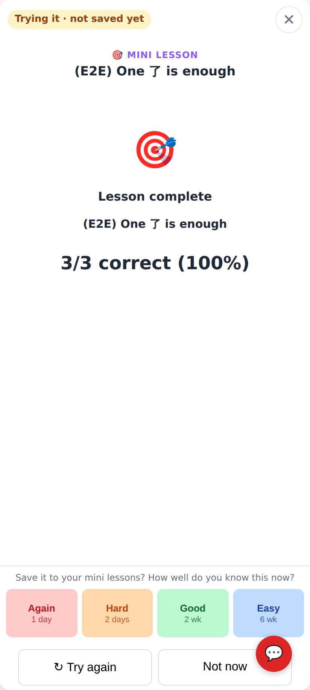
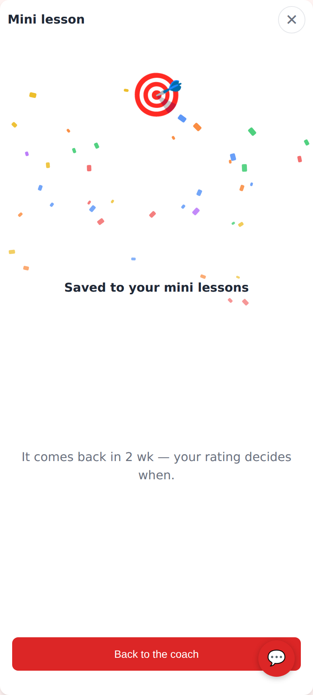

# 🎯 Mini lesson on this mistake

Phone viewport (412×915, 2×). Web shots come from `e2e/tests/coach-mistake-lesson.spec.ts` (`SHOOT=1`) against the
E2E fake model; Lab shots are the Roborazzi tests in `CoachMistakeLessonScreenshots`.

## Web

The check found a mistake: "🎯 Mini lesson on this mistake" leads the quick actions.

The lesson is written in the background and lands as a card: ▶ Do it · Save to my mini lessons.

The real lesson player, nothing recorded ("Trying it · not saved yet"), with ＋ Save in the top bar.

At the end: "Save it to your mini lessons?" — the rating saves it with this run as its first completion.

Saved: it comes back when the rating says (Good → 2 weeks), not as a new lesson tomorrow.

## Lab app

The chip first in the quick-action row.

"Writing your mini lesson…" — the chat stays usable meanwhile.

The lesson card in the conversation.

An exercise in the preview with ＋ Save.

The end of the lesson: the rating bar saves it; ↻ Try again / Not now.

Saved, with when it comes back.
