# Sentence Coach: 🎤 Respond, no chips, tappable Chinese, 🎤 Practise saying it

Phone width (412 × 915, 2×). Web is light only (the web app has no dark theme yet); the Lab app in light and dark.

Before: the chip row ("⚡ Study words from this today…", "🃏 Card for this sentence", …) and the "Cards go to" deck picker under the conversation, and "🎤 Say it" in the follow-up — see [../claude-coach-bump-picker/README.md](../claude-coach-bump-picker/README.md).

## Web

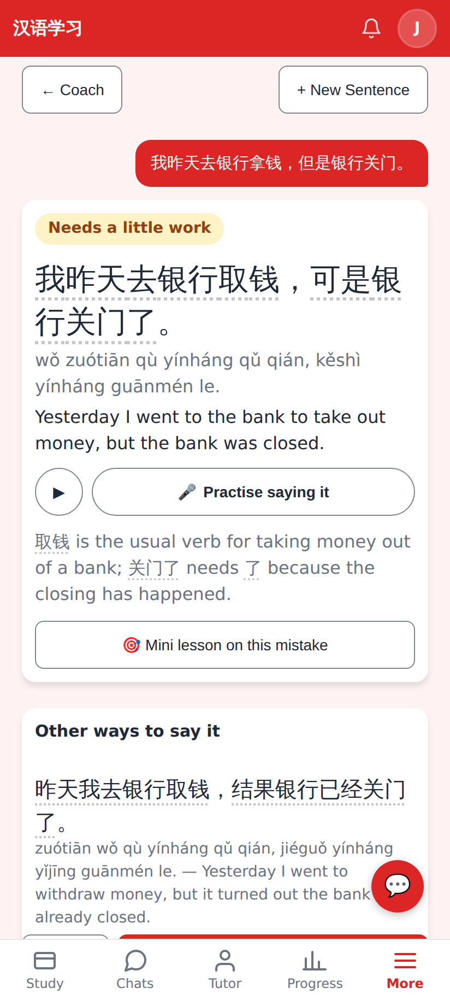
The corrected sentence, the critique and each alternative are word chips (dotted underline); ▶ + 🎤 Practise saying it under every big sentence.

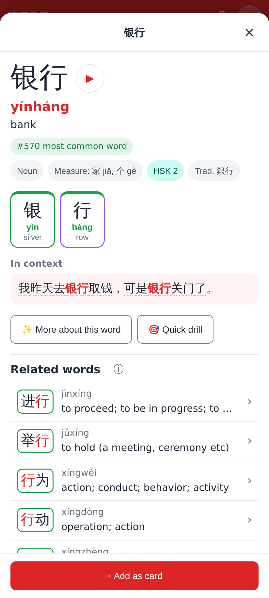
Tapping 银行 opens the language explorer (+ Add as card / ⚡ Study it today live there now).

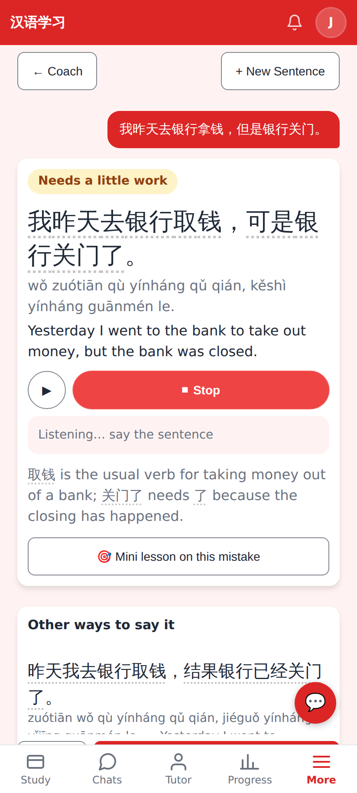
Recording: tap again, press Enter or tap anywhere on the card to stop.

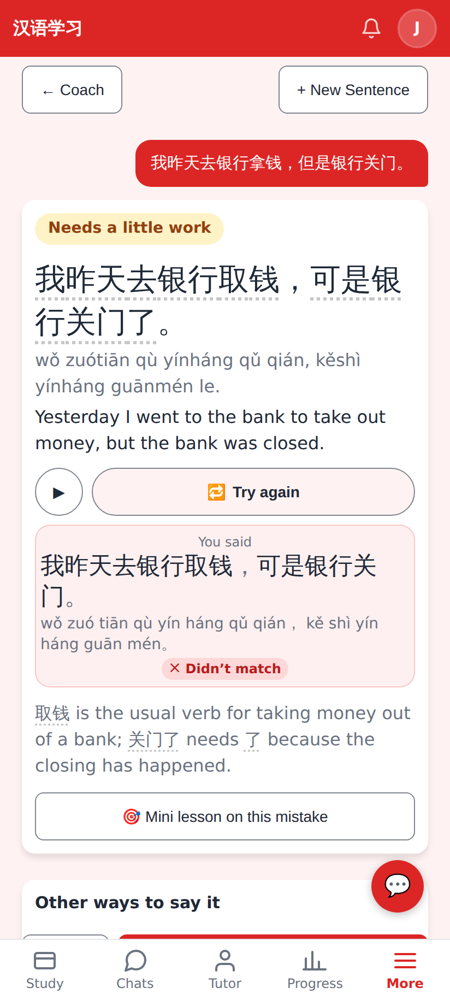
The take checked like a spoken answer (了 left out → ✕ Didn't match), then 🔁 Try again.

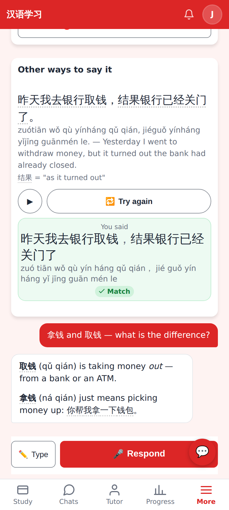
"Other ways to say it" has its own ▶ / 🎤 — ✓ Match.

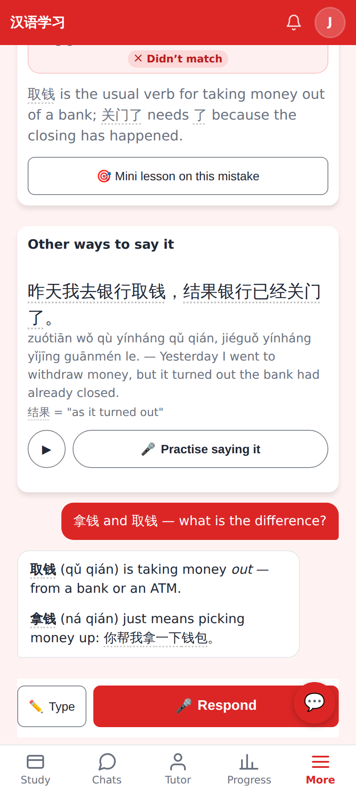
Claude's reply is tappable too; the follow-up composer says 🎤 Respond; no chip row, no "Cards go to".

## Lab app

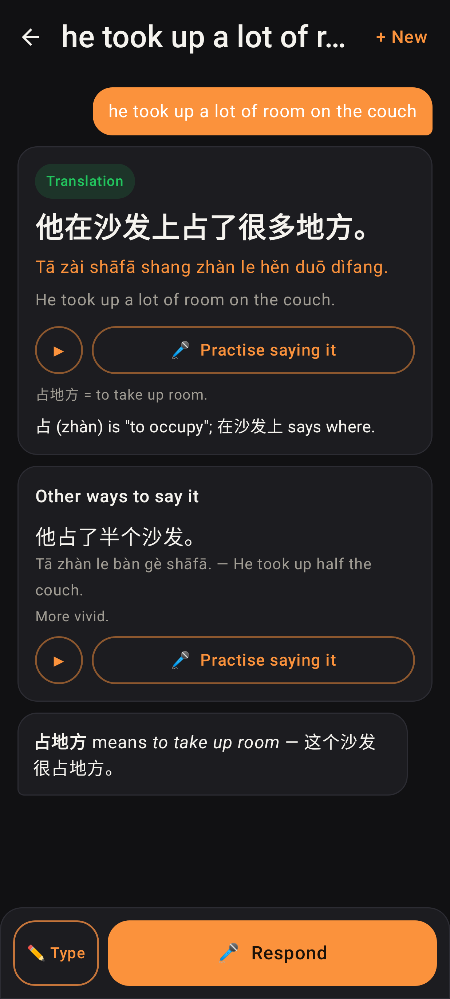
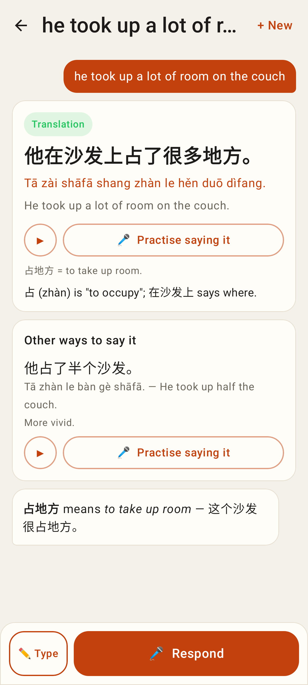
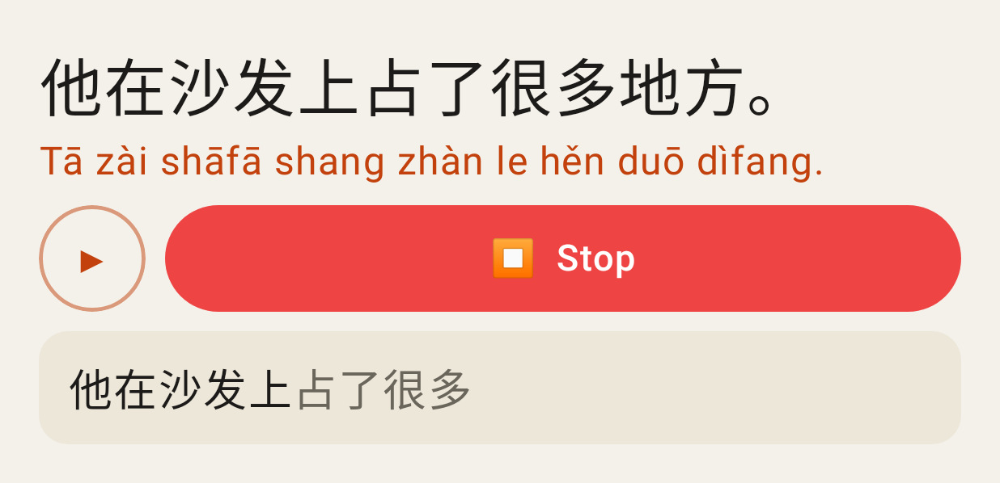
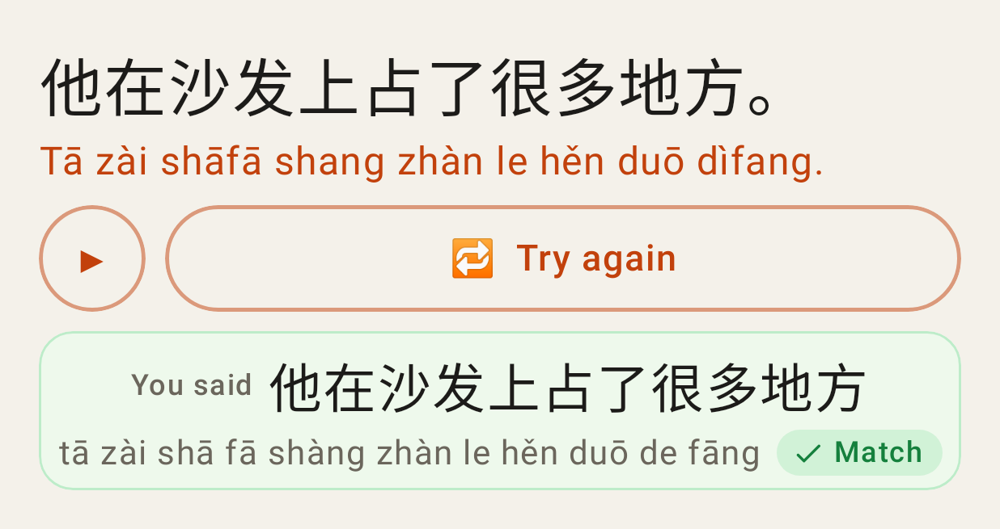
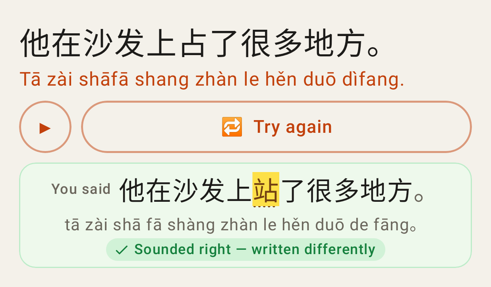
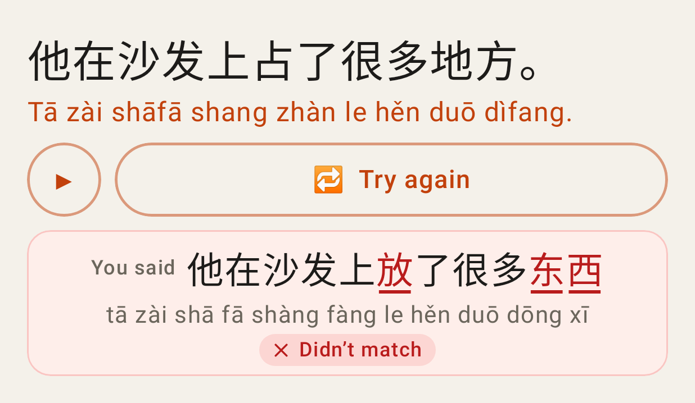
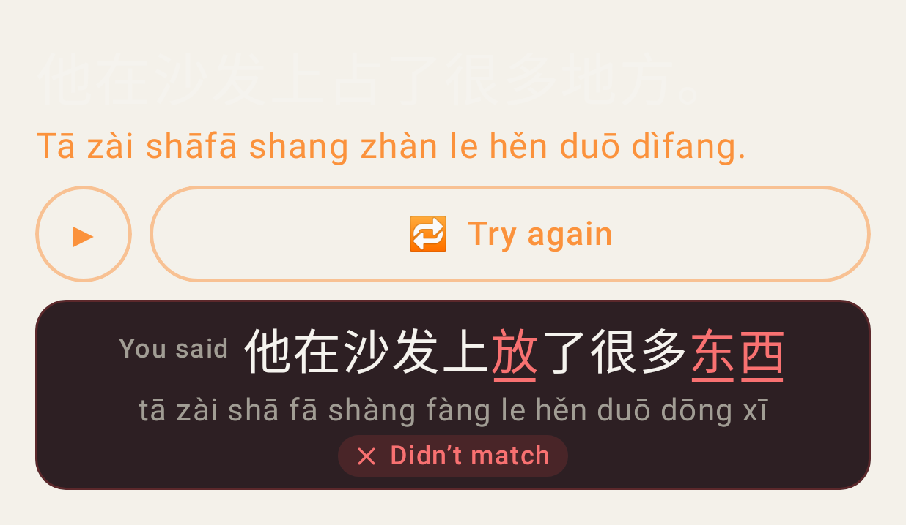
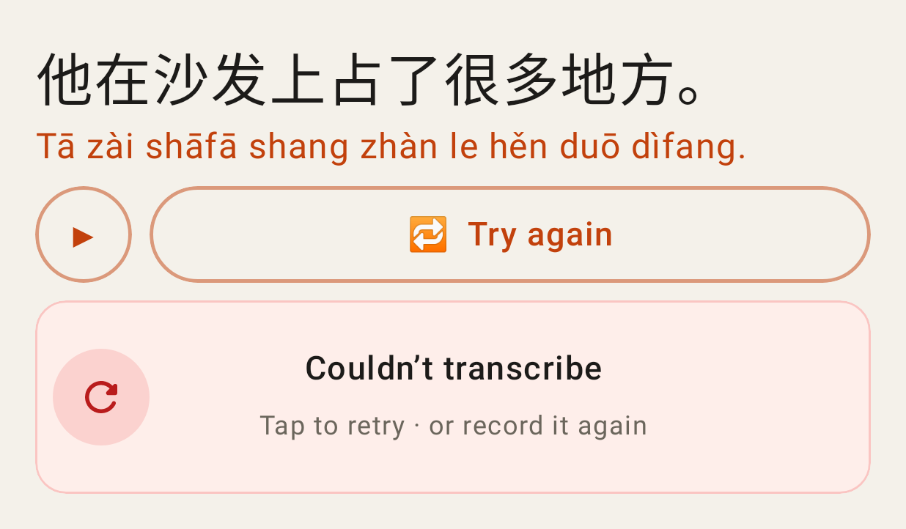
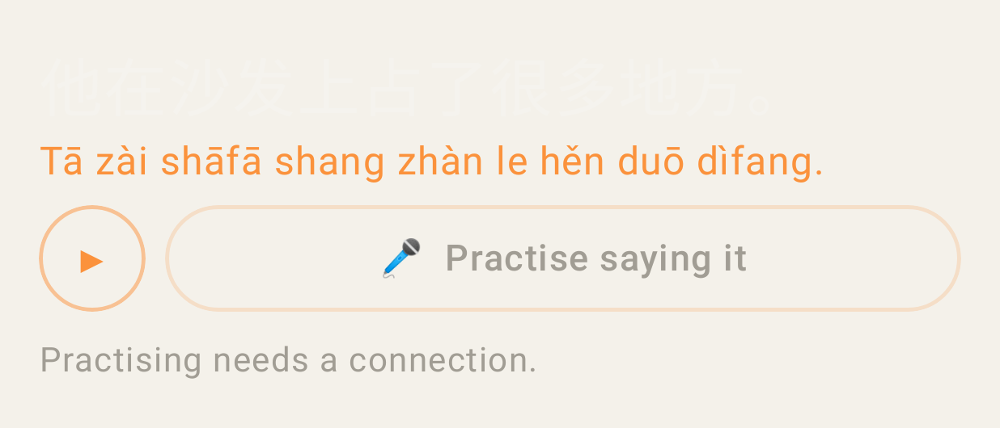
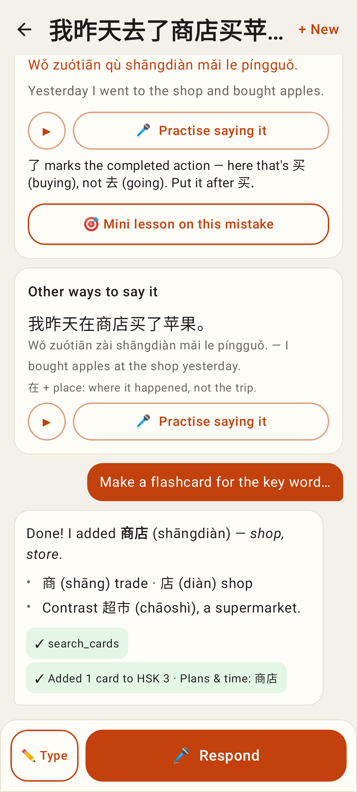
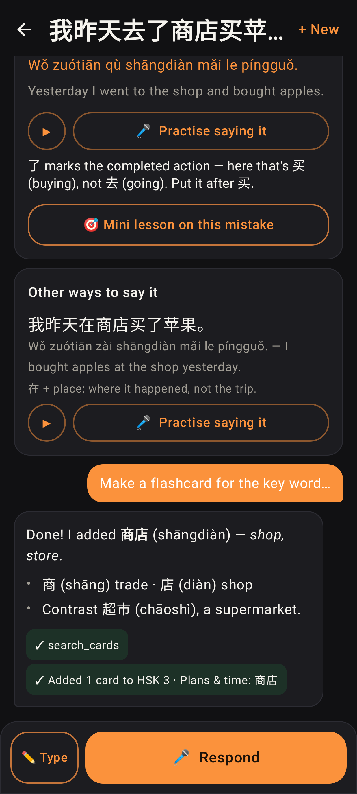
