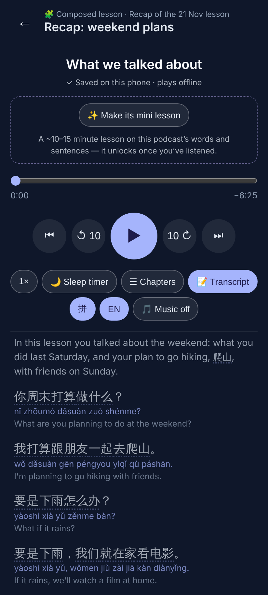
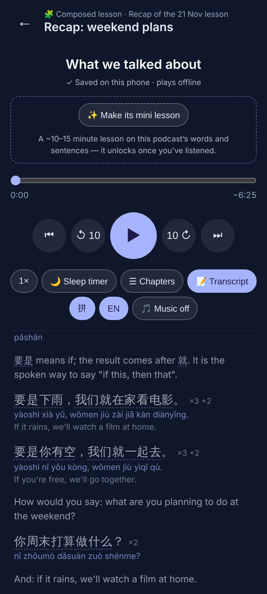
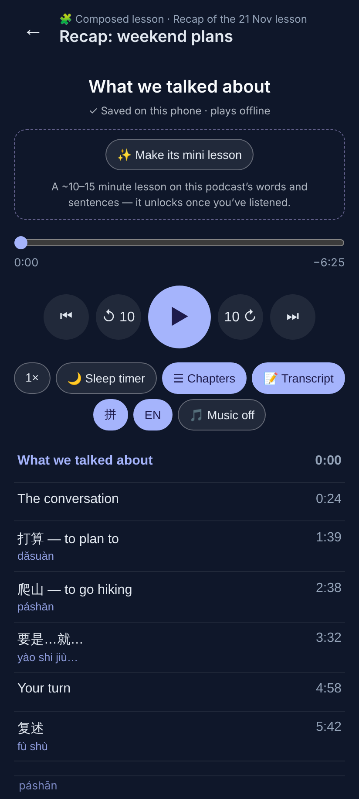

# Composed audio lessons — screenshots

Web, 412×915 @2x, E2E_TEST_MODE (fake voices). The composed lesson is the sample recap
(`SAMPLE_COMPOSED_RECAP_PLAN`) made through the API exactly as the MCP `compose_audio_lesson` tool does, with
`source.label` "Recap of the 21 Nov lesson".

The audio lessons list: the composed lesson gets the 🧩 icon and its source under the title (new), next to a sleep lesson (unchanged).

The player header: "🧩 Composed lesson · Recap of the 21 Nov lesson". Everything else is the existing player.

The transcript: a structure's English line, its example drills as one row each ("×3 +2" with pinyin + English), a recall prompt and its answer ("×2").

The chapters as the plan made them: What we talked about · The conversation · 打算 · 爬山 · 要是…就… · Your turn · 复述.
