# Dark mode: every button has an outline

Before / after, phone viewport. The Lab app has the real dark theme; the web app is light-only today
(only a few chat pieces follow the system dark setting), so the web shots show the light theme with the new
≥ 3:1 outlines, plus the chat composer in system dark.

## Lab app (dark)

| Before | After |
|---|---|
| 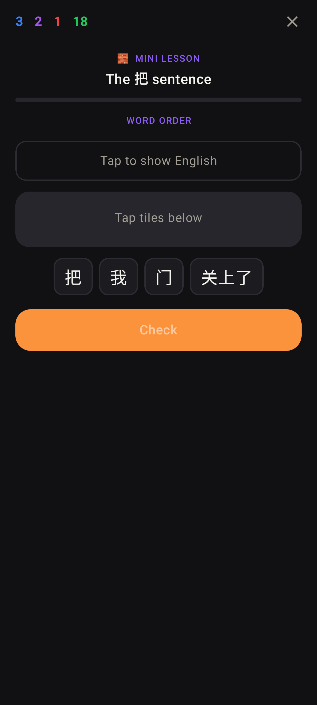 | 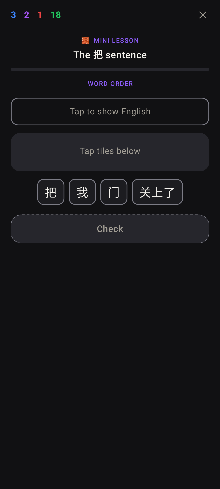 |
| 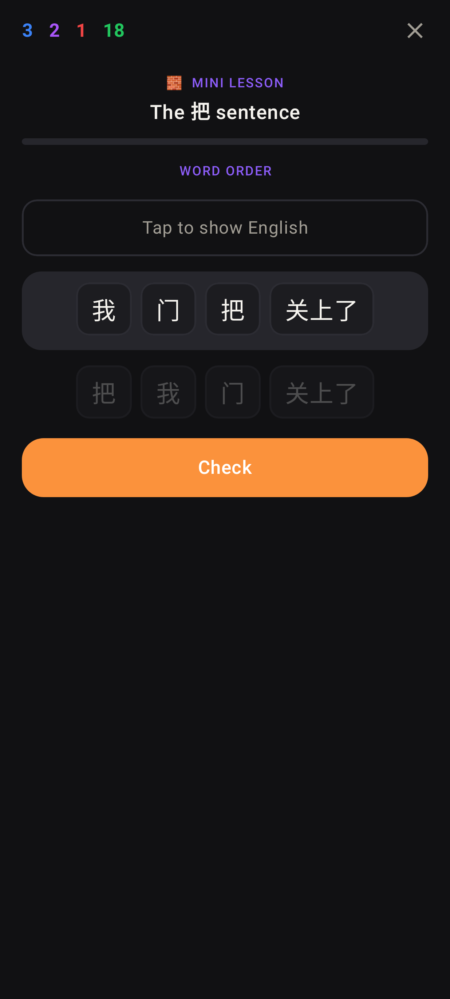 | 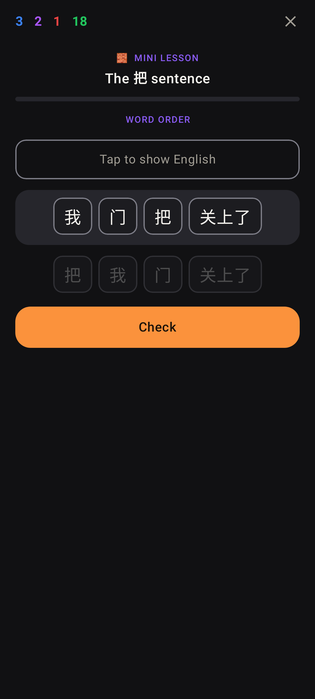 |
| 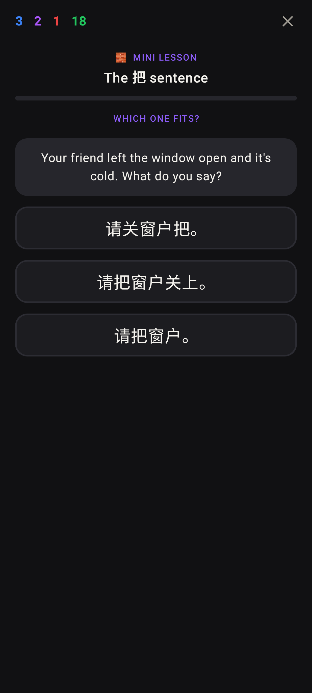 | 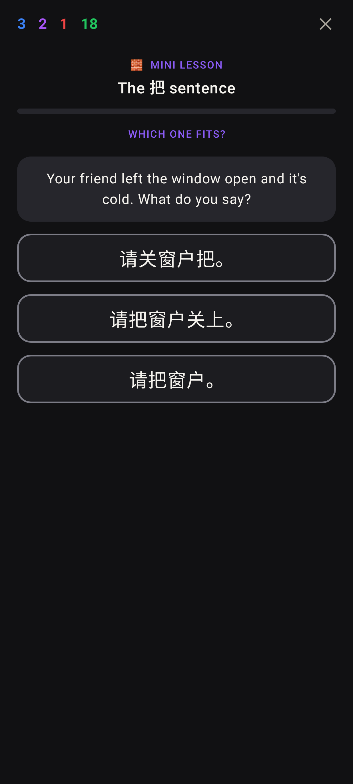 |
|  | 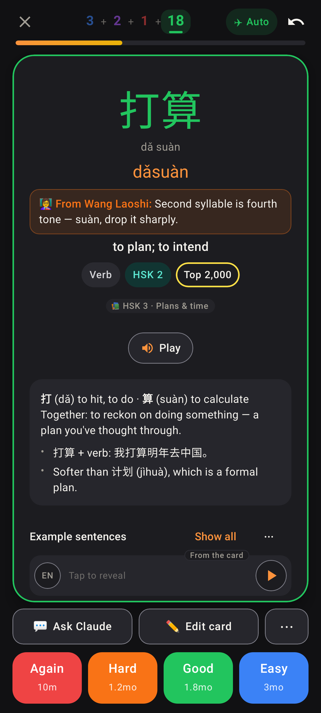 |
|  | 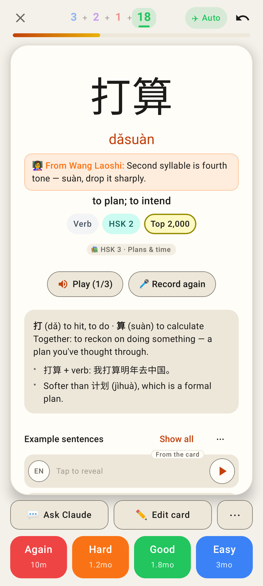 |
| 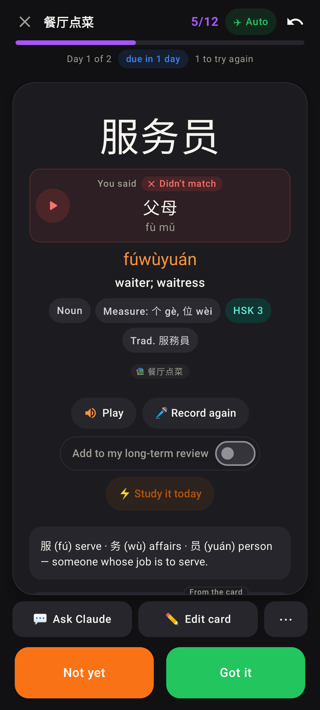 |  |
| 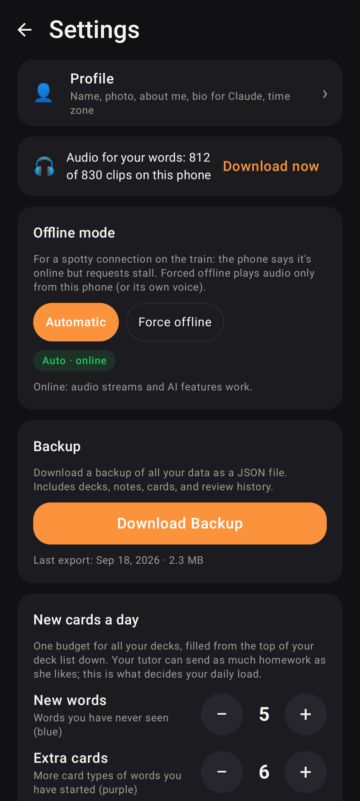 | 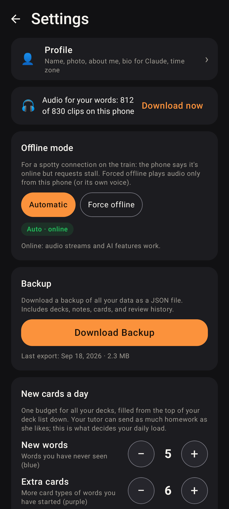 |
|  | 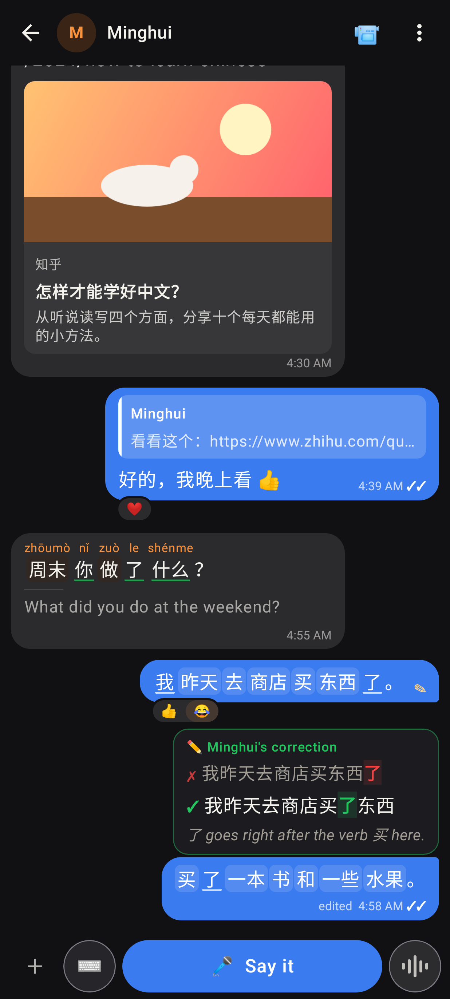 |

## Web app

| Before | After |
|---|---|
| 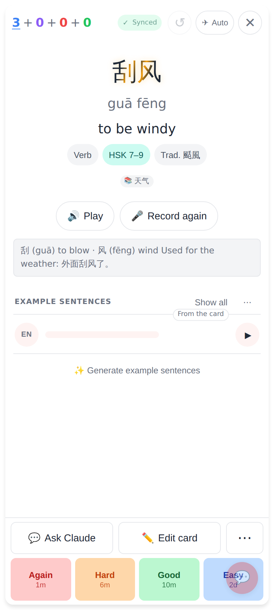 | 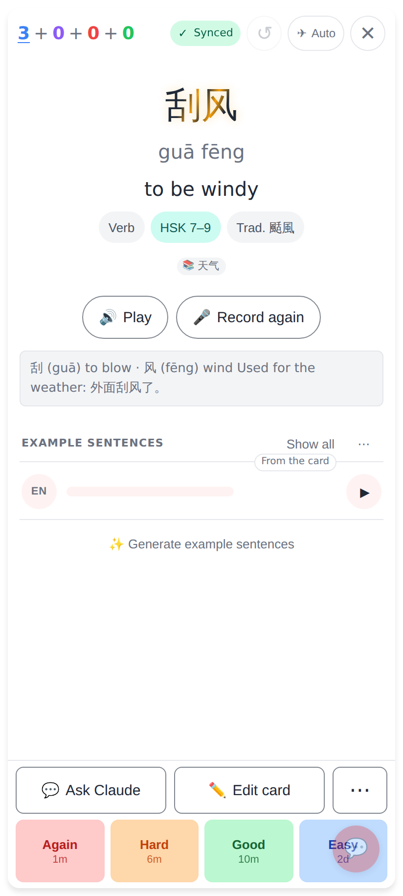 |
| 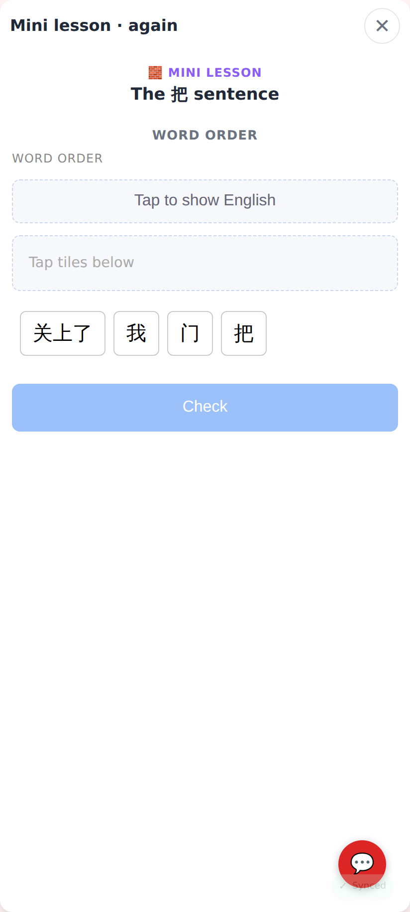 | 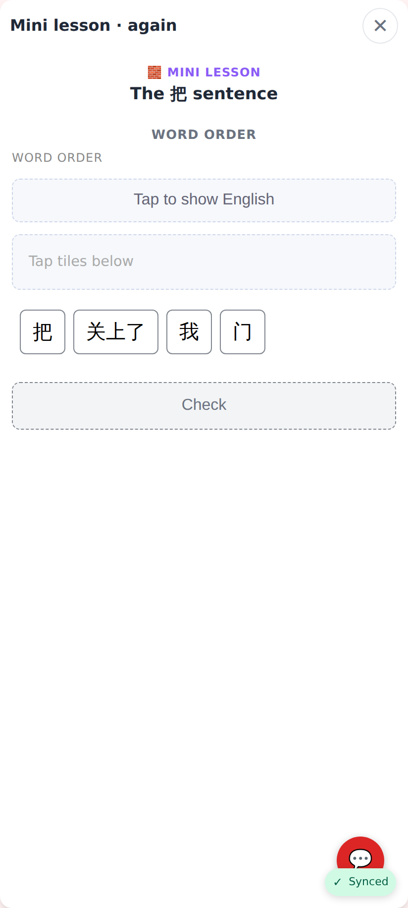 |
|  | 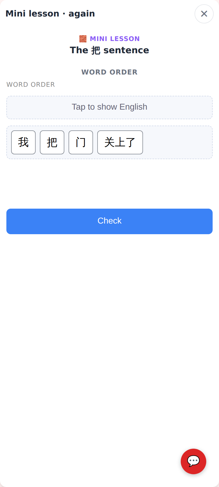 |
| 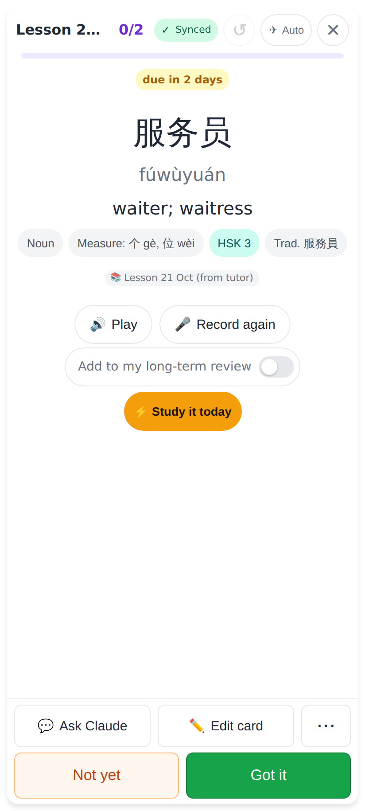 | 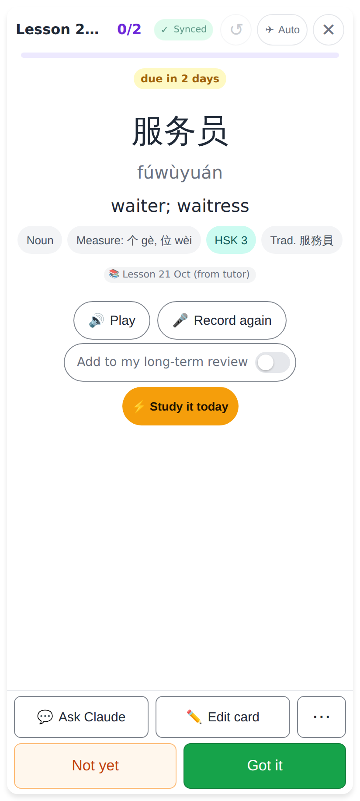 |
| 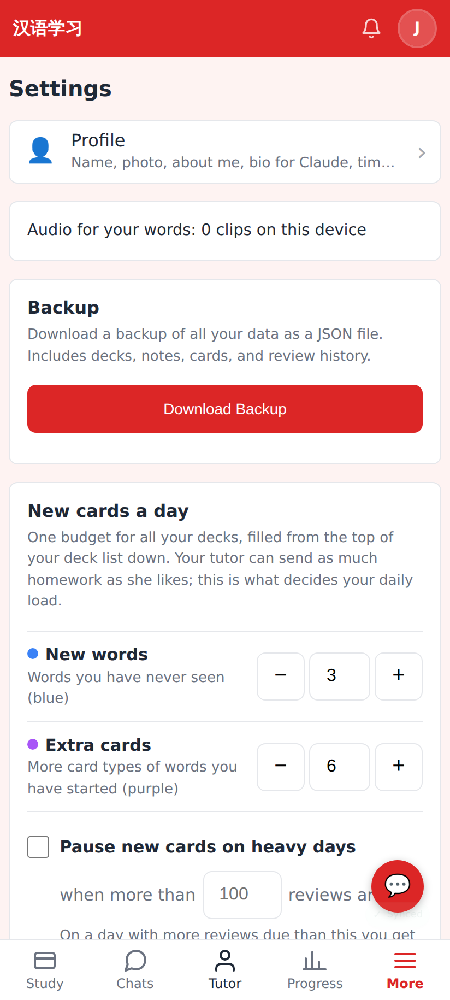 |  |
|  | 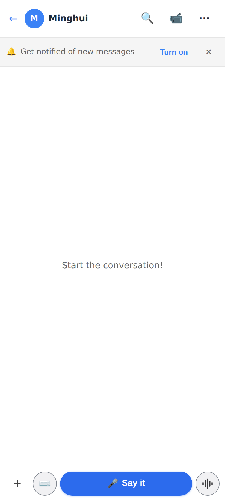 |

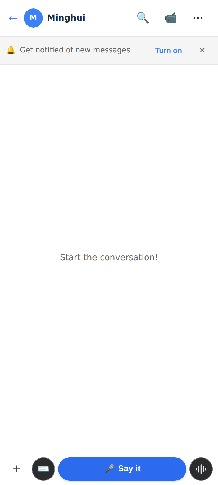
