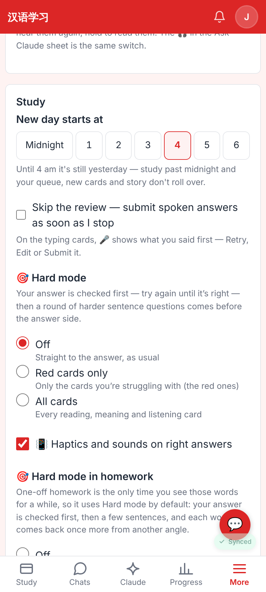
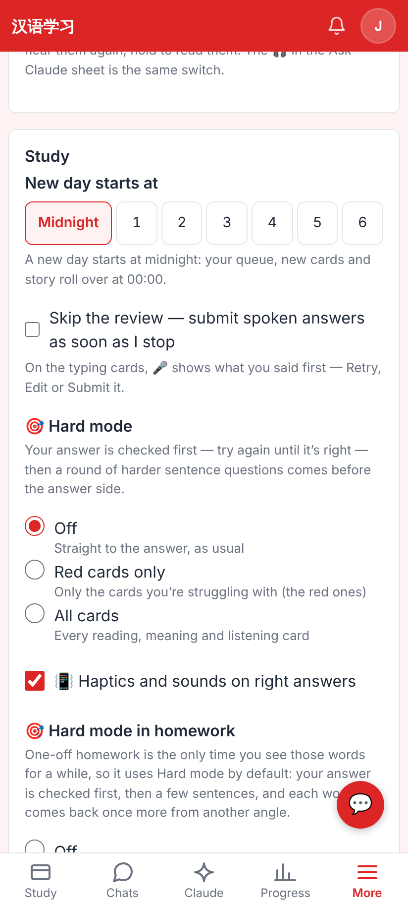
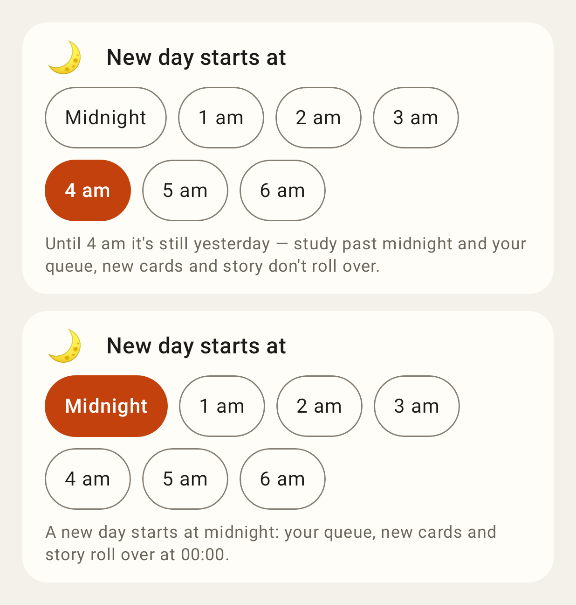

# "New day starts at" — screenshots

Web at 412×915 @2× (Settings → Study), Lab from Roborazzi (`day-rollover-01-setting`).

Web: "New day starts at" at the top of Settings → Study, 4 am selected (the default) with its line.

Web: Midnight chosen — the old calendar-day behaviour, saved at once.

Lab app: the same setting as a card (4 am / midnight states).
