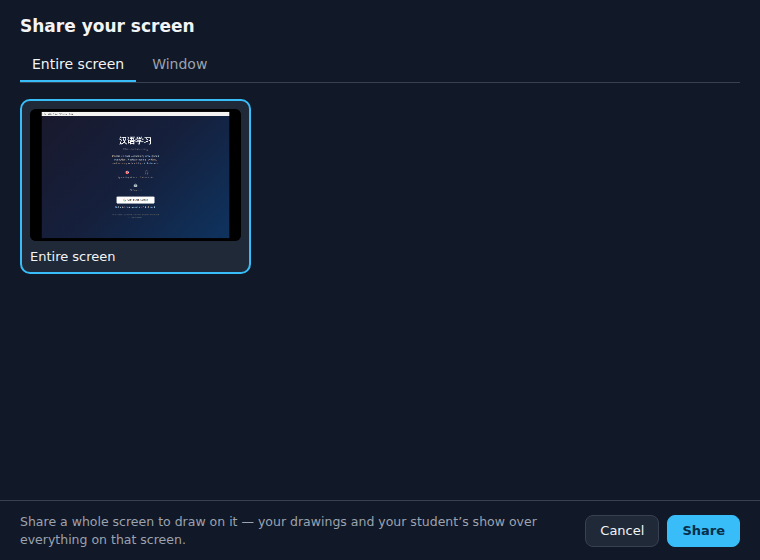
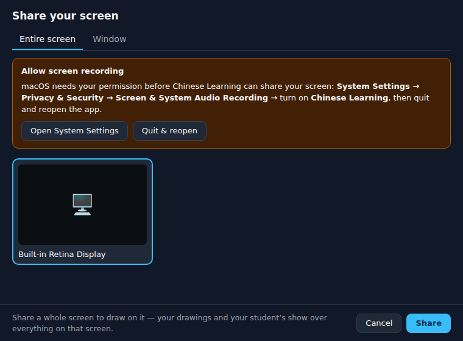
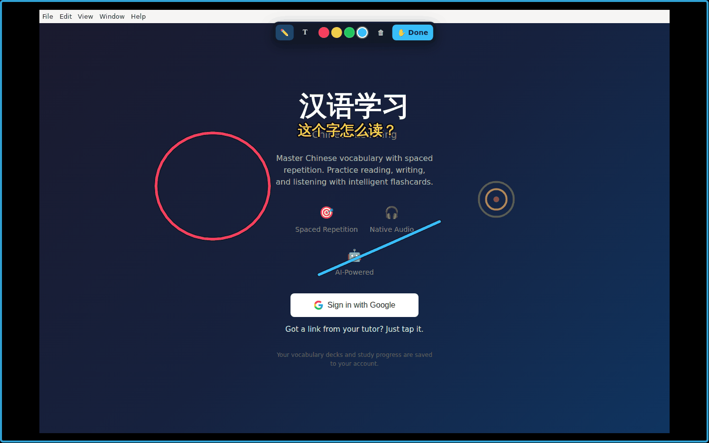
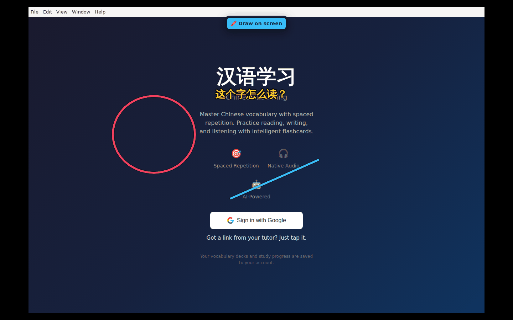

# Desktop app prototype — screenshots

Taken from the real Electron app on Linux under a virtual display (Xvfb, 1440×900) by its smoke
test (`desktop/src/smoke.ts`), running the web app built from this branch. The Mac app is the same
code; macOS draws its own title bar and menu bar.

The app window: the web app itself (here signed out — sign-in opens the system browser).

The page asked for a screen share; the desktop app's picker answers it (Entire screen / Window).

On a Mac without the Screen Recording permission the picker says how to turn it on (rendered with a test payload).

Sharing the entire screen: the overlay covers the real screen. Draw mode (blue frame) with the toolbar — the student's red circle, text and ping, and the tutor's blue line.

After ✋ Done: the drawings stay on the screen, clicks go to the apps underneath, and the toolbar shrinks to 🖍️ Draw on screen.
