# Drop the learner's Tutor tab

Before — Jerome's Lab "Tutor" tab (a list of connections that duplicated Chats):

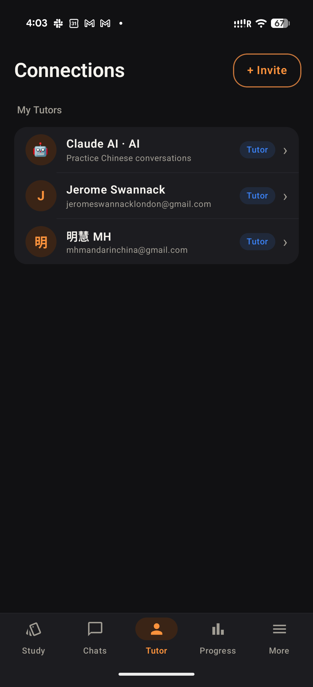

## Web (412×915 @2×)

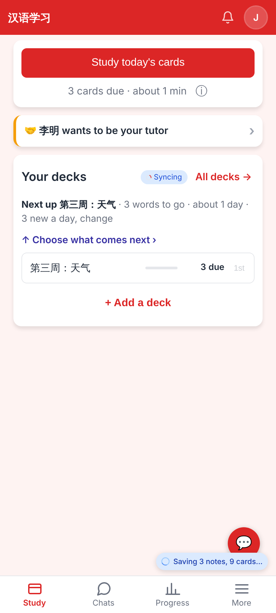
Home — four tabs; a request waiting on me shows as "🤝 李明 wants to be your tutor ›".

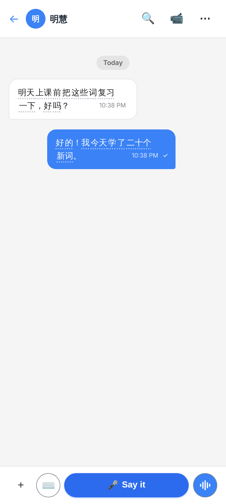
The chat header — tapping 明慧 opens her page.

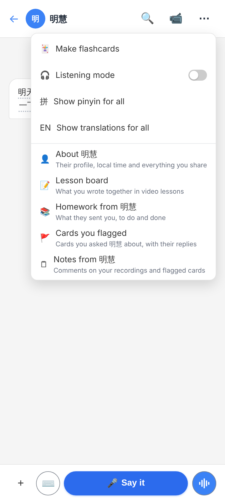
Chat ⋯ — About 明慧 · Lesson board · Homework from 明慧 · Cards you flagged · Notes from 明慧.

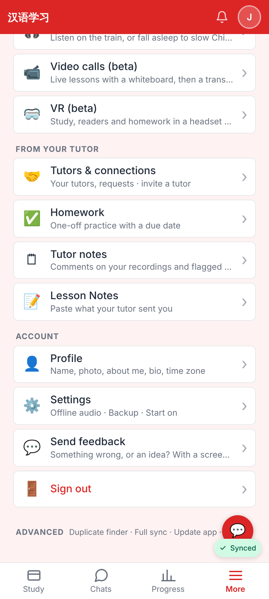
More → From your tutor → 🤝 Tutors & connections.

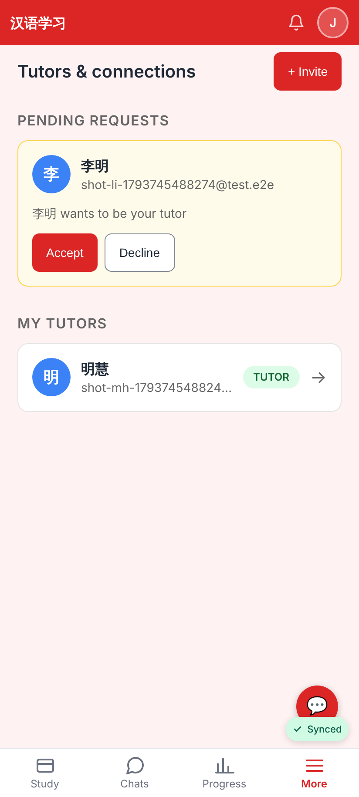
`/connections` for a learner — requests with Accept / Decline, My Tutors (the Claude partner hidden); More is lit.

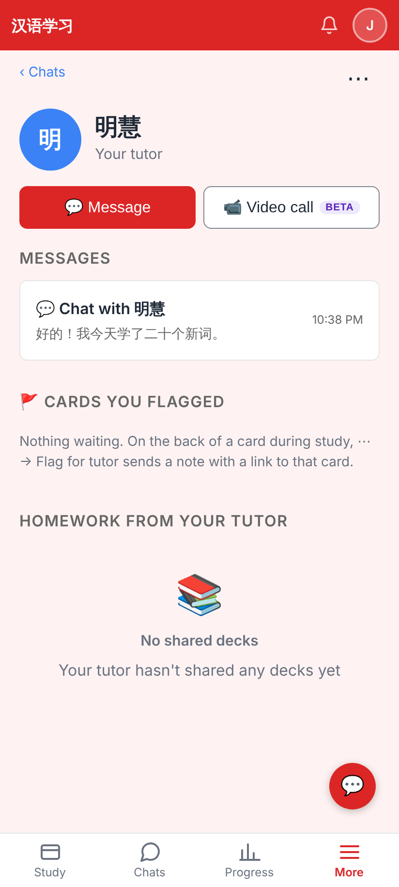
The tutor page (opened directly here, so ‹ Chats; from the chat it is ‹ Back).

## Lab app (light / dark)

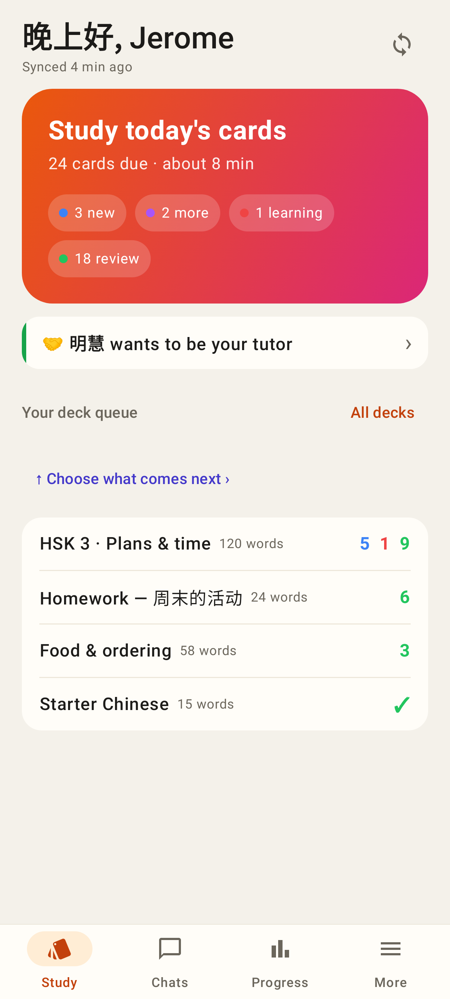 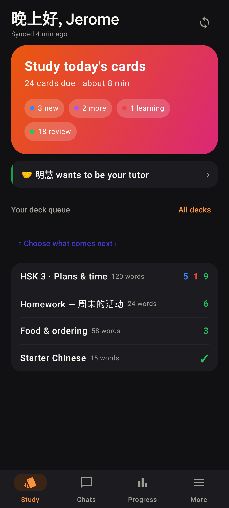
Home — Study · Chats · Progress · More and the request row.

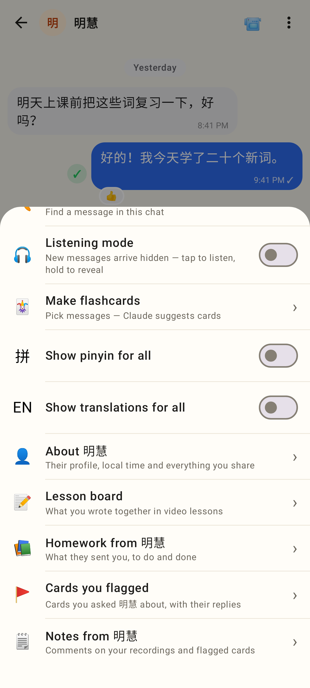 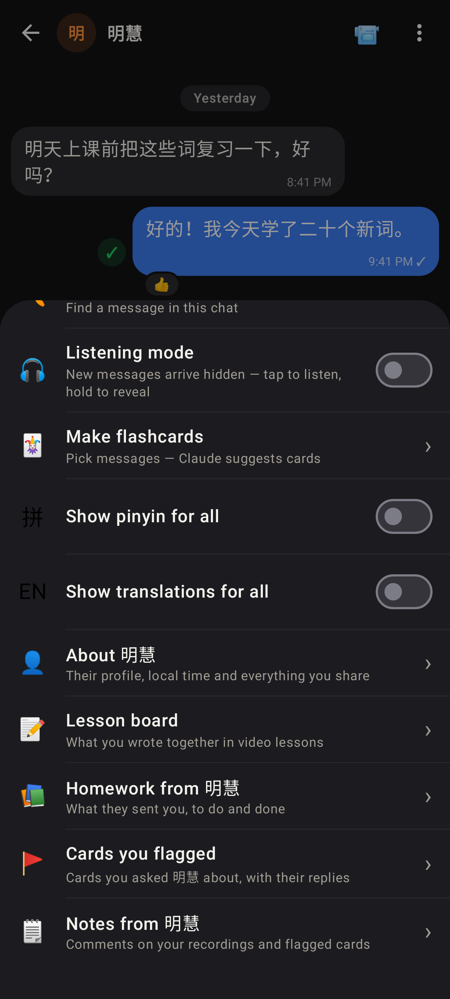
Chat ⋯ with the tutor page's parts at the end.

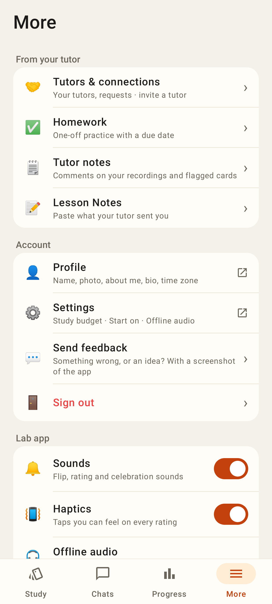 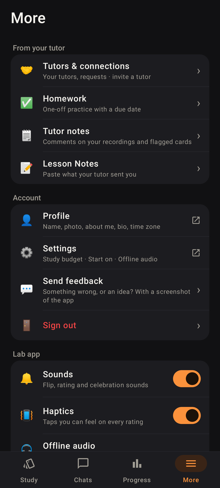
More → From your tutor → Tutors & connections.

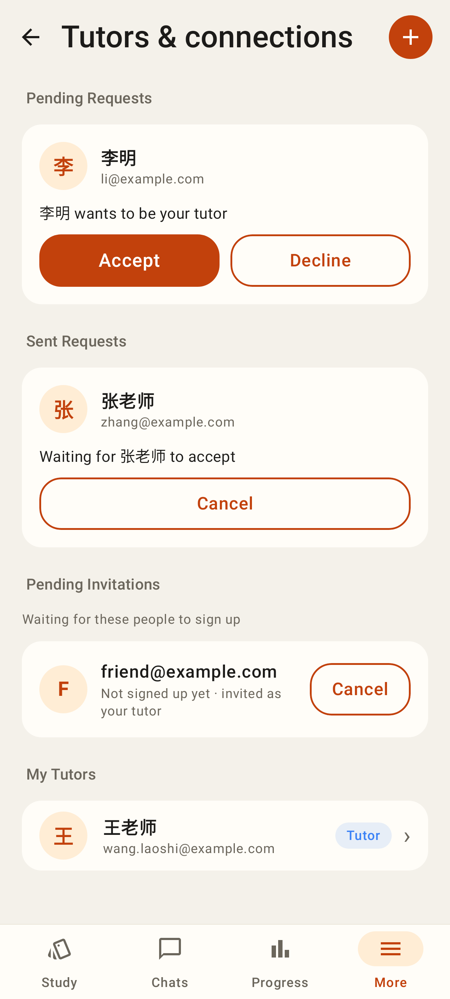 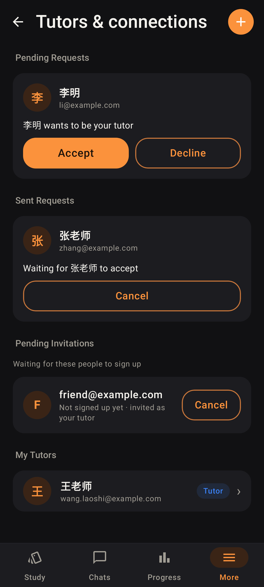
Tutors & connections (← back, a round ＋ Invite so the title fits, the Claude partner hidden).
