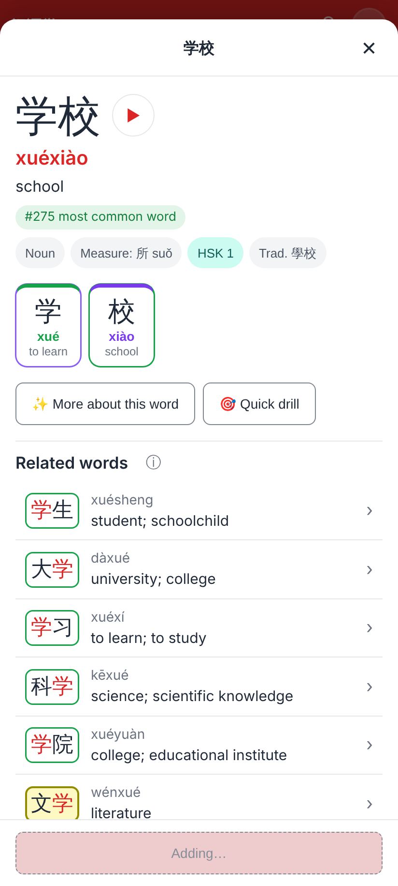
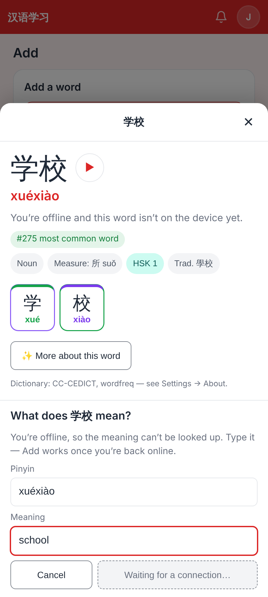

# Explorer: "+ Add as card" before the meaning has loaded

Phone viewport (412×915 @2×), taken by `e2e/tests/explorer-add-before-meaning.spec.ts` with `EXPLORER_ADD_SHOTS`.

1. The ＋ Add tab → 学校 → "+ Add as card" tapped while the word dictionary is still answering: the button says **Adding…** and waits; the card is saved with its meaning once the lookup is in (before: "english is required").

2. Offline: the tap opens the fill sheet in the explorer's footer — "What does 学校 mean?", why it asks, the device's pinyin, the meaning empty and focused.

3. The meaning typed: Add says **Waiting for a connection…** until the phone is back online, then adds it.
