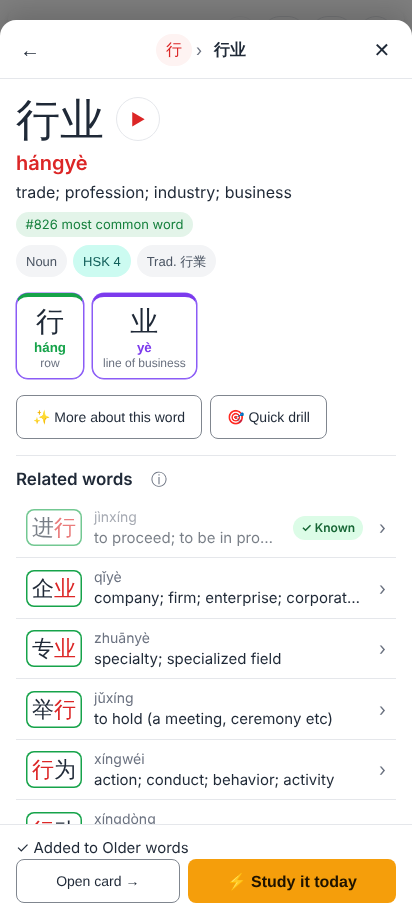
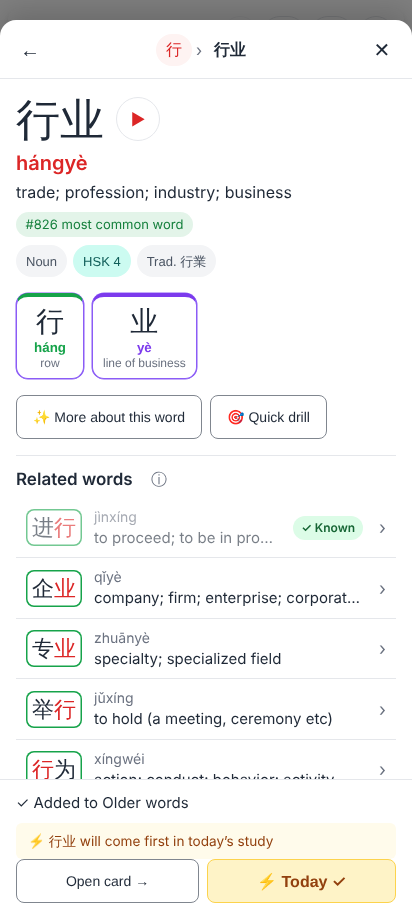
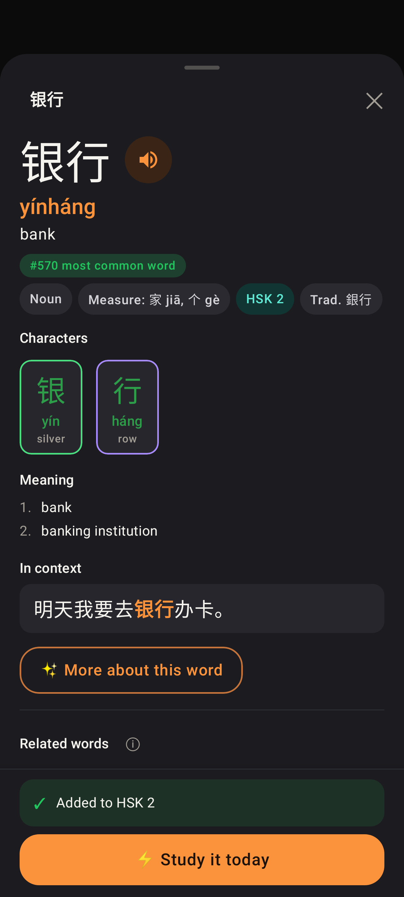
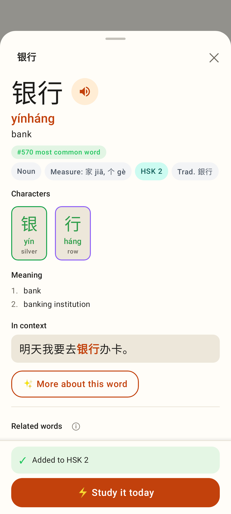

# Explorer: ⚡ Study it today right after "+ Add as card"

Web (412×915): right after "+ Add as card" on 行业, the footer says "✓ Added to Older words" with Open card → and ⚡ Study it today, before the next sync.

Web: ⚡ pressed, "⚡ 行业 will come first in today's study".

Lab app (dark): "Added to HSK 2" + ⚡ Study it today, while Room doesn't have the note yet.

Lab app (light).
