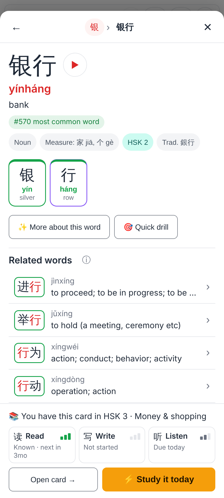
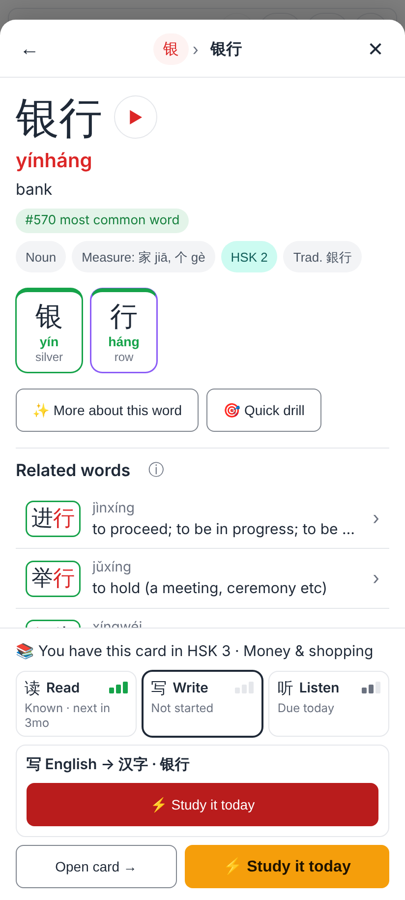
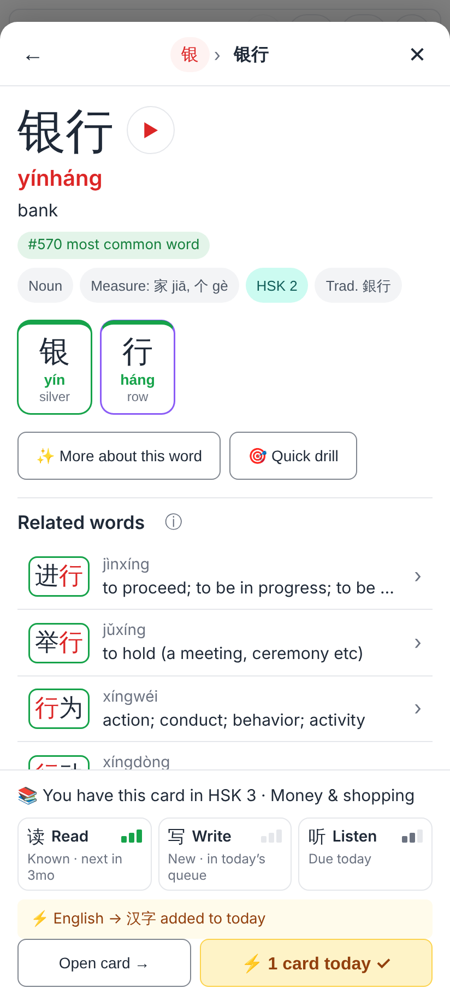
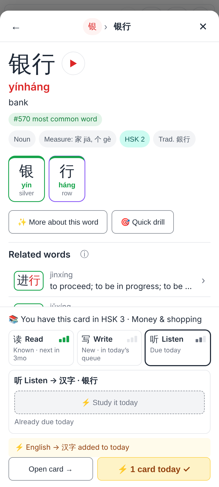
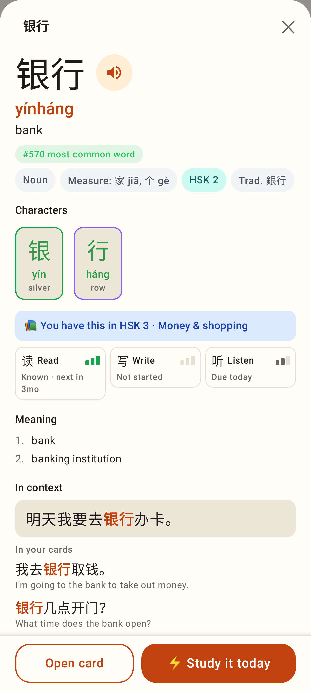
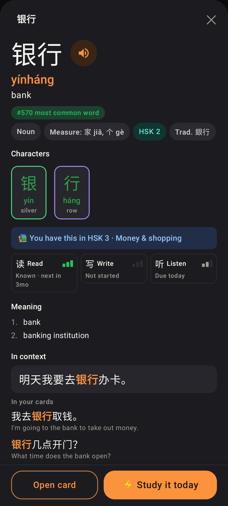
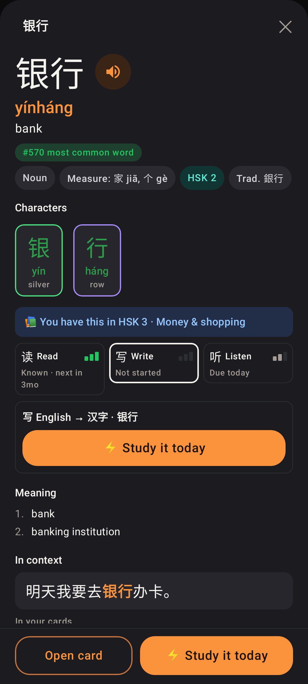
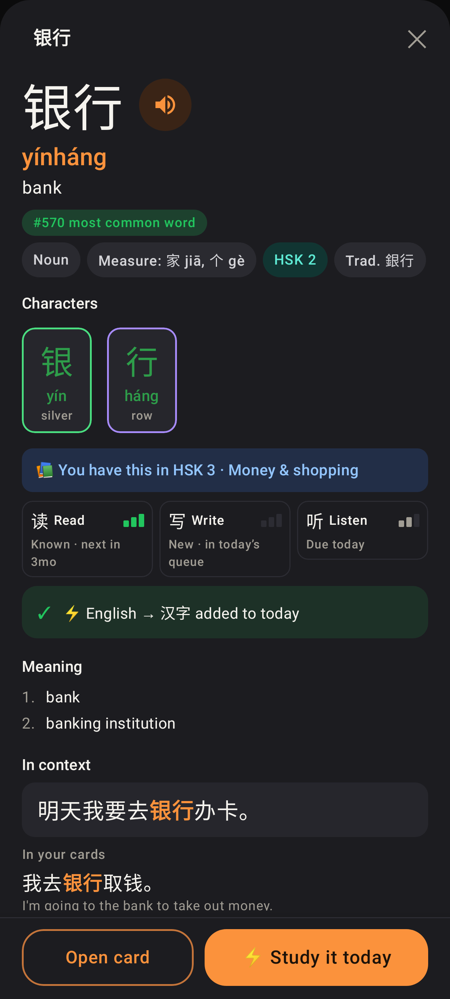
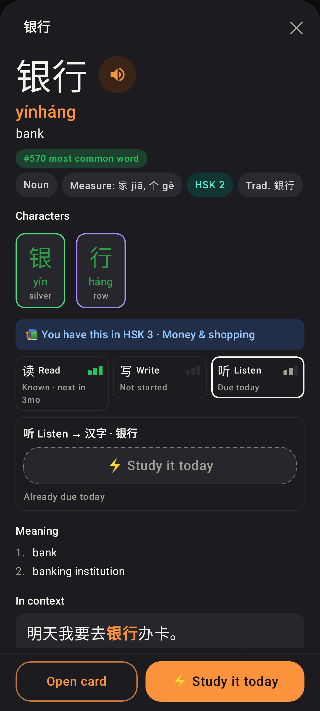

# Explorer: where each card of the word stands

Under "📚 You have this" in the explorer, the study card ⋯ menu's tiles for every card of the word —
读 Read · 写 Write · 听 Listen, with status + strength. A tap opens that card's ⚡ Study it today.
Seeded word 银行: reading known (next in ~3 months), writing never started, listening due today.
412×915 at 2×. The web app is light-only today, so its shots are light; the Lab app is shown light and dark.

## Web

The Word view's footer: the three tiles between "📚 You have this card in …" and Open card / ⚡ Study it today.

Tapping 写 Write opens its panel: "写 English → 汉字 · 银行" + ⚡ Study it today (that card only).

After ⚡: "⚡ English → 汉字 added to today", the tile says "New · in today's queue".

听 Listen is already due today: ⚡ is greyed with "Already due today".

## Lab app

Light: the tiles right under "📚 You have this in HSK 3 · Money & shopping".

Dark.

写 Write tapped: its panel with ⚡ Study it today.

After ⚡: the success line and "New · in today's queue".

听 Listen due today: ⚡ greyed, "Already due today".
