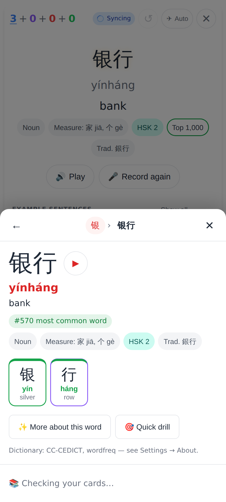
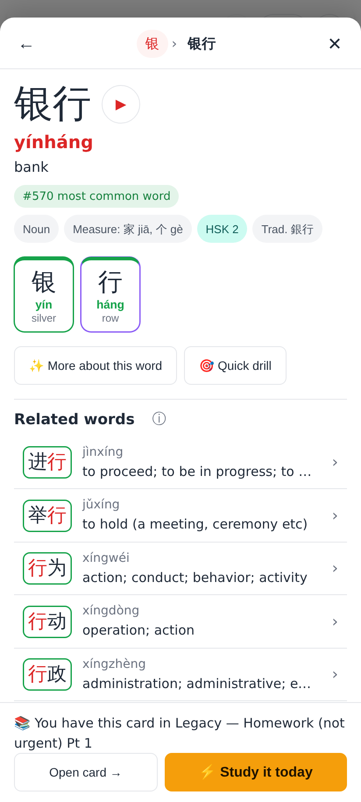
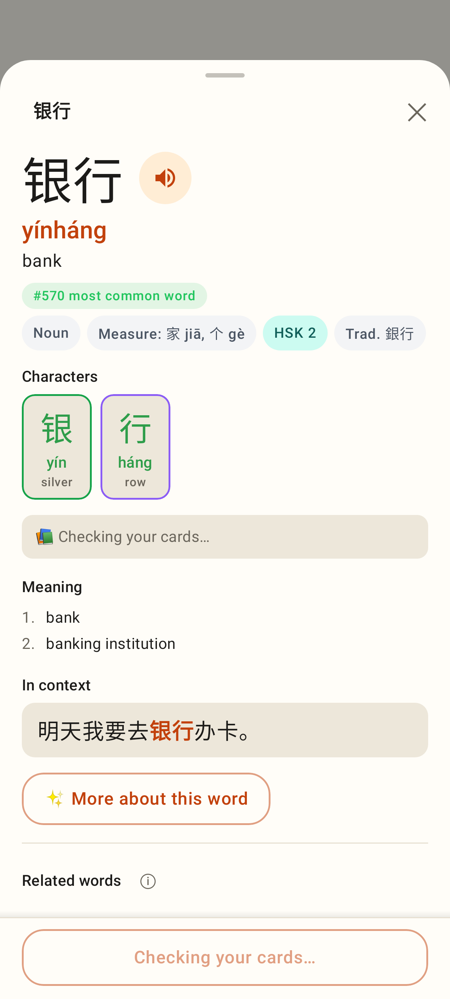
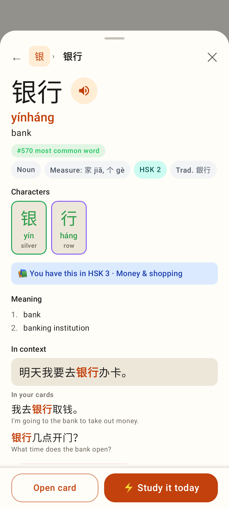

# Explorer: the card section on the first open

Phone viewport (412×915, 2×).

Web: the Word view while the device's cards are still being read — "📚 Checking your cards…" in the footer, never nothing / never a wrong "+ Add as card".

Web: a moment later — 📚 You have this card in Legacy — Homework (not urgent) Pt 1 · Open card · ⚡ Study it today.

Lab app: the same placeholder row + a disabled "Checking your cards…" footer.

Lab app: the loaded Word view (unchanged) — now also on the first open.
