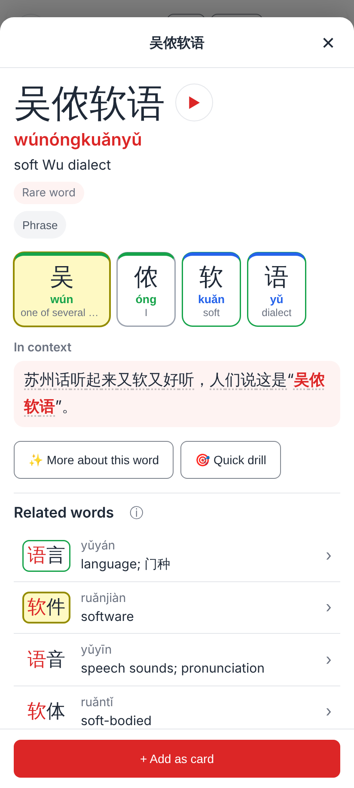
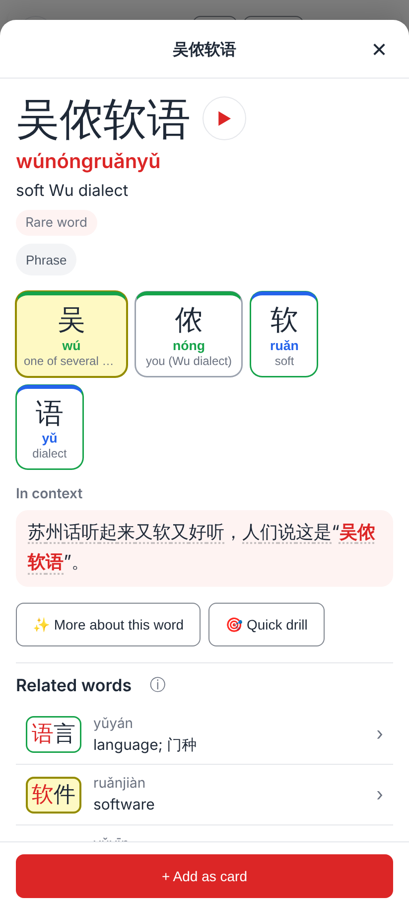
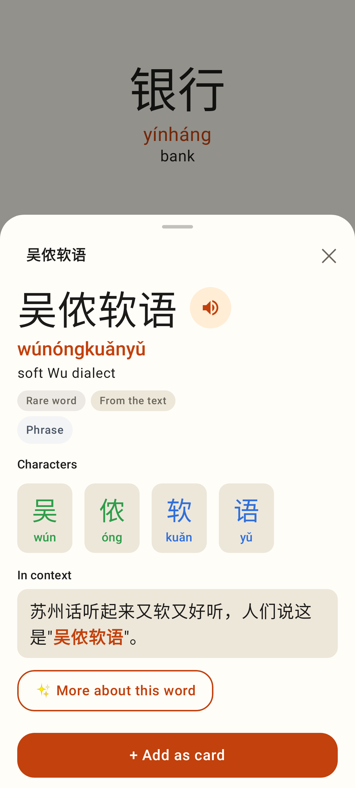
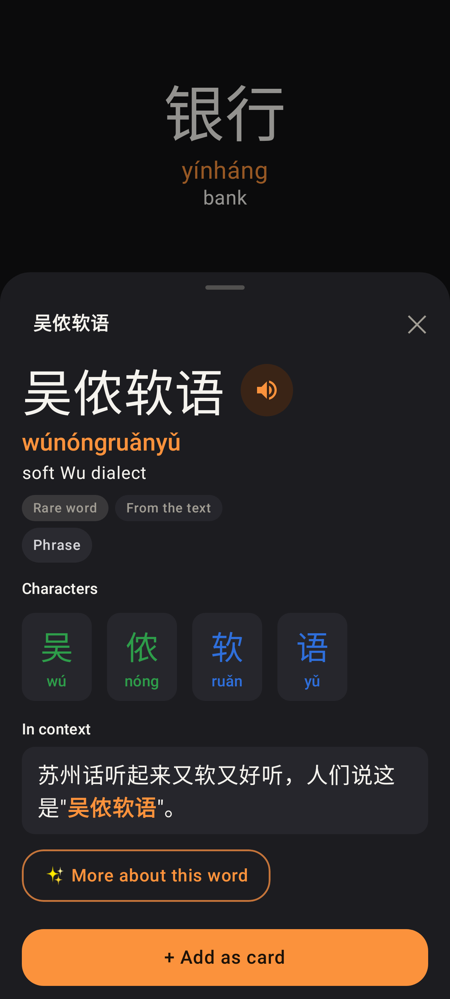

# Explorer: a word's pinyin per character (吴侬软语)

Jerome tapped the word chip 吴侬软语 in the graded reader 苏州 ("苏州话听起来又软又好听，人们说这是“吴侬软语”。").
The word isn't in the word dictionary, so the Word view used the chip's own pinyin — Haiku's "wúnóngkuǎnyǔ"
(软 is never kuǎn) — and split it greedily: wún · óng · kuǎn · yǔ. Phone viewport 412×915 @2×, the same
stored chip pinyin in every shot.

## Web

Before: header "wúnóngkuǎnyǔ", chips wún · óng (I) · kuǎn · yǔ.

After: the pinyin is cut one syllable per character and checked against each character's readings —
header "wúnóngruǎnyǔ", chips wú · nóng (you (Wu dialect)) · ruǎn (soft) · yǔ, coloured by their real tones.

## Lab app

Before: the same wún · óng · kuǎn · yǔ.

After: wú · nóng · ruǎn · yǔ, header "wúnóngruǎnyǔ" (Roborazzi `explorer-30-reader-chip-pinyin`).

After, dark theme.
